# Wide-column com Apache Cassandra 5

Author: Prof. Barbosa<br>
Contact: infobarbosa@gmail.com<br>
Github: [infobarbosa](https://github.com/infobarbosa)

[Cassandra](https://cassandra.apache.org/) é um banco de dados distribuído com modelo de armazenamento **wide-column**. Este material reúne a teoria e a prática do Cassandra num roteiro só, contado a partir de um caso: o **infobarBank**, um banco digital cujo aplicativo lê tudo do Cassandra.

Na Parte 1 você conhece o Cassandra: o cluster, a primeira tabela e como a chave decide onde cada linha mora. Na Parte 2 você aprende a modelar: das telas do aplicativo às chaves de cada tabela, medindo o que acontece quando a modelagem é boa e quando não é. Na Parte 3 você abre os arquivos de dados e vê o que o modelo vira no disco.

Os comandos são copy-paste no terminal do laboratório, na ordem em que aparecem.

---

## O que você vai saber fazer ao final

- Explicar como o Cassandra distribui e replica os dados num cluster, e o que a keyspace decide sobre isso.
- Criar keyspaces e declarar a estratégia de replicação adequada à topologia.
- Escrever `CREATE TABLE` cujo `PRIMARY KEY` responde a uma consulta específica, e explicar a diferença entre **partition key** e **clustering key**.
- Prever em qual partição uma linha vai cair, e por que a ordem física dos dados no disco é uma decisão de modelagem.
- Acompanhar o caminho de escrita — commit log, memtable, SSTable, compactação, tombstone — observando os arquivos que o Cassandra cria.
- Aplicar a **metodologia de modelagem**: do modelo conceitual e dos *access patterns* da aplicação ao modelo lógico e físico.
- Testar uma chave contra os três critérios — **unicidade, ordenação e distribuição** — e aplicar **bucketing** quando a partição cresce sem limite.
- Reconhecer a **desnormalização** como padrão e não como exceção, medir os custos que ela cobra, e decidir quando uma consulta merece tabela própria.
- Reconhecer os erros que o Cassandra devolve e saber, para cada um, se a resposta é corrigir a consulta ou modelar outra tabela.
- Consultar o Cassandra a partir de uma aplicação Python, com prepared statements e paginação.

---

## Pré-requisitos

- Acesso ao **AWS Academy** (o ambiente é uma instância EC2 criada por um script, logo a seguir).
- Um navegador. Nada precisa ser instalado: o `cqlsh`, o `nodetool`, as ferramentas de inspeção de arquivos e o driver Python já vêm no ambiente.

Fora da aula, o mesmo ambiente roda em qualquer máquina com **Docker** e cerca de **2 GB de RAM** livres — veja o [Apêndice D](#d-execução-local).

---

## Índice

[O ambiente](#o-ambiente)

**Parte 1 — O Cassandra e o modelo wide-column**

1. [Apache Cassandra](#1-apache-cassandra)
2. [O cluster](#2-o-cluster)
3. [Sua primeira tabela](#3-sua-primeira-tabela)
4. [A chave vira endereço: partição e token](#4-a-chave-vira-endereço-partição-e-token)
5. [Wide partitions: partições de múltiplas linhas](#5-wide-partitions-partições-de-múltiplas-linhas)

**Parte 2 — Modelagem de dados**

6. [Modelagem orientada a consultas](#6-modelagem-orientada-a-consultas)
7. [Não existe JOIN — existe outra tabela](#7-não-existe-join--existe-outra-tabela)
8. [Do fluxo à chave](#8-do-fluxo-à-chave)
9. [O modelo visto pela aplicação](#9-o-modelo-visto-pela-aplicação)

**Parte 3 — Por dentro do disco**

10. [Do memtable ao disco](#10-do-memtable-ao-disco)
11. [Cassandra 5: SAI e UCS](#11-cassandra-5-sai-e-ucs)

[Desafio](#12-desafio)

[Referências](#referências)

**Apêndices**

- [A. Busca vetorial](#a-busca-vetorial)
- [B. Encerrando o ambiente](#b-encerrando-o-ambiente)
- [C. Troubleshooting](#c-troubleshooting)
- [D. Execução local](#d-execução-local)

---

## O ambiente

O laboratório roda em uma instância **AWS EC2** (`t3.large`) criada automaticamente a partir do **AWS CloudShell**. A instância executa um único container com o **code-server** (Visual Studio Code no navegador) e um nó **Apache Cassandra 5.0** — com as duas keyspaces do curso carregadas no primeiro boot.

> **ATENÇÃO:**
> 1. **Região:** utilize sempre a região **Norte da Virgínia (`us-east-1`)** no Console AWS.
> 2. **Custos:** a instância EC2 e o volume EBS consomem créditos do seu laboratório AWS Academy. Ao encerrar a aula, garanta que a instância esteja parada (**Stopped**) ou aguarde o desligamento automático da sessão.
> 3. **Não recrie a máquina para continuar o trabalho:** cada execução do `launch-lab.sh` cria uma instância **nova e vazia**, com data e hora no nome. Se a sua instância já existir, siga as instruções de [Retomando o laboratório](#retomando-o-laboratório). Se precisar mesmo recriar, encerre a anterior (**Instance state** > **Terminate instance**) para não consumir créditos.

### Passo 1: Abrir o AWS CloudShell

1. Faça login no Console da AWS através do seu painel do AWS Academy.
2. Certifique-se de que a região selecionada no canto superior direito é **N. Virginia (`us-east-1`)**.
3. No topo do console, clique no ícone do **AWS CloudShell** (`>_`) ao lado da barra de pesquisa.
4. Aguarde o terminal do CloudShell carregar.

### Passo 2: Executar o script de provisionamento

No terminal do CloudShell, execute:

```sh
curl -sS https://raw.githubusercontent.com/infobarbosa/cassandra-widecolumn-demo/main/launch-lab.sh | bash

```

O script realiza de forma automatizada:

- Descoberta da VPC padrão e de uma subnet pública.
- Criação do Security Group `lab-cassandra-sg`, liberando as portas `8080` (IDE) e `22` (SSH).
- Lançamento de uma nova instância EC2 `lab-cassandra-widecolumn-AAAA-MM-DD_HH_MI_SS` (`t3.large`, sufixo com a data e hora da execução, Ubuntu 24.04, 20 GB gp3).
- Instalação do Docker e inicialização do container `cassandra-lab` (code-server + Cassandra).
- Exibição do IP público e do link de acesso.

### Passo 3: Acessar a IDE

1. Abra no navegador o link exibido ao final do script: `http://<IP-PUBLICO>:8080`.
2. Caso a página não responda, **aguarde de 3 a 5 minutos** para que o Docker conclua o download da imagem e atualize o navegador.
3. O code-server abre diretamente na IDE, sem solicitar senha.
4. Abra um terminal: menu superior (três linhas horizontais) > **Terminal** > **New Terminal**.

> **Atenção!** Todos os comandos deste laboratório são executados no **terminal do code-server**. O CloudShell só serve para criar a instância.

### Retomando o laboratório

Se a sessão do AWS Academy expirar, a instância será parada. **Não execute o `launch-lab.sh` novamente:** ele criaria uma instância nova, sem o seu trabalho.

1. No Console AWS (`us-east-1`), acesse **EC2** > **Instances**.
2. Selecione a sua instância **`lab-cassandra-widecolumn-<data e hora>`** (se houver mais de uma, a mais recente) e clique em **Instance state** > **Start instance**.
3. Aguarde o status **Running** e copie o novo **Public IPv4 address** (ele muda a cada reinício).
4. Acesse `http://<NOVO_IP_PUBLICO>:8080`. O container reinicia automaticamente e os dados do Cassandra — inclusive a sua keyspace `lab` — são preservados.

> Ao religar, o Cassandra leva cerca de **30 segundos** para voltar a aceitar conexões, mesmo com a IDE já aberta. Se o primeiro comando devolver `Connection refused`, espere e repita.

### O que acontece no primeiro boot

O container sobe o Cassandra e, assim que o nó está pronto, carrega as duas keyspaces do curso. Isso leva cerca de **um minuto**, e roda em segundo plano — a IDE abre antes de terminar. Para acompanhar a carga:

```sh
cat /var/log/lab/carga.log

```

```
[carga] Cassandra pronto.
Carregando infobarbank (log: /var/log/lab/carga-infobarbank.log)...
Carregando infobarshop (log: /var/log/lab/carga-infobarshop.log)...
infobarbank: ok
infobarshop: ok
Keyspaces prontas.
```

As três últimas linhas são as que importam: cada gerador criou a sua keyspace, inseriu os dados e terminou. Se o arquivo ainda não tiver chegado ao fim, espere alguns segundos e repita o `cat`.

> A carga roda **só no primeiro boot**. Quando a instância é religada, as keyspaces não são recarregadas — o que você fez nelas continua lá.

### Verificando o ambiente

```sh
curl -sS https://raw.githubusercontent.com/infobarbosa/cassandra-widecolumn-demo/main/scripts/check.sh | bash

```

```
Keyspaces
  ✓ infobarbank: 12 tabelas (modelagem de dados)
  ✓ infobarshop: 9 tabelas (desafio)
  ! lab: ainda não criada — você a cria na Parte 1

Dados
  ✓ infobarbank.cliente: 50 clientes
  ✓ infobarshop.pedido_detalhe: 12004 pedidos

Resultado
  Ambiente pronto.
```

Guarde este comando. Sempre que uma seção não se comportar como o texto descreve, rode-o: ele diz o que está faltando em vez de deixar você adivinhar.

### As duas ferramentas

O `cqlsh` e o `nodetool` estão no `PATH` do terminal. Teste:

```sh
cqlsh -e "SELECT release_version FROM system.local;"

```

```
 release_version
-----------------
           5.0.9

(1 rows)
```

O `-e` executa um comando e sai — é a forma usada em todo o laboratório. Mais sobre ele na seção 3.

**→ Parte 1.** O ambiente está no ar, e o banco já tem dados carregados. Antes de mexer neles: o que é o Cassandra, para que ele serve e o que ele cobra.

---

# Parte 1 — O Cassandra e o modelo wide-column

## 1. Apache Cassandra

### 1.a. O que é: wide-column

O Cassandra é um banco **wide-column**: organiza os dados em linhas agrupadas por uma chave, em que cada linha tem colunas flexíveis — uma linha pode ter colunas que a vizinha não tem — e cada valor é endereçado por **linha, coluna e timestamp**. As linhas são distribuídas entre os vários servidores do cluster.


O próprio projeto se descreve assim, no [repositório oficial](https://github.com/apache/cassandra): *"a highly-scalable partitioned row store"* — um armazenamento de **linhas**, **particionado** entre máquinas. Guarde as duas palavras: o laboratório inteiro gira em torno delas.

> Wide-column não é o mesmo que **colunar** (ClickHouse, DuckDB), apesar do nome parecido. A diferença está no disco, e você vai vê-la na seção 10.

### 1.b. Onde o Cassandra se aplica

O Cassandra não é um banco de uso geral: ele se destaca quando três necessidades aparecem juntas — **volume muito alto de escrita**, **latência baixa e previsível** e **distribuição** entre muitos servidores, às vezes em várias regiões, sem parar quando um deles cai.

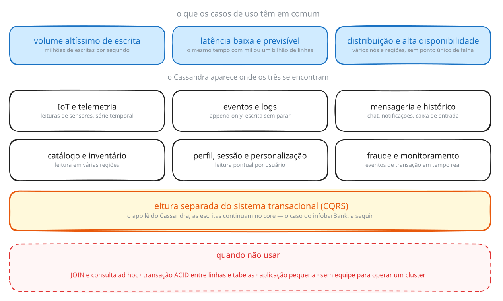

| Caso de uso | O que o Cassandra resolve | Exemplo |
|---|---|---|
| **IoT e telemetria** | leituras de sensores gravadas sem parar e consultadas por dispositivo e período | — |
| **Eventos e logs** | registros que só são acrescentados, nunca alterados, em volume que um banco relacional não absorve | — |
| **Mensageria e histórico** | caixa de entrada, chat, notificações: escrita constante, leitura pela conversa ou pelo usuário | — |
| **Catálogo e inventário** | dados de produto replicados perto de cada região, com leitura rápida em todas | eBay |
| **Perfil, sessão e personalização** | leitura pontual pelo id do usuário, em qualquer região, com o mesmo tempo de resposta | — |
| **Fraude e monitoramento** | eventos de transação gravados e consultados em tempo real | Visa; Capital One, com 21 mil transações por segundo e 99,99% de disponibilidade |

Em escala, o caso mais citado é o da Apple, com mais de 75 mil nós e mais de 10 PB de dados ([Neontri](https://neontri.com/blog/apache-cassandra-use-cases/)). Números como esses vêm de apresentações públicas e envelhecem rápido; o que importa é a ordem de grandeza.

O avesso importa tanto quanto. O Cassandra é a escolha errada quando a aplicação precisa de `JOIN` e de consultas ad hoc; quando precisa de transação ACID envolvendo várias linhas ou tabelas, como um sistema contábil; quando o volume é pequeno, e um banco relacional resolve com muito menos trabalho; ou quando não há equipe para operar um cluster distribuído.

### 1.c. O que o Cassandra oferece, e o que cobra

| Característica | O que significa |
|---|---|
| **Alta disponibilidade** | Cada dado tem várias cópias; um servidor caído não derruba o sistema. |
| **Escalabilidade linear** | Dobrar o número de servidores dobra a capacidade. |
| **Desempenho previsível** | A mesma consulta custa o mesmo com mil ou com um bilhão de linhas — se o modelo for bom. |
| **Sem mestre** | Todos os nós são iguais; não há ponto único de falha. |
| **Vários datacenters** | Um mesmo cluster pode se espalhar por regiões e países. |
| **Hardware comum** | Roda em máquinas convencionais, sem equipamento especial. |
| **Não substitui o relacional** | Não tem `JOIN`, nem transação entre tabelas, nem consulta livre. |

A última linha é o preço das outras seis. Por isso o Cassandra raramente trabalha sozinho: ele costuma ficar ao lado de um banco relacional, e não no lugar dele.

Há um segundo preço, mais sutil. Em sistemas distribuídos, quando a rede entre servidores falha, é preciso escolher entre responder sempre (**disponibilidade**) ou responder só com o dado garantidamente atual (**consistência**) — é o que diz o **teorema CAP**. O Cassandra escolhe disponibilidade: aceita, por um instante, que uma cópia esteja atrasada em relação à outra, e por isso se diz que ele tem **consistência eventual**. Quanto de consistência cada consulta exige é configurável, e é assunto do laboratório de cluster.

### 1.d. Como ele se encaixa numa arquitetura

Ao lado de um banco transacional, o Cassandra aparece em três padrões comuns:

- **Leitura separada da escrita** (*CQRS*): um sistema transacional grava, e o Cassandra serve as leituras.
- **Integração por eventos**: CDC e Kafka alimentando o Cassandra a partir de vários bancos de origem — PostgreSQL, MySQL, SQL Server, Oracle.
- **Camada de serviço em arquiteturas de dados**: visões pré-calculadas por Spark, em lote ou em streaming, gravadas no Cassandra para consulta rápida.

É, há anos, o banco wide-column mais usado do mercado ([ranking DB-Engines](https://db-engines.com/en/ranking/wide+column+store)).

### 1.e. O caso deste laboratório: infobarBank

Para exercitar tudo isso, este laboratório usa um caso: o **infobarBank**, um banco digital. O coração dele — contas, cartões, transferências — roda num **core bancário** tradicional, um DB2 em mainframe, onde cada operação é uma transação com todas as garantias que dinheiro exige.

O problema é o aplicativo. Milhões de clientes abrem o app ao longo do dia, e cada abertura pede saldo, últimos lançamentos e limite dos cartões. Se cada uma dessas leituras batesse no core, o sistema que precisa processar transferências passaria o dia respondendo a quem só quer olhar o extrato.

A solução do banco é o primeiro padrão de 1.d, a leitura separada da escrita:

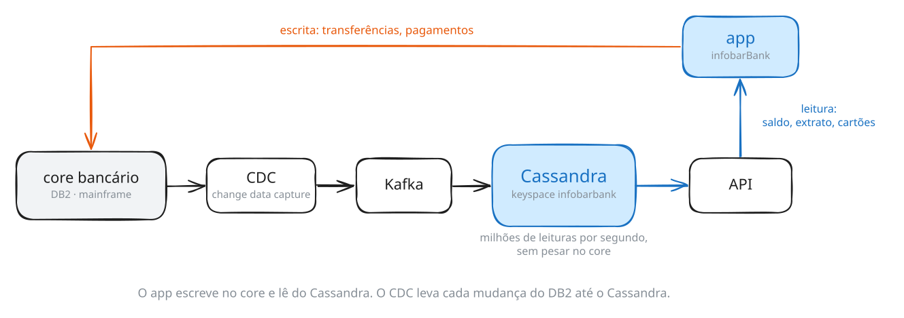

O app **escreve** no core. Um processo de **CDC** (*change data capture*) captura cada mudança do DB2 e a entrega, via Kafka, ao **Cassandra**. O app **lê** do Cassandra. O core fica com o que faz bem — transação —, e o Cassandra com o que faz bem: responder a um volume enorme de leituras e escritas simples, sempre com o mesmo tempo de resposta.

Este laboratório é a construção do lado direito desse desenho: a keyspace `infobarbank` que o aplicativo consulta.

### 1.f. O que existe no nó

```sh
# 1.f.1
cqlsh -e "DESCRIBE KEYSPACES;"

```

```
infobarbank  system_auth         system_traces
infobarshop  system_distributed  system_views
system       system_schema       system_virtual_schema
```

Duas keyspaces são do curso — `infobarbank` e `infobarshop`. As outras seis são do próprio Cassandra: `system_schema` guarda a definição das suas tabelas, `system_auth` os usuários, `system_views` e `system_virtual_schema` expõem métricas internas como se fossem tabelas. Você vai consultar algumas delas ao longo do laboratório.

**→ Próxima seção.** Um banco que atende milhões de clientes não cabe num servidor. Como o Cassandra distribui os dados entre vários — e o que acontece quando um deles cai?

---

## 2. O cluster

Um cluster Cassandra é um conjunto de servidores — **nós** — que se organizam num **ring** (anel). Não existe nó principal: todos guardam dados e todos respondem a leituras e escritas. A aplicação pode falar com qualquer um deles.

Cada nó é dono de **faixas** de dados. Como o Cassandra decide qual dado vai para qual faixa é o assunto da seção 4; por ora basta saber que todo dado tem um endereço no ring, e que esse endereço vem da chave.

### 2.a. Coordinator e réplicas

Guardar cada dado num nó só seria frágil: se o nó cai, o dado some. Por isso cada dado tem várias cópias, as **réplicas**, em nós diferentes. Quantas cópias é o **fator de replicação** (*replication factor*, RF).

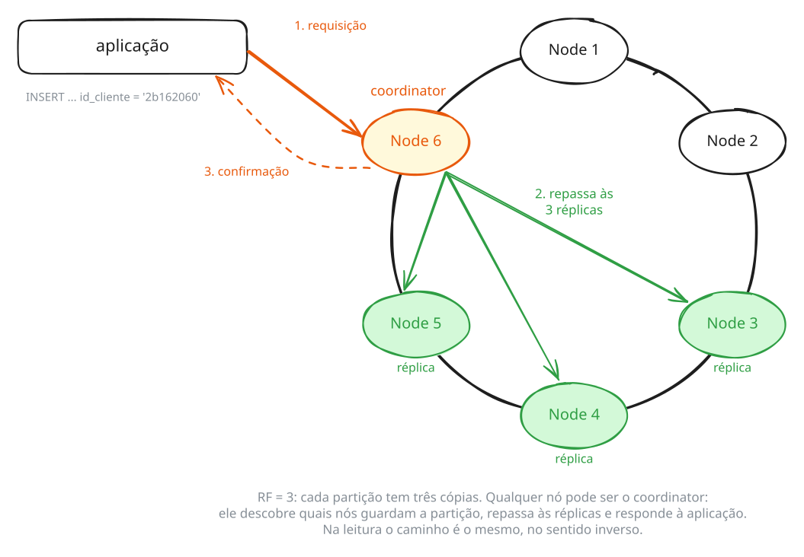

O nó que recebe a requisição vira o **coordinator** daquela operação. Ele calcula a quem o dado pertence, repassa às réplicas e responde à aplicação. Na leitura é o mesmo caminho: o coordinator consulta as réplicas e devolve o resultado. Com RF=3, dois nós podem cair e o dado continua disponível.

> Nada disso se demonstra com um nó só, que é o que o seu ambiente tem. Nesta seção o desenho faz o papel da prática; replicação, falha de nós e consistência têm laboratório próprio, com um cluster de verdade.

### 2.b. Este nó

O seu ambiente tem um nó só, mas ele já se apresenta como parte de um cluster.

```sh
# 2.b.1
cqlsh -e "SELECT cluster_name, release_version, cql_version, data_center, rack FROM system.local;"

```

```
 cluster_name   | release_version | cql_version | data_center | rack
----------------+-----------------+-------------+-------------+------
 infobarbosainc |           5.0.9 |       3.4.7 | datacenter1 | RAC1

(1 rows)
```

`system.local` é a tabela em que o nó guarda o que sabe sobre si mesmo. Note que ele se declara em um **datacenter** (`datacenter1`) e em um **rack** (`RAC1`) — nomes que vieram da configuração do nó, preparada na imagem do laboratório. Um nó só, mas já se apresentando com endereço na topologia. Isso vai importar logo adiante, ao criar a keyspace.

### 2.c. O ponto de vista do operador

```sh
# 2.c.1
nodetool status

```

```
Datacenter: datacenter1
=======================
Status=Up/Down
|/ State=Normal/Leaving/Joining/Moving
--  Address    Load        Tokens  Owns (effective)  Host ID                               Rack
UN  127.0.0.1  117.82 KiB  16      100.0%            607a239d-b7ac-4361-9792-6d46a197cbef  RAC1
```

O `Host ID` e o `Load` do seu ambiente serão diferentes dos que aparecem aqui — são gerados na criação do container. O `Address` é `127.0.0.1` porque o nó só atende dentro do próprio container: o `cqlsh`, o `nodetool` e, na seção 9, a aplicação Python rodam ao lado dele.

`UN` é a leitura mais frequente do dia a dia de quem opera Cassandra: **U**p e **N**ormal. A legenda logo acima do resultado explica as combinações possíveis — um nó entrando no cluster, por exemplo, aparece como `UJ` (Up, Joining).

Duas colunas para guardar: `Owns` diz que este nó responde por 100% dos dados, o que é esperado quando há um nó só; e `Tokens 16` diz que ele ocupa dezesseis posições no ring de tokens. O que são esses tokens é assunto da seção 4.

> Se o `nodetool status` devolver `Server is not initialized yet, cannot run nodetool`, o serviço ainda está subindo. Espere alguns segundos e repita.

### 2.d. Keyspace: onde a replicação é decidida

Uma `keyspace` é o repositório lógico das tabelas. Em outros bancos equivale a um *schema* ou *database*.

O papel importante dela, porém, é **físico**: é na keyspace que se define como o dado será replicado. Essa é a decisão que determina o que acontece com a sua aplicação quando um nó cai.

Crie a sua:

```sh
# 2.d.1
cqlsh -e "
CREATE KEYSPACE lab
    WITH REPLICATION = {
        'class': 'NetworkTopologyStrategy',
        'datacenter1': 1
    };"

```

Conferindo:

```sh
# 2.d.2
cqlsh -e "DESCRIBE KEYSPACE lab;"

```

```
CREATE KEYSPACE lab WITH replication = {'class': 'NetworkTopologyStrategy', 'datacenter1': '1'}  AND durable_writes = true;
```

#### As duas estratégias

```
CREATE KEYSPACE [IF NOT EXISTS] nome_da_keyspace
   WITH REPLICATION = {
      'class' : 'SimpleStrategy', 'replication_factor' : N
    | 'class' : 'NetworkTopologyStrategy', 'nome_do_dc' : N [, ...]
   }
   [AND DURABLE_WRITES = true|false] ;
```

A `SimpleStrategy` distribui as réplicas ignorando a topologia: para ela não existem datacenters nem racks. Funciona, inclusive nesta versão, mas só faz sentido em ambiente de estudo com um nó.

Usamos `NetworkTopologyStrategy` porque é ela que permite dizer **quantas cópias em cada datacenter** — e porque é coerente com a configuração do nó, que usa o `GossipingPropertyFileSnitch` e se declara no datacenter `datacenter1`, rack `RAC1`. É também a estratégia usada pelas duas keyspaces do curso.

Os nomes dos datacenters não são etiquetas livres: precisam existir na topologia declarada pelo administrador. Nomear um datacenter inexistente é recusado:

> **Não execute.** Exemplo para leitura.

```
CREATE KEYSPACE lab_erro
  WITH REPLICATION = { 'class':'NetworkTopologyStrategy', 'dc-brasil':1 };

ConfigurationException: Unrecognized strategy option {dc-brasil}
passed to NetworkTopologyStrategy for keyspace lab_erro
```

Guarde esse comportamento ao ler os exemplos a seguir: é por isso que nenhum deles roda aqui.

#### Exemplos de produção

Os casos abaixo são para debate em sala. Todos usam a mesma ideia: um cluster espalhado por mais de um datacenter, com a keyspace dizendo quantas cópias ficam em cada um.

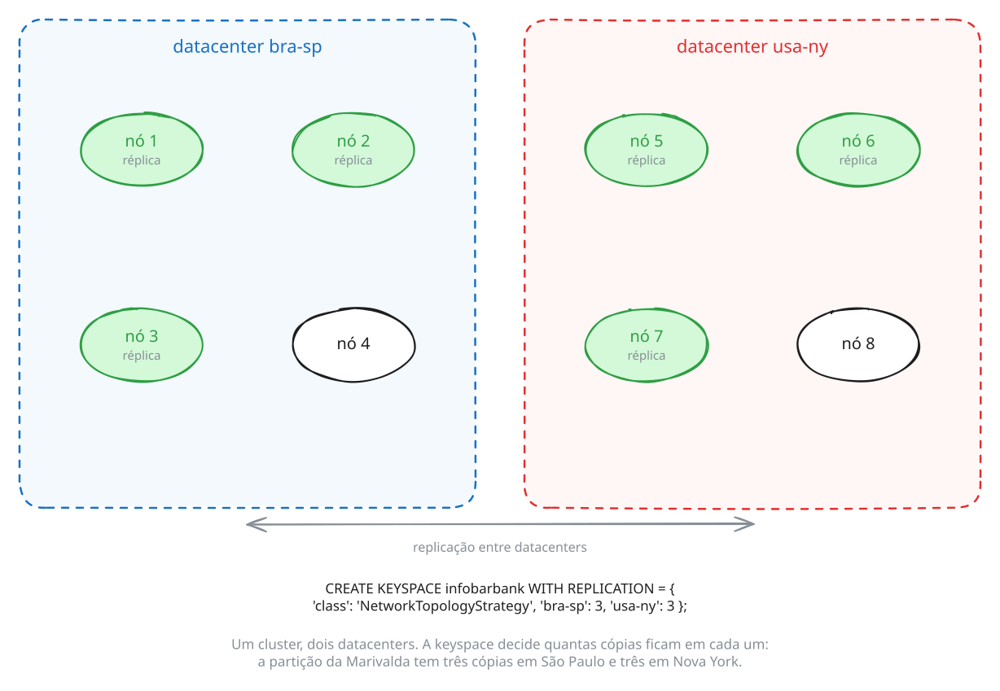

> **Não execute.** Os três descrevem topologias com vários datacenters. Neste ambiente de um nó, todos devolveriam o `ConfigurationException` acima.

Distribuição geográfica em três países — três cópias no Brasil, três nos Estados Unidos, duas na Alemanha:

```
CREATE KEYSPACE ks001
  WITH REPLICATION = {
   'class'  : 'NetworkTopologyStrategy',
   'bra-sp' : 3 , // São Paulo/Brasil
   'usa-ny' : 3 , // Nova Iorque/Estados Unidos
   'deu-fr' : 2   // Frankfurt/Alemanha
  };
```

Uma região só, mas com quatro instalações em duas zonas de disponibilidade, segmentadas por propósito. Três cópias transacionais em cada zona (seis no total) e uma cópia analítica em cada (duas no total) — o mesmo cluster servindo OLTP e OLAP sem que a carga analítica pese nos nós transacionais:

```
CREATE KEYSPACE ks001
  WITH REPLICATION = {
   'class'  : 'NetworkTopologyStrategy',
   'bra-sp-az1-oltp' : 3 , // Transacional AZ1 em São Paulo/Brasil
   'bra-sp-az2-oltp' : 3 , // Transacional AZ2 em São Paulo/Brasil
   'bra-sp-az1-olap' : 1 , // Analítico AZ1 em São Paulo/Brasil
   'bra-sp-az2-olap' : 1   // Analítico AZ2 em São Paulo/Brasil
  };
```

O comando a seguir entrega a mesma quantidade de cópias do anterior, mas a distribuição física depende de como o administrador declarou a topologia. É um tópico mais avançado, para discutirmos em sala:

```
CREATE KEYSPACE ks001
  WITH REPLICATION = {
   'class'  : 'NetworkTopologyStrategy',
   'bra-sp-oltp' : 6,
   'bra-sp-olap' : 2
  };
```

Vale também segmentar keyspaces por assunto — pedidos, faturamento, contábil — ou uma por microsserviço. A segmentação facilita a administração e permite política de replicação diferente para cada conjunto de dados.

#### Até onde este laboratório vai

O fator de replicação que você acabou de definir é o parâmetro mais consequente do Cassandra: ele decide quantas cópias de cada dado existem e, junto com o **consistency level** escolhido pela aplicação, determina o que acontece quando um nó cai — quanto o cluster tolera de falha e sob qual garantia de leitura.

Nada disso se demonstra com um nó. Derrubar réplicas, acompanhar `nodetool repair` redistribuindo dados e comparar `ONE`, `QUORUM` e `ALL` sob falha exige um cluster de verdade, e é assunto de um laboratório próprio. Aqui o fator de replicação fica no papel que ele tem nesta seção: uma decisão que se declara ao criar a keyspace.

**→ Próxima seção.** Com a keyspace criada, você já pode criar tabelas — e é aí que começam as decisões que o Cassandra não perdoa.

---

## 3. Sua primeira tabela

### 3.a. CQL e `cqlsh`

O Cassandra fala **CQL** (*Cassandra Query Language*), uma linguagem declarativa inspirada em SQL: `CREATE TABLE`, `INSERT`, `SELECT`, `UPDATE`, `DELETE` têm a cara que você conhece. A semelhança acaba aí — o que cada comando **pode** fazer é limitado pela forma como o dado está distribuído, e esta seção mostra o primeiro desses limites.


O `cqlsh` é a linha de comando do Cassandra. Ele tem dois modos:

- **Não interativo**, com `-e` ou `--execute`: executa um comando e sai. É a forma usada em todo este laboratório, e em scripts de manutenção.
- **Interativo**, sem parâmetro: abre um prompt `cqlsh>` que fica aguardando comandos.

Este laboratório usa o modo não interativo do começo ao fim — assim nenhum comando depende de você estar "dentro" de algum lugar. Se quiser conhecer o modo interativo:

```sh
# 3.a.1
cqlsh

```

```
ATTENTION: All commands will be saved to history file: /home/barbosa/.cassandra/cqlsh_history
This may include sensitive information such as passwords.
[...]

Connected to infobarbosainc at 127.0.0.1:9042
[cqlsh 6.2.0 | Cassandra 5.0.9 | CQL spec 3.4.7 | Native protocol v5]
Use HELP for help.
cqlsh>
```

O aviso do topo é normal: o `cqlsh` grava histórico de comandos, e o Cassandra 5 passou a alertar sobre isso porque o histórico pode conter senhas. Não é erro.

Para sair, digite `exit` ou `Control+D`.

#### Tipos de dados

Os tipos mais usados neste laboratório e em modelos reais:

| Tipo | Para | Exemplo |
|---|---|---|
| `text` | texto UTF-8 | `'MARIVALDA'` |
| `int`, `bigint` | inteiros de 32 e 64 bits | `42` |
| `float`, `double`, `decimal` | números com casas decimais (`decimal` sem arredondamento, para dinheiro) | `100.50` |
| `boolean` | verdadeiro ou falso | `true` |
| `date`, `timestamp` | data; data e hora com milissegundos | `'2026-06-27 17:46:00'` |
| `uuid`, `timeuuid` | identificadores únicos; o `timeuuid` carrega o instante em que foi gerado | `uuid()`, `now()` |

A lista completa está na [documentação](https://cassandra.apache.org/doc/latest/cassandra/developing/cql/types.html).

### 3.b. A tabela de clientes

A primeira peça do aplicativo é o cadastro de clientes. Estas cinco pessoas você vai reencontrar na Parte 2, no sistema completo do banco — inclusive com o mesmo `id_cliente`:

```sh
# 3.b.1
cqlsh -e "
CREATE TABLE lab.cliente (
    id_cliente  text PRIMARY KEY,
    cpf         text,
    nome        text,
    sobrenome   text,
    email       text
);"

```

#### O que o Cassandra realmente criou

```sh
# 3.b.2
cqlsh -e "DESCRIBE TABLE lab.cliente;"

```

```
CREATE TABLE lab.cliente (
    id_cliente text PRIMARY KEY,
    cpf text,
    email text,
    nome text,
    sobrenome text
) WITH additional_write_policy = '99p'
    AND bloom_filter_fp_chance = 0.01
    AND caching = {'keys': 'ALL', 'rows_per_partition': 'NONE'}
    AND compaction = {'class': 'org.apache.cassandra.db.compaction.SizeTieredCompactionStrategy', 'max_threshold': '32', 'min_threshold': '4'}
    AND compression = {'chunk_length_in_kb': '16', 'class': 'org.apache.cassandra.io.compress.LZ4Compressor'}
    AND default_time_to_live = 0
    AND gc_grace_seconds = 864000
    [... mais dez opções ...]
    AND speculative_retry = '99p';
```

Duas observações sobre esse resultado.

A primeira: **as colunas mudaram de ordem**. Você declarou `cpf, nome, sobrenome, email` e o Cassandra guardou `cpf, email, nome, sobrenome` — alfabética, depois da chave. A ordem em que você declara colunas não-chave é irrelevante para ele.

A segunda: você escreveu cinco linhas e o Cassandra completou umas vinte opções de armazenamento. Três delas voltam mais adiante neste laboratório:

| Opção | Onde reaparece |
|---|---|
| `compaction` | seção 10, quando vários arquivos de dados forem fundidos em um |
| `gc_grace_seconds` | seção 10, quando um registro apagado continuar no disco |
| `compression` | seção 10, ao inspecionar o arquivo de dados |

#### INSERT

```sh
# 3.b.3
cqlsh -e "
INSERT INTO lab.cliente(id_cliente, cpf, nome, sobrenome, email) VALUES ('2b162060','987.539.360-60','MARIVALDA','KANAMARY','marivalda@bmail.com');
INSERT INTO lab.cliente(id_cliente, cpf, nome, sobrenome, email) VALUES ('2b16242a','124.554.260-50','JUCILENE','MOREIRA CRUZ','jucilene@bmail.com');
INSERT INTO lab.cliente(id_cliente, cpf, nome, sobrenome, email) VALUES ('2b16256a','324.873.000-51','GRACIMAR','BRASIL GUERRA','gracimar@bmail.com');
INSERT INTO lab.cliente(id_cliente, cpf, nome, sobrenome, email) VALUES ('2b16353c','598.131.330-74','ALDENORA','VIANA MOREIRA','aldenora@gmail.com');
INSERT INTO lab.cliente(id_cliente, cpf, nome, sobrenome, email) VALUES ('2b1636ae','797.399.520-03','VERA','LUCIA RODRIGUES SENA','vera@bmail.com');"

```

#### SELECT

```sh
# 3.b.4
cqlsh -e "SELECT id_cliente, nome, sobrenome FROM lab.cliente;"

```

```
 id_cliente | nome      | sobrenome
------------+-----------+----------------------
   2b1636ae |      VERA | LUCIA RODRIGUES SENA
   2b16242a |  JUCILENE |         MOREIRA CRUZ
   2b16256a |  GRACIMAR |        BRASIL GUERRA
   2b16353c |  ALDENORA |        VIANA MOREIRA
   2b162060 | MARIVALDA |             KANAMARY

(5 rows)
```

**Repare na ordem.** Não é a de inserção, não é alfabética, não é a do `id_cliente`. Também não é aleatória — e não vai mudar se você repetir a consulta. Essa ordem é o assunto da próxima seção.

Busca pela chave, que é a consulta que o Cassandra faz melhor:

```sh
# 3.b.5
cqlsh -e "SELECT * FROM lab.cliente WHERE id_cliente = '2b162060';"

```

```
 id_cliente | cpf            | email               | nome      | sobrenome
------------+----------------+---------------------+-----------+-----------
   2b162060 | 987.539.360-60 | marivalda@bmail.com | MARIVALDA |  KANAMARY

(1 rows)
```

Agora uma busca por um campo que **não** é chave:

> **Provoque este erro.**

```sh
# 3.b.6
cqlsh -e "SELECT * FROM lab.cliente WHERE nome = 'MARIVALDA';"

```

```
InvalidRequest: Error from server: code=2200 [Invalid query] message="Cannot execute
this query as it might involve data filtering and thus may have unpredictable
performance. If you want to execute this query despite the performance
unpredictability, use ALLOW FILTERING"
```

Cinco linhas na tabela e o Cassandra se recusa a varrê-las. Não é limitação de implementação: é uma escolha de projeto. Uma consulta que hoje varre cinco linhas vai varrer cinco bilhões amanhã, e ele prefere recusar a entregar uma consulta que funciona no desenvolvimento e derruba a produção.

O `ALLOW FILTERING` sugerido na mensagem existe e faz exatamente o que o nome diz. Vamos medir o custo dele na seção 8, junto com as duas outras respostas possíveis para esse erro.

#### UPDATE

```sh
# 3.b.7
cqlsh -e "UPDATE lab.cliente SET email = 'aldenora.moreira@bmail.com' WHERE id_cliente = '2b16353c';"

```

```sh
# 3.b.8
cqlsh -e "SELECT id_cliente, nome, email FROM lab.cliente WHERE id_cliente = '2b16353c';"

```

```
 id_cliente | nome     | email
------------+----------+----------------------------
   2b16353c | ALDENORA | aldenora.moreira@bmail.com

(1 rows)
```

Agora experimente atualizar uma chave que não existe:

```sh
# 3.b.9
cqlsh -e "UPDATE lab.cliente SET nome = 'FANTASMA' WHERE id_cliente = 'NAO-EXISTE';"

```

```sh
# 3.b.10
cqlsh -e "SELECT id_cliente, nome, cpf FROM lab.cliente WHERE id_cliente = 'NAO-EXISTE';"

```

```
 id_cliente | nome     | cpf
------------+----------+------
 NAO-EXISTE | FANTASMA | null

(1 rows)
```

O `UPDATE` **criou** a linha. No Cassandra não existe diferença entre inserir e atualizar: as duas operações são a mesma escrita, e o termo para isso é *upsert*. Consequência prática que costuma pegar quem vem do mundo relacional: um `UPDATE` com a chave errada não devolve "0 linhas afetadas" — ele cria um registro novo, com `null` em tudo o que você não informou.

Por isso também não existe erro de chave duplicada. Um `INSERT` com uma chave que já existe sobrescreve os campos informados, silenciosamente.

#### DELETE

```sh
# 3.b.11
cqlsh -e "DELETE FROM lab.cliente WHERE id_cliente = 'NAO-EXISTE';"

```

```sh
# 3.b.12
cqlsh -e "DELETE FROM lab.cliente WHERE id_cliente = '2b16256a';"

```

```sh
# 3.b.13
cqlsh -e "SELECT id_cliente, nome FROM lab.cliente WHERE id_cliente = '2b16256a';"

```

```
 id_cliente | nome
------------+------


(0 rows)
```

A Gracimar desapareceu da consulta. Guarde esta frase, porque a seção 10 vai desmenti-la: **o dado dela não foi apagado do disco**.

Note também que apagar uma chave inexistente não deu erro. Faz sentido, pelo mesmo motivo do upsert: o Cassandra não vai ler antes de escrever só para conferir se havia algo lá.

### 3.c. A chave primária

Toda tabela no Cassandra tem uma **chave primária** (`PRIMARY KEY`), e em `lab.cliente` ela é uma coluna só: `id_cliente`. Você já viu o que ela decide:

- **identifica a linha**: escrever duas vezes com a mesma chave é escrever na mesma linha (o upsert);
- **é o único caminho de busca**: o `WHERE` pela chave funciona, por qualquer outra coluna é recusado.

**→ Próxima seção.** Você inseriu cinco clientes e o Cassandra os devolveu numa ordem que ninguém pediu. Essa ordem não é detalhe de apresentação: é o endereço físico de cada linha.

---

## 4. A chave vira endereço: partição e token

### 4.a. O token

Toda linha que você grava vai para uma **partição**, e a partição é escolhida aplicando uma função de hash sobre a partition key. Em `lab.cliente`, a partition key é `id_cliente` — a única coluna da `PRIMARY KEY`.

O resultado dessa função é um número chamado **token**, e ele dá para consultar:

```sh
# 4.a.1
cqlsh -e "SELECT id_cliente, token(id_cliente), nome FROM lab.cliente;"

```

```
 id_cliente | system.token(id_cliente) | nome
------------+--------------------------+-----------
   2b1636ae |     -4846341449078699481 |      VERA
   2b16242a |     -4461337310647205397 |  JUCILENE
   2b16353c |     -3218952037653612748 |  ALDENORA
   2b162060 |      -754340186604780055 | MARIVALDA

(4 rows)
```

Compare com o `SELECT` da seção anterior: **é a mesma ordem**. O Cassandra devolveu as linhas ordenadas por token, porque é assim que elas estão guardadas. A ordem que pareceu arbitrária é o endereço físico.

O token é um inteiro de 64 bits, produzido pelo particionador `Murmur3Partitioner` — o padrão desde a versão 1.2. Ele vai de -2⁶³ a 2⁶³-1, e esse intervalo é o **ring** da seção 2: cada nó é dono de faixas de tokens, e a linha mora no nó dono da faixa em que o token dela cai.

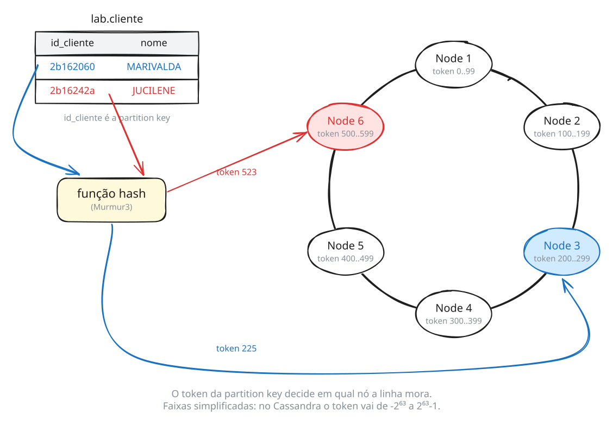

No desenho os tokens são números pequenos, para caber no olho. No seu nó, o token da Marivalda é `-754340186604780055` — o princípio é o mesmo, só a escala muda.

### 4.b. O ring deste nó

```sh
# 4.b.1
nodetool ring

```

```
Datacenter: datacenter1
==========
Address         Rack        Status State   Load            Owns                Token
                                                                               8953171646460077952
127.0.0.1       RAC1        Up     Normal  93.02 KiB       100.00%             -8250052421568881691
[... quatro linhas ...]
127.0.0.1       RAC1        Up     Normal  93.02 KiB       100.00%             -1316880576939703052
127.0.0.1       RAC1        Up     Normal  93.02 KiB       100.00%             -220838676704764763
127.0.0.1       RAC1        Up     Normal  93.02 KiB       100.00%             870458433987447496
[... mais oito linhas ...]

  Warning: "nodetool ring" is used to output all the tokens of a node.
  To view status related info of a node use "nodetool status" instead.
```

Dezesseis linhas para um único nó — o mesmo `Tokens 16` que o `nodetool status` mostrou na seção 2. O nó não ocupa uma posição no ring, ocupa dezesseis, e cada uma delas responde por uma faixa que **termina** no token da linha. Isso se chama **vnodes**, e existe para que a entrada ou saída de um nó redistribua o dado em pedaços pequenos, em vez de mover metade do cluster.

Agora localize a Marivalda. O token dela é `-754340186604780055`, e no trecho acima ele cai entre `-1316880576939703052` e `-220838676704764763`. Essa faixa é a que responde por ela.

> Os valores de token do **ring** são sorteados quando o nó é criado, então os do seu ambiente serão outros. Os valores de token das **linhas** não: `token('2b162060')` devolve `-754340186604780055` em qualquer instalação, porque é um hash da chave. Procure no seu `nodetool ring` a faixa que contém esse número.

Com um nó, todas as faixas são dele — daí `Owns 100.00%`. Com dois nós, cada um ficaria com aproximadamente metade das faixas, e cada partição passaria a ter um endereço não só no disco, mas na rede. Esse é o assunto do laboratório de cluster.

### 4.c. Partição e linha não são a mesma coisa

Em `lab.cliente`, cada partição tem exatamente uma linha, porque a `PRIMARY KEY` tem só a partition key. É o caso mais simples que existe, e também o menos interessante: uma partição de uma linha só não aproveita nada do que o Cassandra sabe fazer.

O outro extremo — uma partição que cresce sem limite — é um problema de verdade, e existe uma técnica para controlá-lo. Ela tem seção própria: 8.f.

O que muda quando a `PRIMARY KEY` tem mais colunas é a seção 5 — e, na Parte 2, o centro de toda a modelagem. Antes disso, vale organizar quem é quem numa chave. Saia do banco por um instante e pense numa tabela de pedidos guardada como as pastas de um data lake, uma pasta por dia:


| | Corte | Papel |
|---|---|---|
| **primary key** | horizontal | identifica uma linha, e só uma: é a chave inteira, `dia + hora + id_pedido` |
| **partition key** | vertical | agrupa as linhas que moram juntas — e, num cluster, decide em qual nó. A regra: **armazene junto o que você quer recuperar junto** |
| **clustering key** | — | decide **em que ordem** as linhas ficam dentro da partição |

Na `lab.cliente`, os três papéis se confundem: a chave tem uma coluna só, que é ao mesmo tempo primary key e partition key, e não existe clustering key. Na seção 5 eles se separam.

### 4.d. O mínimo sobre o disco

A Parte 3 abre os arquivos de dados um a um. Para modelar, basta conhecer o caminho que uma escrita faz, em quatro passos. Eles aparecem em alguns comandos da Parte 2:

1. **A escrita vai para o commit log e para a memtable.** O `INSERT` é gravado no fim de um arquivo sequencial, o **commit log**, que garante o dado se o processo cair, e aplicado numa estrutura em memória, a **memtable**. Nenhum arquivo de dados é tocado nesse momento — por isso a escrita é rápida.
2. **O flush leva a memtable para o disco.** Quando a memtable enche, ou quando você pede com `nodetool flush`, ela vira um arquivo de dados, a **SSTable**: ordenada pela chave e **imutável** — nunca mais é alterada.
3. **A compactação junta SSTables.** Cada flush cria uma SSTable nova, e a mesma partição acaba espalhada por várias. Em segundo plano, o Cassandra as funde numa só, guardando a versão mais recente de cada valor. `nodetool compact` força isso.
4. **`DELETE` também é escrita.** Apagar grava um marcador, o **tombstone**, que só desaparece numa compactação, dias depois.

O que importa para a modelagem: o tamanho de uma partição se mede nas SSTables, e uma partição grande pesa em cada flush, em cada compactação e em cada leitura.

**→ Próxima seção.** Até aqui cada partição de `lab.cliente` teve uma linha só — a forma mais simples, e a menos "wide" que existe. Na próxima seção uma partição vai ganhar várias linhas.

---

## 5. Wide partitions: partições de múltiplas linhas

A Marivalda tem **três cartões de crédito**. O aplicativo precisa listá-los na tela inicial, com o limite de cada um. Vamos guardar os cartões na sua bancada — e errar primeiro, do jeito que quase todo mundo erra.

### 5.a. A primeira tentativa

Cada cartão pertence a uma cliente, e a tela busca os cartões **pela cliente**. Pela seção 3, a busca só funciona pela chave — então a chave seria `id_cliente`:

```sh
# 5.a.1
cqlsh -e "
CREATE TABLE lab.cartao_credito (
    id_cliente   text PRIMARY KEY,
    id_cartao    text,
    num_cartao   text,
    limite_total float
);"

```

Cadastre os três cartões da Marivalda:

```sh
# 5.a.2
cqlsh -e "
INSERT INTO lab.cartao_credito (id_cliente, id_cartao, num_cartao, limite_total) VALUES ('2b162060','007c2c1c','5450 3799 9172 8454',1000);
INSERT INTO lab.cartao_credito (id_cliente, id_cartao, num_cartao, limite_total) VALUES ('2b162060','897199aa','5576 8924 9861 7490',200);
INSERT INTO lab.cartao_credito (id_cliente, id_cartao, num_cartao, limite_total) VALUES ('2b162060','9a748c3c','5188 2716 2053 8850',500);"

```

Três `INSERT`, nenhum erro. A tela pede os cartões dela:

```sh
# 5.a.3
cqlsh -e "SELECT * FROM lab.cartao_credito WHERE id_cliente = '2b162060';"

```

```
 id_cliente | id_cartao | limite_total | num_cartao
------------+-----------+--------------+---------------------
   2b162060 |  9a748c3c |          500 | 5188 2716 2053 8850

(1 rows)
```

**Um cartão.** Os outros dois sumiram, sem erro e sem aviso. É o upsert da seção 3: a chave identifica a linha, e as três escritas tinham a mesma chave — então foram três escritas **na mesma linha**, e ficou a última.

Esse é o primeiro dos três critérios que toda chave precisa passar, e o que mais engana porque não dá erro:

> **Unicidade.** A chave primária precisa identificar **uma** linha de verdade. Se duas coisas diferentes podem ter a mesma chave, uma vai sobrescrever a outra.

### 5.b. A segunda tentativa

Se a chave precisa ser única, por que não o id do cartão? Cada cartão tem o seu, e nenhum se repete:

```sh
# 5.b.1
cqlsh -e "
DROP TABLE lab.cartao_credito;
CREATE TABLE lab.cartao_credito (
    id_cartao    text PRIMARY KEY,
    id_cliente   text,
    num_cartao   text,
    limite_total float
);"

```

A chave é única: nenhum cartão sobrescreveria outro. Agora a consulta que a tela faz:

> **Provoque este erro.**

```sh
# 5.b.2
cqlsh -e "SELECT * FROM lab.cartao_credito WHERE id_cliente = '2b162060';"

```

```
InvalidRequest: Error from server: code=2200 [Invalid query] message="Cannot execute
this query as it might involve data filtering and thus may have unpredictable
performance. If you want to execute this query despite the performance
unpredictability, use ALLOW FILTERING"
```

O mesmo erro da seção 3 — e com a tabela vazia: o Cassandra recusa pela forma da consulta, não pelos dados. A tela de cartões não tem em mãos o id de um cartão; tem o id da cliente que acabou de entrar no aplicativo. Com `id_cartao` como chave, cada cartão vira uma partição, e não há como pedir "todos os cartões desta cliente" sem varrer a tabela.

> A chave precisa ser única, mas ser única não basta. **A tabela é modelada para a consulta**: a chave começa por aquilo que a aplicação tem em mãos no momento da leitura.

Essa tabela não está errada em si: ela serviria a outra tela, a de detalhe de um cartão, em que o id já veio da lista anterior. Você vai reencontrar essa forma na seção 8.c, na Q7. Para a tela de cartões, é preciso outra chave.

### 5.c. A chave com duas partes

A Marivalda é **uma** cliente com **vários** cartões. A chave precisa dizer as duas coisas: de quem é o cartão — o que a tela tem em mãos — e qual cartão é — o que distingue um do outro. Recrie a tabela:

```sh
# 5.c.1
cqlsh -e "
DROP TABLE lab.cartao_credito;
CREATE TABLE lab.cartao_credito (
    id_cliente   text,
    id_cartao    text,
    num_cartao   text,
    limite_total float,
    PRIMARY KEY (id_cliente, id_cartao)
);"

```

Repare na forma nova: a `PRIMARY KEY` saiu da linha da coluna e virou uma cláusula no fim, porque agora ela tem **duas colunas** e a **ordem** entre elas importa. Repita os cadastros, e acrescente o cartão da Jucilene:

```sh
# 5.c.2
cqlsh -e "
INSERT INTO lab.cartao_credito (id_cliente, id_cartao, num_cartao, limite_total) VALUES ('2b162060','007c2c1c','5450 3799 9172 8454',1000);
INSERT INTO lab.cartao_credito (id_cliente, id_cartao, num_cartao, limite_total) VALUES ('2b162060','897199aa','5576 8924 9861 7490',200);
INSERT INTO lab.cartao_credito (id_cliente, id_cartao, num_cartao, limite_total) VALUES ('2b162060','9a748c3c','5188 2716 2053 8850',500);
INSERT INTO lab.cartao_credito (id_cliente, id_cartao, num_cartao, limite_total) VALUES ('2b16242a','a2fab366','5590 5738 5562 1778',5000);"

```

```sh
# 5.c.3
cqlsh -e "SELECT * FROM lab.cartao_credito WHERE id_cliente = '2b162060';"

```

```
 id_cliente | id_cartao | limite_total | num_cartao
------------+-----------+--------------+---------------------
   2b162060 |  007c2c1c |         1000 | 5450 3799 9172 8454
   2b162060 |  897199aa |          200 | 5576 8924 9861 7490
   2b162060 |  9a748c3c |          500 | 5188 2716 2053 8850

(3 rows)
```

Os três cartões, **e em ordem de `id_cartao`**, sem que você tenha pedido. As duas colunas da chave têm papéis diferentes:

| | Coluna | Papel |
|---|---|---|
| **partition key** | `id_cliente`, a primeira | decide **em qual partição** — e em qual nó — a linha mora; é o que passa pela função hash da seção 4 |
| **clustering key** | `id_cartao`, as seguintes | decide **em que ordem** as linhas ficam **dentro** da partição |

A ordem não é arrumação da consulta: é como o dado está gravado. Desenhada, a tabela fica assim:

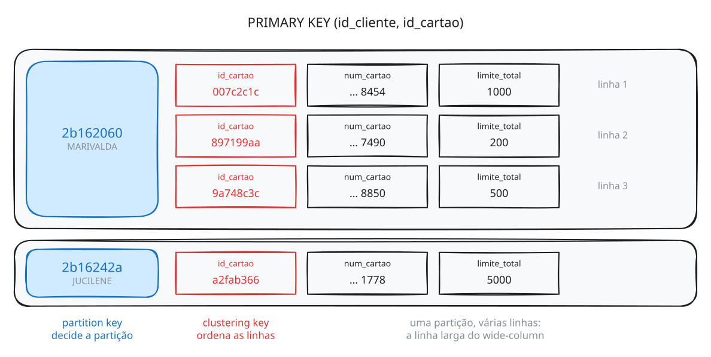

Esta é uma **wide partition** — uma partição de múltiplas linhas —, e é dela que vem o nome do modelo *wide-column*: uma partição que guarda muitas linhas, ordenadas pela clustering key, lidas de uma vez numa única ida ao disco. A tela de cartões da Marivalda é **uma** leitura, numa partição, num nó — por mais cartões que ela tenha.

Na `lab.cliente`, com chave de uma coluna, cada partição tinha uma linha só. Agora você conhece a outra ponta, e os dois extremos têm riscos: a partição de uma linha não aproveita nada do modelo; a partição que cresce sem limite é um problema que a Parte 2 vai medir. Você vai encontrar o termo *wide partition* também nesse sentido negativo, em alertas e artigos sobre partições grandes demais: é a mesma estrutura, quando cresce sem controle (seção 8.f).

Na Parte 3 você vai abrir o arquivo desta tabela e ver as três linhas da Marivalda, em ordem, dentro de uma só partição (seção 10.l).

### 5.d. O que você deve conseguir explicar

- Por que a primeira versão da tabela perdeu dois cartões sem dar erro.
- Por que `id_cartao` sozinho, mesmo sendo único, não serve de chave para a tela de cartões.
- A diferença de papel entre partition key e clustering key.
- Por que o resultado veio ordenado por `id_cartao` sem `ORDER BY`.
- O que é uma *wide partition*, e por que a tela de cartões é uma leitura só.

**→ Parte 2.** Você construiu duas peças do aplicativo à mão, uma tabela por vez. O sistema do banco tem doze. Como se decide quais tabelas criar, e qual chave cada uma recebe?

---

# Parte 2 — Modelagem de dados

## 6. Modelagem orientada a consultas

No modelo relacional, a modelagem começa pelas entidades e seus relacionamentos, e as consultas se viram com `JOIN`. No Cassandra não há `JOIN` (a seção 7 mostra por quê), e a busca só funciona pela chave — então **a consulta precisa ser conhecida antes da tabela existir**. A metodologia de modelagem do Cassandra parte daí:

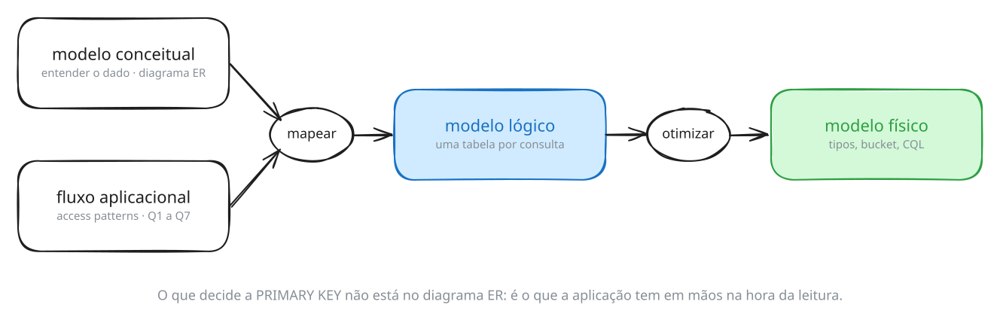

| Etapa | Pergunta | Produto |
|---|---|---|
| **Modelo conceitual** | Que dados existem e como se relacionam? | diagrama de entidades |
| **Fluxo aplicacional** | Que consultas a aplicação faz, e em que ordem? | os *access patterns*: Q1, Q2, … |
| **Modelo lógico** | Que tabela responde a cada consulta? | uma tabela por consulta, com a chave |
| **Modelo físico** | Que tipos, que bucket, que CQL? | `CREATE TABLE` |

As duas primeiras etapas são independentes; a terceira junta as duas. Vamos percorrê-las com o infobarBank.

### 6.a. O modelo conceitual

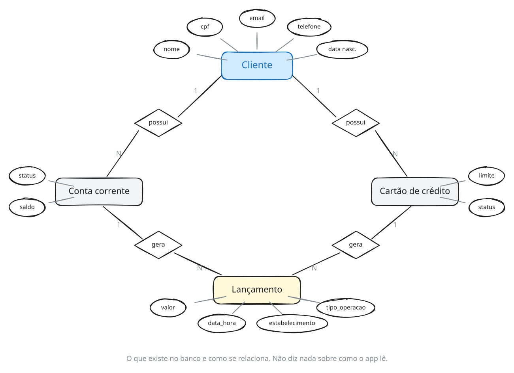

Uma cliente tem contas e cartões; contas e cartões geram lançamentos. É o diagrama que você faria para qualquer banco relacional — e ele é necessário, porque é ele que diz que dados existem. Mas repare no que ele **não** diz: nada sobre o que o aplicativo mostra, em que ordem, a partir de quê. E é isso que decide a chave.

### 6.b. O fluxo aplicacional

O fluxo aplicacional é a sequência de consultas que a aplicação faz ao banco — os seus **padrões de acesso**, ou *access patterns*. No infobarBank, cada consulta nasce de uma tela do aplicativo; em outros sistemas, pode ser uma chamada de API, um job noturno ou outro serviço. O método é o mesmo.

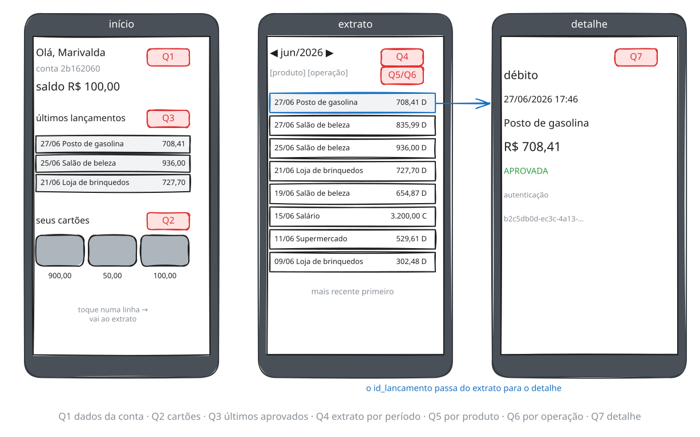

Cada tela, ou cada parte de tela, é uma consulta:

| | Consulta | Tela |
|---|---|---|
| **Q1** | Exibir dados da conta | abertura |
| **Q2** | Exibir lista de cartões de crédito e seus limites | cartões |
| **Q3** | Últimos lançamentos aprovados de conta e cartão | extrato, visão inicial |
| **Q4** | Exibir extrato de lançamentos por período | extrato, filtro de datas |
| **Q5** | Exibir extrato dos lançamentos de um cartão | extrato de um cartão |
| **Q6** | Exibir extrato de lançamentos do tipo débito | extrato, filtro de tipo |
| **Q7** | Exibir detalhe do lançamento selecionado | detalhe |

Duas regras de negócio completam as consultas:

- **Q3**: os últimos três lançamentos **aprovados**; se o mês corrente não tiver nenhum, busca-se o mês anterior.
- **Q4**: o extrato mostra **um mês por vez** — a tela tem um seletor de mês, não um campo livre de datas. Na seção 8 você vai ver que essa decisão de tela é consequência do modelo de dados.

### 6.c. A inversão em relação ao relacional

Aquela tabela acima não é documentação do modelo: **é o método.** Ela tem nome — **modelagem orientada a consultas**, ou *query-first design* — e a inversão em relação ao que você aprendeu em relacional é literal:

| | Relacional | Cassandra |
|---|---|---|
| Começa em | entidades e relacionamentos | **as consultas** |
| Depois | normaliza até a 3ª forma normal | uma tabela por consulta (seção 7) |
| As consultas | se adaptam ao modelo, com `JOIN` | **definem** o modelo |
| Consulta nova | quase sempre é só SQL novo | pode ser tabela nova, carga de dados e deploy |

A consequência prática incomoda quem vem do relacional: **não se modela em Cassandra sem saber as consultas.** Um diagrama de entidades correto não produz um modelo Cassandra utilizável, porque a informação que decide a `PRIMARY KEY` não está no diagrama. O que decide é *o que a aplicação tem em mãos no momento da leitura* — e isso está no fluxo aplicacional, nos *access patterns*, não no modelo conceitual. Você vai ver isso em 8.c, quando faltar um `id_lancamento`: a chave da Q7 só faz sentido porque a tela anterior entrega o id.

Daí a ordem de trabalho, que é a desta seção:

```
fluxo aplicacional  →  uma consulta por access pattern  →  o que a aplicação tem em mãos  →  PRIMARY KEY  →  tabela
```

E o preço do método, que é honesto declarar agora: **a consulta que ninguém previu não tem tabela.** Nenhuma das doze responde "quais os dez maiores lançamentos da cliente no mês" — não porque seja difícil, mas porque essa tela não existia quando o modelo foi feito. Você vai reencontrar essa pergunta no desafio da seção 12, e as três saídas para ela são as da seção 11 e da seção 8.i: modelar mais uma tabela, aceitar um índice SAI, ou varrer com `ALLOW FILTERING`. Nenhuma é grátis.

### 6.d. Do fluxo às tabelas

O resultado da modelagem está carregado no seu ambiente:

```sh
# 6.d.1
cqlsh -e "SELECT table_name FROM system_schema.tables WHERE keyspace_name='infobarbank';"

```

```
 table_name
----------------------------
             cartao_credito
                    cliente
            cliente_por_cpf
          cliente_por_email
       cliente_por_telefone
             conta_corrente
 lancamentos_cartao_credito
        lancamentos_detalhe
    lancamentos_por_periodo
    lancamentos_por_produto
     lancamentos_por_status
       lancamentos_por_tipo

(12 rows)
```

Doze tabelas para sete consultas. Cada uma existe por causa de um access pattern:

| Tabela | Atende |
|---|---|
| `cliente`, `cliente_por_cpf`, `cliente_por_email`, `cliente_por_telefone` | o login, por quatro caminhos (seção 7) |
| `conta_corrente` | Q1 |
| `cartao_credito` | Q2 |
| `lancamentos_por_status` | Q3 |
| `lancamentos_por_periodo` | Q4 |
| `lancamentos_por_produto` | Q5 |
| `lancamentos_por_tipo` | Q6 |
| `lancamentos_detalhe` | Q7 |
| `lancamentos_cartao_credito` | a primeira tentativa de extrato, com uma tabela só para todos os filtros — e o motivo pelo qual não basta (seção 8.g) |

Quatro tabelas de cliente, cinco de lançamento com os mesmos dados. A próxima seção explica por que um modelo Cassandra repete tanto.

### 6.e. Os três critérios da chave

Toda chave do modelo lógico passa por três perguntas. A primeira você já conhece da seção 5:

| Critério | Pergunta | Onde você vê |
|---|---|---|
| **Unicidade** | A chave identifica uma linha só? | seção 5 (cartões) e seção 8.d (CPF) |
| **Ordenação** | As linhas vêm na ordem que a consulta pede? | seção 8.g |
| **Distribuição** | A partição tem tamanho limitado? | seção 8.f |

### 6.f. O que você deve conseguir explicar

- As quatro etapas da metodologia, e o que cada uma produz.
- O que o diagrama de entidades não sabe informar, e onde essa informação está.
- Por que, em Cassandra, uma consulta nova pode exigir uma tabela nova.

**→ Próxima seção.** Doze tabelas para sete consultas, e quatro delas guardam a mesma cliente. Antes de olhar as chaves uma a uma, a pergunta que todo mundo faz: por que não um `JOIN`?

---

## 7. Não existe JOIN — existe outra tabela

### 7.a. A tentativa de JOIN

Sua tabela `lab.cliente` responde bem a uma pergunta: *"quem é o cliente de id X?"*. Um sistema bancário faz essa pergunta uma vez, no login, e depois faz outras dez. A mais imediata: *"quais os lançamentos desta cliente?"*

No modelo relacional isso é uma tabela `lancamento` com chave estrangeira e um `JOIN`. Vamos tentar — e não em tabelas que você acabou de inventar, mas em duas que existem, povoadas, no sistema do banco:

> **Provoque este erro.**

```sh
# 7.a.1
cqlsh -e "
SELECT nome_completo, valor
FROM infobarbank.cliente
JOIN infobarbank.lancamentos_por_periodo
  ON cliente.id_cliente = lancamentos_por_periodo.id_cliente;"

```

```
SyntaxException: line 1:53 mismatched input 'JOIN' expecting EOF
(..., valor FROM infobarbank.cliente [JOIN]...)
```

Leia com atenção: **`expecting EOF`**. O interpretador chegou ao fim do nome da tabela e concluiu que a consulta deveria ter terminado ali. Não é que o `JOIN` seja proibido — é que a gramática do CQL não tem onde encaixar uma segunda tabela. Nem com a sintaxe antiga:

> **Provoque este erro.**

```sh
# 7.a.2
cqlsh -e "SELECT * FROM infobarbank.cliente, infobarbank.conta_corrente;"

```

```
SyntaxException: line 1:33 mismatched input ',' expecting EOF
(SELECT * FROM infobarbank.cliente[,]...)
```

A razão está nas seções 2 e 4. Um `JOIN` combina linhas de dois conjuntos, e num cluster essas linhas estão em partições diferentes, em nós diferentes. Fazer isso exigiria mover dados pela rede em quantidade imprevisível, no meio de uma consulta que alguém está esperando. O Cassandra não oferece essa operação — do mesmo modo que não oferece `WHERE` em coluna não indexada.

Então **como um sistema real resolve isso?**

### 7.b. O mesmo dado, quatro vezes

A seção 6 mostrou quatro tabelas de cliente: `cliente`, `cliente_por_cpf`, `cliente_por_email`, `cliente_por_telefone`. Parecem quatro tabelas diferentes. Procure a Marivalda em cada uma:

```sh
# 7.b.1
cqlsh -e "SELECT id_cliente, nome_completo, estado FROM infobarbank.cliente WHERE id_cliente='2b162060';"

```

```sh
# 7.b.2
cqlsh -e "SELECT id_cliente, nome_completo, estado FROM infobarbank.cliente_por_cpf WHERE cpf='987.539.360-60';"

```

```sh
# 7.b.3
cqlsh -e "SELECT id_cliente, nome_completo, estado FROM infobarbank.cliente_por_email WHERE email='marivalda@bmail.com';"

```

```sh
# 7.b.4
cqlsh -e "SELECT id_cliente, nome_completo, estado FROM infobarbank.cliente_por_telefone WHERE telefone='(11) 987654321';"

```

Os quatro comandos devolvem exatamente a mesma linha:

```
   2b162060 | MARIVALDA KANAMARY |     SP
```

**É o mesmo dado, gravado quatro vezes.** Não é redundância acidental, nem falta de normalização por descuido: é a resposta do Cassandra ao problema que você acabou de encontrar. A aplicação de banco precisa aceitar login por CPF, por e-mail ou por telefone, e cada uma dessas três formas é uma consulta diferente. Sem `JOIN` e sem `WHERE` livre, **cada consulta ganha a sua tabela**.

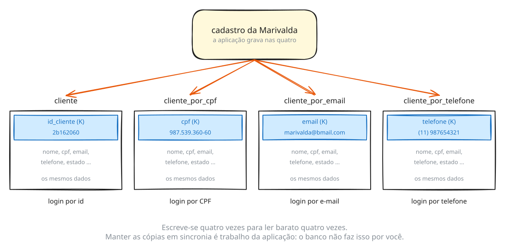

Isso tem nome.

### 7.c. Desnormalização

**Desnormalização** é gravar o mesmo dado em mais de um lugar para que cada consulta encontre tudo o que precisa num só lugar. É o oposto da normalização que você aprendeu em modelagem relacional, onde cada fato existe uma vez e as consultas o remontam com `JOIN`.

A palavra é a mesma nos dois mundos, mas o papel se inverte:

| | Relacional | Cassandra |
|---|---|---|
| A regra | normalizar; cada fato uma vez | uma tabela por consulta |
| Desnormalizar é | **exceção**, um desvio justificado por desempenho | **o padrão** |
| Quem reclama de uma cópia fora de sincronia | o banco, com chave estrangeira e transação | **ninguém** |

A terceira linha é a que custa caro, e vamos medir as duas primeiras antes de chegar nela.

#### O que as quatro cópias custam, medido

Quantas linhas em cada uma das quatro tabelas?

```sh
# 7.c.1
cqlsh -e "
SELECT count(*) FROM infobarbank.cliente;
SELECT count(*) FROM infobarbank.cliente_por_cpf;
SELECT count(*) FROM infobarbank.cliente_por_email;
SELECT count(*) FROM infobarbank.cliente_por_telefone;"

```

Cinquenta em cada, com um aviso em cada — `Aggregation query used without partition key`, que é o Cassandra dizendo que para contar ele varreu a tabela inteira. Guarde o aviso: até `count(*)` é uma varredura.

Agora o espaço em disco. As keyspaces do curso foram carregadas há pouco, e parte delas pode estar ainda na memtable — sem arquivo no disco, como em 4.d. Force a descida antes de medir:

```sh
# 7.c.2
nodetool flush infobarbank

```

```sh
# 7.c.3
nodetool tablestats infobarbank.cliente infobarbank.cliente_por_cpf infobarbank.cliente_por_email infobarbank.cliente_por_telefone

```

O comando imprime umas trinta linhas por tabela. Três delas interessam:

```
  Table: cliente
  Space used (total): 10069
  Number of partitions (estimate): 50

  Table: cliente_por_cpf
  Space used (total): 9766
  Number of partitions (estimate): 30

  Table: cliente_por_email
  Space used (total): 10438
  Number of partitions (estimate): 50

  Table: cliente_por_telefone
  Space used (total): 10260
  Number of partitions (estimate): 49
```

Cerca de **40 KB para armazenar 10 KB de clientes** — o fator quatro, medido. Num banco com cinquenta milhões de clientes seria a diferença entre 10 GB e 40 GB, e é o custo mais fácil de aceitar dos três: disco é barato e previsível.

Antes de seguir, olhe a linha de partições, porque ela denuncia algo que as contagens escondem. As quatro tabelas têm 50 linhas, mas `cliente_por_cpf` estima **30 partições** e `cliente_por_telefone`, **49**. Menos partições que linhas significa linhas diferentes com a mesma chave. Esse número é uma estimativa — confirme contando as chaves distintas:

```sh
# 7.c.4
cqlsh -e "SELECT DISTINCT cpf FROM infobarbank.cliente_por_cpf;"

```

```
 cpf
----------------
 324.873.000-51
 219.384.290-89
 129.384.250-60
[...]

(30 rows)
```

Trinta chaves para cinquenta linhas. E é aqui que aparece a lição, que vale para qualquer tabela de acesso alternativo:

> `cliente_por_cpf` foi modelada supondo que **o CPF identifica uma pessoa**. Quando essa suposição falha, o Cassandra não avisa: não existe `UNIQUE`, não existe chave estrangeira, e um `INSERT` com chave que já existe é um upsert (seção 3) — sobrescreve, sem erro e sem log. **A partition key carrega uma afirmação sobre unicidade, e ninguém a verifica para você.**

Vale separar as duas repetições desta base, porque só uma delas é realista:

| | O que é |
|---|---|
| **telefone**, 49 chaves para 50 linhas | plausível em produção — duas pessoas da mesma casa, um celular corporativo. Uma tela que espera uma pessoa vai receber duas |
| **CPF**, 30 chaves para 50 linhas | **artefato desta base.** CPF é único por lei; foi a lista de personas do gerador que repetiu valores |

Ou seja: não tome o CPF repetido como retrato de produção. Tome-o como o que ele é — a chance de ver, em dado real, o que acontece quando a premissa de unicidade de uma partition key é falsa. O que se leva daqui é o hábito: **antes de eleger uma coluna como partition key, prove que ela é única na sua base**, porque o banco não vai reclamar depois.

E guarde a pergunta, porque a resposta está em 8.d: se o CPF se repete, por que as trinta pessoas com CPF repetido **não** se sobrescreveram? Quem modelou a `cliente_por_cpf` já contava com isso.

Consequência operacional, para não te confundir mais adiante: consultar `cliente_por_cpf` por um desses CPFs devolve **várias pessoas**. O CPF da Marivalda é único, e é o usado em todos os exemplos deste laboratório — assim como as outras seis clientes com movimento. Se você trocar de cliente por conta própria, confira antes.

#### O custo que dói: não existe transação

O segundo custo é escrever quatro vezes em vez de uma. O terceiro é o que quebra sistema em produção, e é melhor ver do que ler. Faça na sua bancada.

Crie uma tabela de acesso por e-mail para a `lab.cliente`, do mesmo jeito que o banco fez:

```sh
# 7.c.5
cqlsh -e "
CREATE TABLE lab.cliente_por_email (
  email text PRIMARY KEY,
  id_cliente text,
  nome text
);
INSERT INTO lab.cliente_por_email (email, id_cliente, nome) VALUES ('marivalda@bmail.com','2b162060','MARIVALDA');"

```

Duas tabelas, o mesmo dado, tudo em ordem. Agora a Marivalda troca de e-mail, e a aplicação atualiza o cadastro:

```sh
# 7.c.6
cqlsh -e "UPDATE lab.cliente SET email = 'marivalda.kanamary@bmail.com' WHERE id_cliente = '2b162060';"

```

Nenhum erro. Amanhã ela tenta entrar com o e-mail novo:

```sh
# 7.c.7
cqlsh -e "SELECT * FROM lab.cliente_por_email WHERE email = 'marivalda.kanamary@bmail.com';"

```

```
 email | id_cliente | nome
-------+------------+------

(0 rows)
```

**O login falhou.** E o e-mail antigo, que ela não usa mais, continua funcionando:

```sh
# 7.c.8
cqlsh -e "SELECT * FROM lab.cliente_por_email WHERE email = 'marivalda@bmail.com';"

```

```
 email               | id_cliente | nome
---------------------+------------+-----------
 marivalda@bmail.com |   2b162060 | MARIVALDA
```

Duas tabelas discordam sobre um fato, e **o banco não reclamou em nenhum momento.** Não existe chave estrangeira ligando as duas, não existe transação abrangendo as duas, não existe `ROLLBACK`. O `UPDATE` que faltou é código da aplicação, e esquecê-lo produz um dado que existe em duas versões — sem erro, sem log, sem aviso.

Piora um pouco. O conserto óbvio não é permitido:

> **Provoque este erro.**

```sh
# 7.c.9
cqlsh -e "UPDATE lab.cliente_por_email SET email = 'marivalda.kanamary@bmail.com' WHERE email = 'marivalda@bmail.com';"

```

```
InvalidRequest: ... "PRIMARY KEY part email found in SET part"
```

O e-mail é a partition key: ele **decide em que partição a linha mora**. Mudá-lo não é alterar um campo, é mudar a linha de lugar — e isso, para o Cassandra, são duas operações. Insira a nova e apague a velha:

```sh
# 7.c.10
cqlsh -e "
INSERT INTO lab.cliente_por_email (email, id_cliente, nome) VALUES ('marivalda.kanamary@bmail.com','2b162060','MARIVALDA');
DELETE FROM lab.cliente_por_email WHERE email = 'marivalda@bmail.com';
SELECT * FROM lab.cliente_por_email;"

```

```
 email                        | id_cliente | nome
------------------------------+------------+-----------
 marivalda.kanamary@bmail.com |   2b162060 | MARIVALDA
```

Some a tabela auxiliar e devolva o e-mail original — as próximas seções usam a `lab.cliente` como ela estava:

```sh
# 7.c.11
cqlsh -e "
DROP TABLE lab.cliente_por_email;
UPDATE lab.cliente SET email = 'marivalda@bmail.com' WHERE id_cliente = '2b162060';"

```

Some a conta: **uma troca de e-mail custou um `UPDATE`, um `INSERT` e um `DELETE`, em duas tabelas, e nenhum deles é opcional.** Em relacional teria sido um `UPDATE`. É esse trabalho que a desnormalização transfere da consulta para a escrita, e da consulta para a aplicação.

#### O que se compra com isso

Qualquer uma das três telas de login responde com uma **leitura pontual, em uma partição, em um nó**, com custo que não muda quando a base cresce de mil para um bilhão de clientes.

> Essa é a frase que resume a modelagem em Cassandra: **escreve-se o dado N vezes para lê-lo barato N vezes.** No modelo relacional o dado é guardado uma vez e a consulta faz o trabalho; aqui a escrita faz o trabalho e a consulta é trivial.

E a Marivalda que você cadastrou na seção 3, com o mesmo `id_cliente` `2b162060`? É a mesma pessoa. A diferença é que aqui ela existe em um modelo que foi projetado a partir das perguntas que o sistema faz.

#### Quando desnormalizar, e quando não

A regra, e ela erra para os dois lados:

> Crie uma tabela por **caminho de acesso que precisa ser rápido**. Cada tabela nova soma uma escrita a cada mudança e uma cópia a manter em sincronia.

| Erro | Sintoma |
|---|---|
| **Tabelas de menos** | a consulta cai em `ALLOW FILTERING`, varredura, latência que cresce com a base (seção 8.i) |
| **Tabelas demais** | amplificação de escrita e superfície de bug de sincronia — a falha que você acabou de provocar, multiplicada |

Duas perguntas resolvem a maioria dos casos:

1. **Com que frequência essa consulta acontece?** A tela principal do aplicativo merece tabela. Um relatório mensal e uma busca do atendimento, não — para esses existem o índice SAI (seção 11) e o processamento em lote.
2. **Esse dado muda mais do que é lido?** Se muda, a troca se inverte: cada alteração paga N escritas por uma leitura que talvez não venha. Dado de cadastro — nome, CPF, e-mail — muda uma vez por ano e é lido todo dia, e por isso desnormalizar compensa tanto aqui.

#### Onde mais a desnormalização aparece neste laboratório

Agora que a técnica tem nome, ela fica visível em quase toda tabela que você vai ver:

| O mesmo dado, repetido em | Para atender |
|---|---|
| `infobarbank.cliente` + `cliente_por_cpf` + `cliente_por_email` + `cliente_por_telefone` | login por id, por CPF, por e-mail, por telefone |
| `infobarshop.cliente` + `cliente_por_cpf` + `cliente_por_email` | o mesmo, na infobarShop |
| `lancamentos_detalhe` × as quatro tabelas de lançamento | a tela de detalhe e as telas de lista (8.c e 8.g) |
| `lancamentos_por_periodo` + `_por_produto` + `_por_status` + `_por_tipo` | os mesmos lançamentos, quatro filtros (8.g) |
| `pedido_detalhe` × as tabelas de pedido do `infobarshop` | idem, na infobarShop |

Não existe uma única tabela do `infobarbank` cujo conteúdo não apareça em outra. **É a regra, não a exceção.**

### 7.d. O que você deve conseguir explicar

- Por que o CQL não tem `JOIN`, em termos de onde os dados estão fisicamente.
- O que é desnormalização, e por que em Cassandra ela é o padrão e não a exceção.
- Os três custos dela: espaço, escrita repetida e ausência de transação — e qual dos três quebra sistema.
- Por que mudar uma partition key exige `INSERT` mais `DELETE`.
- Dada uma consulta que a aplicação precisa fazer, decidir se ela merece uma tabela própria.

**→ Próxima seção.** A desnormalização explica as quatro tabelas de cliente. Agora as telas, uma a uma: para cada consulta, a chave que ela pede.

---

## 8. Do fluxo à chave

O modelo lógico do infobarBank tem uma tabela por consulta. Na notação usada para modelar Cassandra, **K** marca as colunas da partition key, e **C↑** / **C↓** as clustering keys, com a ordem em que as linhas ficam gravadas:

| Consulta | Tabela | K | C |
|---|---|---|---|
| Q1 | `conta_corrente` | `id_cliente` | `status` ↑, `id_conta` ↑ |
| Q2 | `cartao_credito` | `id_cliente` | `status` ↑, `id_cartao` ↑ |
| Q3 | `lancamentos_por_status` | `id_cliente`, `competencia` | `status` ↑, `data_hora` ↓, `id_lancamento` ↑ |
| Q4 | `lancamentos_por_periodo` | `id_cliente`, `competencia` | `data_hora` ↓, `id_lancamento` ↑ |
| Q5 | `lancamentos_por_produto` | `id_cliente`, `competencia` | `id_produto` ↑, `data_hora` ↓, `id_lancamento` ↑ |
| Q6 | `lancamentos_por_tipo` | `id_cliente`, `competencia` | `tipo_operacao` ↑, `data_hora` ↓, `id_lancamento` ↑ |
| Q7 | `lancamentos_detalhe` | `id_lancamento` | — |

Nesta seção vamos percorrer cada forma de chave dessa tabela — coluna única, composta, partition key de várias colunas — com a consulta que a motivou, e testar os três critérios da seção 6.

### 8.a. Escolhendo a competência

Os lançamentos são gerados em relação à data de execução, então as competências disponíveis no seu ambiente são outras. Descubra:

```sh
# 8.a.1
cqlsh -e "SELECT DISTINCT id_cliente, competencia FROM infobarbank.lancamentos_por_periodo;"

```

```
   2b162060 |     2026-05
   2b162060 |     2026-06
   2b162060 |     2026-07
[...]
```

Use uma competência **do meio da lista** nos exemplos — nem a primeira, nem a última. O motivo aparece ao olhar a data do último lançamento de cada uma:

```sh
# 8.a.2
cqlsh -e "SELECT max(data_hora) FROM infobarbank.lancamentos_por_periodo WHERE id_cliente='2b162060' AND competencia='2026-06';"

```

```
 2026-06-29 19:10:14.797000+0000
```

```sh
# 8.a.3
cqlsh -e "SELECT max(data_hora) FROM infobarbank.lancamentos_por_periodo WHERE id_cliente='2b162060' AND competencia='2026-07';"

```

```
 2026-07-25 19:10:15.437000+0000
```

A última competência para no dia **25** — que é hoje. Ela é o **mês corrente**, e por isso cobre um mês incompleto. A primeira da lista tem o problema simétrico:

```sh
# 8.a.4
cqlsh -e "SELECT min(data_hora) FROM infobarbank.lancamentos_por_periodo WHERE id_cliente='2b162060' AND competencia='2025-07';"

```

```
 2025-07-26 19:10:12.988000+0000
```

Começa no dia 26, porque os lançamentos foram distribuídos nos últimos 365 dias — e 365 dias atrás era o dia 26 do mês. **As duas pontas da série são parciais.**

Não é defeito do laboratório: é o que acontece em qualquer base de produção, e é o tipo de detalhe que derruba relatório — um gráfico de movimento por mês mostra queda no mês corrente todos os meses, e quem não souber disso vai procurar explicação de negócio para um artefato do calendário.

> Note que a **contagem** de lançamentos pode não denunciar isso: os lançamentos são sorteados, e um mês incompleto pode acabar com mais registros que um mês fechado. O que denuncia é a data, não o volume.

Nos exemplos a seguir aparece `2026-06`; troque por uma competência intermediária do seu ambiente.

### 8.b. O que é igual e o que é diferente no seu ambiente

Vale saber antes de comparar resultados:

| | |
|---|---|
| **Igual em qualquer ambiente** | as cinquenta clientes, com nome, CPF, e-mail e telefone; as contas correntes e os cartões, com números, limites e saldos |
| **Sorteado a cada ambiente** | todos os lançamentos — data, valor, estabelecimento, `id_lancamento` e a conta ou cartão que os originou |

Ou seja: os resultados de Q1 e Q2 abaixo devem coincidir com os seus. Os de Q3 a Q7, não — a forma da resposta é a mesma, os valores são outros.

### 8.c. Partition key de coluna única

O caso mais simples, o mesmo da sua `lab.cliente`: a `PRIMARY KEY` tem uma coluna, que é a partition key. Uma partição, uma linha.

A tabela `cliente` do banco tem exatamente essa forma:

```sh
# 8.c.1
cqlsh -e "DESCRIBE TABLE infobarbank.cliente;"

```

```
    id_cliente text PRIMARY KEY,
```

Repare **onde** essa declaração aparece: na própria linha da coluna. É a forma que o CQL usa quando a chave tem uma coluna só. Da seção 8.d em diante você vai ver a outra forma, uma cláusula `PRIMARY KEY (...)` separada, no fim da lista de colunas — ela é obrigatória assim que a chave tem mais de uma coluna, porque aí a **ordem** das colunas importa e não haveria como expressá-la linha por linha.

Recupere a Marivalda:

```sh
# 8.c.2
cqlsh -e "SELECT id_cliente, nome_completo, cpf, estado FROM infobarbank.cliente WHERE id_cliente='2b162060';"

```

```
 id_cliente | nome_completo      | cpf            | estado
------------+--------------------+----------------+--------
   2b162060 | MARIVALDA KANAMARY | 987.539.360-60 |     SP
```

Esta é uma das saídas que devem coincidir **exatamente** com a sua — clientes não são sorteados. Use como calibração antes de entrar nas tabelas de lançamento, onde os valores mudam a cada ambiente.

#### A mesma forma na Q7 — e o id que você não tem

A **Q7** é o detalhe de um lançamento, e usa a mesma chave de uma coluna:

```sh
# 8.c.3
cqlsh -e "DESCRIBE TABLE infobarbank.lancamentos_detalhe;"

```

```
    id_lancamento text PRIMARY KEY,
```

Mesma forma, outra tabela. Só que aqui aparece um problema que a `cliente` não tem: **você não sabe nenhum `id_lancamento`.** O `id_cliente` da Marivalda você tinha em mãos — vem do login. Um `id_lancamento` não vem de lugar nenhum, e não se adivinha.

Isso não é inconveniência do laboratório, é a própria mecânica do aplicativo. A tela de detalhe nunca é a primeira: a cliente chega nela **tocando numa linha do extrato**, e é a tela anterior que carrega o id. Então faça o que o aplicativo faz — leia o extrato primeiro:

```sh
# 8.c.4
cqlsh -e "
SELECT id_lancamento, data_hora, estabelecimento, valor
FROM infobarbank.lancamentos_por_periodo
WHERE id_cliente='2b162060' AND competencia='2026-06'
LIMIT 5;"

```

```
 id_lancamento | data_hora                       | estabelecimento     | valor
---------------+---------------------------------+---------------------+-----------
      ccf7c105 | 2026-06-27 19:41:51.601000+0000 |   Posto de gasolina |    957.63
      7bf5dcc8 | 2026-06-20 19:41:49.440000+0000 |             Padaria |    471.91
      a9f23932 | 2026-06-18 19:41:50.544000+0000 | Loja de eletrônicos | 297.51999
      6685149f | 2026-06-17 19:41:52.338000+0000 |     Salão de beleza |    150.47
      7133781c | 2026-06-17 19:41:52.081000+0000 |      Loja de roupas |     159.3
```

Os seus cinco ids são outros. **Escolha qualquer um deles** e siga com ele nos comandos abaixo.

> Repare que não há `ORDER BY` e ainda assim vieram os cinco mais recentes. A ordenação já está gravada no disco — é assunto de 8.d, e é o que faz o `LIMIT` ser barato aqui.

Agora a Q7, com o id que você escolheu:

```sh
# 8.c.5
cqlsh -e "
SELECT id_lancamento, data_hora, estabelecimento, valor, status, codigo_autenticacao
FROM infobarbank.lancamentos_detalhe
WHERE id_lancamento='ccf7c105';"

```

```
 id_lancamento | data_hora                       | estabelecimento   | valor  | status   | codigo_autenticacao
---------------+---------------------------------+-------------------+--------+----------+--------------------------------------
      ccf7c105 | 2026-06-27 19:41:51.601000+0000 | Posto de gasolina | 957.63 | APROVADA | 74769828-a8a8-4244-b9c6-506a4adc758a
```

Confira contra a listagem anterior: mesmo estabelecimento, mesma data, mesmo valor. **É o mesmo lançamento, gravado em duas tabelas** — a listagem numa, o detalhe na outra. É a desnormalização da seção 7, agora entre tabelas de lançamento: a tela de extrato e a tela de detalhe são duas consultas, então são duas tabelas.

E repare no que a `lancamentos_detalhe` tem de diferente das outras tabelas de lançamento: uma coluna a mais, `codigo_autenticacao`. A tela de detalhe é a única que mostra esse campo, então ele existe só aqui. **Tabela por consulta significa também colunas por consulta.**

Duas leituras, duas partições, dois nós possíveis num cluster — e é assim que a tela funciona. Guarde o par: **uma consulta entrega a lista, outra entrega o detalhe, e o id é o que passa de uma para a outra.**

### 8.d. Partition key mais clustering key

Agora a `PRIMARY KEY` tem duas partes. A **Q1**, dados da conta:

```sh
# 8.d.1
cqlsh -e "DESCRIBE TABLE infobarbank.conta_corrente;"

```

```
    PRIMARY KEY (id_cliente, status, id_conta)
) WITH CLUSTERING ORDER BY (status ASC, id_conta ASC)
```

Leia a cláusula da esquerda para a direita: a **primeira** coluna é a partition key, as demais são clustering keys. Aqui é `id_cliente` que decide a partição, e o `CLUSTERING ORDER BY` que veio de brinde confirma quem são as outras duas.

```sh
# 8.d.2
cqlsh -e "
SELECT id_conta, status, apelido_cliente, saldo_disponivel
FROM infobarbank.conta_corrente
WHERE id_cliente='2b162060';"

```

```
 id_conta | status | apelido_cliente | saldo_disponivel
----------+--------+-----------------+------------------
 2b162060 |  ATIVA |       MARIVALDA |              100
```

E a **Q2**, cartões e limites, com a mesma forma:

```sh
# 8.d.3
cqlsh -e "
SELECT status, id_cartao, num_cartao, limite_total, limite_disponivel
FROM infobarbank.cartao_credito
WHERE id_cliente='2b162060';"

```

```
 status  | id_cartao | num_cartao          | limite_total | limite_disponivel
---------+-----------+---------------------+--------------+-------------------
   ATIVO |  007c2c1c | 5450 3799 9172 8454 |         1000 |               900
   ATIVO |  897199aa | 5576 8924 9861 7490 |          200 |                50
 INATIVO |  9a748c3c | 5188 2716 2053 8850 |          500 |               100

(3 rows)
```

Três linhas em **uma** partição — a wide partition que você montou na seção 5, agora no sistema do banco. Com uma diferença na chave: aqui ela é `(id_cliente, status, id_cartao)`, com `status` **antes** de `id_cartao`.

E note a ordem: os dois `ATIVO` vêm antes do `INATIVO`, porque `status` é a primeira clustering key e ordena alfabeticamente. Não é coincidência conveniente — é decisão de modelagem. A tela de cartões mostra primeiro os que a cliente pode usar, e essa ordenação **não custa nada em tempo de consulta** porque já está no disco. Compare com o mundo relacional, onde seria um `ORDER BY status` executado a cada requisição.

Essa é também a forma das tabelas de acesso alternativo que você viu na seção 7:

```sh
# 8.d.4
cqlsh -e "DESCRIBE TABLE infobarbank.cliente_por_cpf;"

```

```
    PRIMARY KEY (cpf, id_cliente)
```

Por que `id_cliente` como clustering key, se um CPF identifica uma pessoa? Por segurança de modelagem: se dois registros vierem com o mesmo CPF, eles coexistem como duas linhas na mesma partição, em vez de um sobrescrever o outro silenciosamente — que é o que o upsert da seção 3 faria.

E não é hipótese. É exatamente o que você mediu na seção 7: **30 partições para 50 clientes.** Se a chave fosse apenas `cpf`, aqueles trinta clientes que dividem dez CPFs teriam virado dez linhas, e vinte pessoas simplesmente não existiriam nesta tabela — sem erro, sem aviso. A clustering key é o que impede isso. Comprove:

```sh
# 8.d.5
cqlsh -e "SELECT cpf, id_cliente, nome_completo FROM infobarbank.cliente_por_cpf WHERE cpf='892.394.120-12';"

```

```
 cpf            | id_cliente | nome_completo
----------------+------------+------------------------
 892.394.120-12 |   2b165b48 | CARLOS EDUARDO MARTINS
 892.394.120-12 |   2b16727c | ROBERTO CARLOS MARTINS
 892.394.120-12 |   2b1689b0 |  MARIA EDUARDA MARTINS
 892.394.120-12 |   2b168c02 | RODRIGO CARLOS MARTINS

(4 rows)
```

Quatro pessoas, uma partição, quatro linhas ordenadas por `id_cliente`. A tela de login que espera uma pessoa recebe quatro — e o problema passou a ser da aplicação, não do banco. Mas **o dado está lá**, e é isso que a clustering key comprou.

> Os quatro têm o mesmo sobrenome, o que faz o resultado parecer uma família e a duplicidade parecer plausível. Não é: são quatro personas geradas em sequência a partir do mesmo sobrenome, e CPF continua sendo único por lei. Vale como aviso sobre dado sintético — ele às vezes é errado de um jeito que parece certo.

### 8.e. Partition key de múltiplas colunas

A **Q4**, extrato por período, é onde o modelo fica interessante:

```sh
# 8.e.1
cqlsh -e "DESCRIBE TABLE infobarbank.lancamentos_por_periodo;"

```

```
    PRIMARY KEY ((id_cliente, competencia), data_hora, id_lancamento)
) WITH CLUSTERING ORDER BY (data_hora DESC, id_lancamento ASC)
```

A partition key agora tem **duas** colunas: `id_cliente` **e** `competencia`. O hash é calculado sobre o par.

```sh
# 8.e.2
cqlsh -e "
SELECT data_hora, id_produto, tipo_operacao, estabelecimento, valor
FROM infobarbank.lancamentos_por_periodo
WHERE id_cliente='2b162060' AND competencia='2026-06'
  AND data_hora >= '2026-06-19' AND data_hora < '2026-06-28';"

```

```
 data_hora                       | id_produto | tipo_operacao | estabelecimento    | valor
---------------------------------+------------+---------------+--------------------+-----------
 2026-06-27 17:46:39.942000+0000 |   2b162060 |        DEBITO |  Posto de gasolina | 708.40997
 2026-06-27 17:46:39.770000+0000 |   897199aa |        DEBITO |    Salão de beleza | 835.98999
 2026-06-25 17:46:42.420000+0000 |   2b162060 |        DEBITO |    Salão de beleza |       936
 2026-06-21 17:46:39.620000+0000 |   2b162060 |        DEBITO | Loja de brinquedos | 727.70001
 2026-06-19 17:46:39.360000+0000 |   2b162060 |        DEBITO |    Salão de beleza |    654.87

(5 rows)
```

Duas coisas nesse resultado.

**A ordem é decrescente** — do lançamento mais recente para o mais antigo, que é como um extrato se lê. Veio do `CLUSTERING ORDER BY (data_hora DESC)`, e portanto do disco. Sem `ORDER BY` na consulta.

**O filtro de datas funciona** sem `ALLOW FILTERING`, ao contrário do `WHERE nome=...` da seção 3. Porque `data_hora` é clustering key: dentro da partição as linhas estão ordenadas por ela, então buscar um intervalo é ir a duas posições e ler o que está entre elas.

Falta explicar a decisão mais importante dessa chave: **por que `competencia` está ali**. Ela não identifica o lançamento, não é pedida pela regra de negócio e obriga toda consulta a informar um mês. É uma coluna que existe por um motivo de engenharia — e esse motivo tem nome. É a próxima seção.

### 8.f. Bucketing: quebrando a partição que não para de crescer

Imagine a chave sem a competência: `PRIMARY KEY ((id_cliente), data_hora, id_lancamento)`. Fica mais simples, e a consulta por período fica melhor — um intervalo de datas qualquer, sem precisar saber de mês nenhum.

O problema é que a partição de cada cliente passa a **crescer para sempre**. Uma partição não se divide entre nós: o cluster escala em **número** de partições, não em tamanho delas. Dez anos de extrato de um cliente ativo viram uma única partição, num único nó.

Acrescentar a competência à partition key quebra esse histórico em uma partição por mês. A técnica tem nome: **bucketing**. Consiste em incluir na partition key uma coluna cuja única função é **limitar quantas linhas caem em cada partição** — quase sempre derivada do tempo.

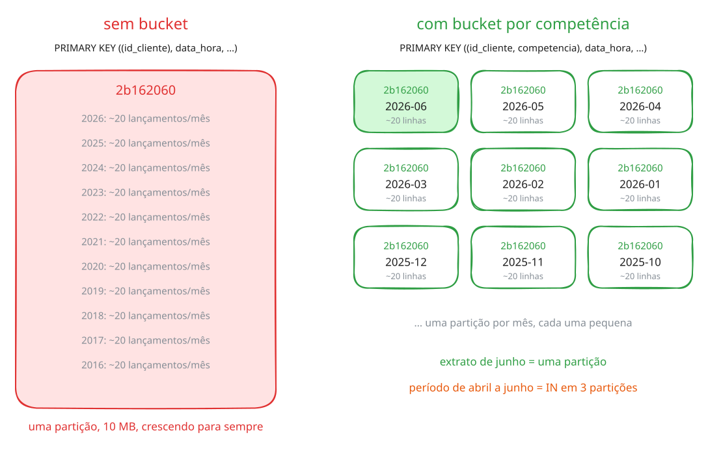

É o terceiro critério da seção 6, a **distribuição**: a chave precisa manter cada partição com tamanho limitado. É também o sentido negativo de *wide partition* que a seção 5 anunciou: a mesma partição de múltiplas linhas que é a força do modelo vira problema quando não tem limite.

#### O tamanho do problema, medido

Vamos construir a versão sem bucket e comparar. Primeiro a tabela:

```sh
# 8.f.1
cqlsh -e "
CREATE TABLE lab.lancamento_sem_bucket (
    id_cliente      text,
    data_hora       timestamp,
    id_lancamento   text,
    estabelecimento text,
    valor           float,
    PRIMARY KEY ((id_cliente), data_hora, id_lancamento)
) WITH CLUSTERING ORDER BY (data_hora DESC, id_lancamento ASC);"

```

Agora 200 mil lançamentos de **uma só cliente**, distribuídos em dez anos — o que um correntista ativo acumula em uma década:

```sh
# 8.f.2
LC_ALL=C awk 'BEGIN{
  srand(42);
  split("Supermercado,Restaurante,Farmácia,Padaria,Posto de gasolina", est, ",");
  print "id_cliente,data_hora,id_lancamento,estabelecimento,valor";
  for (i = 0; i < 200000; i++)
    printf "2b162060,%d,%08x,%s,%.2f\n", 1451606400000 + i * 1576800, i, est[int(rand()*5)+1], 10 + rand()*990;
}' > lancamentos.csv

```

```sh
# 8.f.3
cqlsh -e "COPY lab.lancamento_sem_bucket (id_cliente, data_hora, id_lancamento, estabelecimento, valor) FROM 'lancamentos.csv' WITH HEADER=TRUE;"

```

```
200000 rows imported from 1 files in 0 day, 0 hour, 0 minute, and 2.103 seconds (0 skipped).
```

> Duas coisas sobre esse `awk`. A coluna `data_hora` é gerada como **epoch em milissegundos** (`1451606400000` é 1º de janeiro de 2016), formato que o `COPY` aceita para colunas `timestamp` — assim não dependemos de nenhuma extensão de `awk` para formatar datas. E o `LC_ALL=C` não é enfeite: em locale brasileiro, `%.2f` imprime `395,46` com vírgula, o que quebraria o CSV em uma coluna a mais.

Force a descida para o disco:

```sh
# 8.f.4
nodetool flush lab lancamento_sem_bucket

```

E veja quantas SSTables a tabela tem:

```sh
# 8.f.5
ls -1 /var/lib/cassandra/data/lab/lancamento_sem_bucket-*/*-Data.db

```

```
.../nb-1-big-Data.db
.../nb-2-big-Data.db
```

Duas, e você só pediu um flush. A outra o Cassandra fez sozinho, no meio do `COPY`: 200 mil linhas não couberam no espaço reservado às memtables, e ele descarregou a maior delas para liberar memória. É o flush de 4.d acontecendo sem ninguém pedir (a seção 10 mostra esse ciclo em detalhe) — e agora a mesma partição está em dois arquivos. Para medi-la inteira, junte os dois:

```sh
# 8.f.6
nodetool compact lab lancamento_sem_bucket

```

Agora compare as duas tabelas:

```sh
# 8.f.7
nodetool tablestats lab.lancamento_sem_bucket

```

```
  Number of partitions (estimate): 1
  Compacted partition maximum bytes: 10090808
  Compacted partition mean bytes: 10090808
```

```sh
# 8.f.8
nodetool tablestats infobarbank.lancamentos_por_periodo

```

```
  Number of partitions (estimate): 91
  Compacted partition maximum bytes: 2759
  Compacted partition mean bytes: 934
```

| | partições | maior partição |
|---|---|---|
| sem bucket | 1 | 10.090.808 bytes |
| com bucket | 91 | 2.759 bytes |

Uma partição de **10 MB**, contra 2,7 KB. E isso com 200 mil linhas de **uma** cliente.

#### Onde o problema realmente aparece

Aqui está a parte que costuma surpreender. Uma leitura pontual dentro da partição gigante continua rápida:

```sh
# 8.f.9
cqlsh -e "SELECT count(*) FROM lab.lancamento_sem_bucket WHERE id_cliente='2b162060' AND data_hora >= '2020-06-01' AND data_hora < '2020-06-08';"

```

```
   384
```

Responde em meio segundo. O índice da partição mais as clustering keys levam direto ao trecho pedido, e o tamanho da partição quase não pesa. Já atravessar a partição inteira custa:

```sh
# 8.f.10
cqlsh -e "SELECT count(*) FROM lab.lancamento_sem_bucket WHERE id_cliente='2b162060';"

```

```
 200000
```

Três vezes mais lento — e com 200 mil linhas isso ainda é tolerável. Agora que houve leituras, o `tablehistograms` mostra a distribuição das duas tabelas lado a lado:

```sh
# 8.f.11
nodetool tablehistograms lab lancamento_sem_bucket

```

```
Percentile      Read Latency     Write Latency          SSTables    Partition Size        Cell Count
                    (micros)          (micros)                             (bytes)
50%                   215.00             35.00              1.00          10090808            454826
99%                   372.00           1916.00              1.00          10090808            454826
```

```sh
# 8.f.12
nodetool tablehistograms infobarbank lancamentos_por_periodo

```

```
50%                     0.00              0.00              0.00               770                50
99%                     0.00              0.00              0.00              2759               179
```

454 mil células numa partição contra 179, e uma partição que precisa de uma SSTable inteira para ser lida contra uma que o Cassandra resolve tão rápido que a latência fica abaixo da resolução do instrumento. O problema da partição gigante não está na leitura pontual; está em tudo que precisa **atravessá-la ou movê-la**:

- **Hotspot.** A partição inteira mora nas mesmas réplicas. Um cliente muito ativo concentra carga em poucos nós, e nenhum rebalanceamento resolve, porque partição não se divide.
- **Compactação e repair.** As duas operam sobre partições inteiras. Uma partição de gigabytes pressiona heap e GC em cada ciclo.
- **Leitura completa.** Em escala, ela deixa de ser lenta e passa a estourar o `read_request_timeout` — o servidor desiste antes de terminar.

A regra prática é manter partições **abaixo de ~100 MB**. Nossa partição de 10 MB está confortável; o que interessa é a trajetória: dez anos deram 10 MB para 200 mil linhas, então um cliente com dez vezes mais movimento encosta no teto, e um cliente corporativo o estoura.

#### O preço do bucketing

O bucket não é grátis, e o custo é na consulta. Com a competência na partition key, **não existe intervalo** na coluna de bucket:

> **Provoque este erro.**

```sh
# 8.f.13
cqlsh -e "SELECT competencia, data_hora FROM infobarbank.lancamentos_por_periodo WHERE id_cliente='2b162060' AND competencia >= '2026-04';"

```

```
InvalidRequest: ... "Cannot execute this query as it might involve data filtering..."
```

Faz sentido, pelo que você viu na seção 4: a partição vem de um hash, e hash não tem ordem. Não existe "as partições entre abril e junho". A saída é listar os buckets desejados:

```sh
# 8.f.14
cqlsh -e "
SELECT competencia, count(*)
FROM infobarbank.lancamentos_por_periodo
WHERE id_cliente='2b162060' AND competencia IN ('2026-04','2026-05','2026-06')
GROUP BY competencia;"

```

```
 competencia | count
-------------+-------
     2026-04 |    25
     2026-05 |    22
     2026-06 |    18
```

E para um período que atravessa buckets, combina-se `IN` no bucket com o intervalo na clustering key:

```sh
# 8.f.15
cqlsh -e "
SELECT competencia, count(*)
FROM infobarbank.lancamentos_por_periodo
WHERE id_cliente='2b162060' AND competencia IN ('2026-05','2026-06')
  AND data_hora >= '2026-05-20' AND data_hora < '2026-06-10'
GROUP BY competencia;"

```

```
 competencia | count
-------------+-------
     2026-05 |     4
     2026-06 |     4
```

Compare com a tabela sem bucket, onde o mesmo período é um intervalo só, sem que a aplicação precise saber de meses:

```sh
# 8.f.16
cqlsh -e "SELECT count(*) FROM lab.lancamento_sem_bucket WHERE id_cliente='2b162060' AND data_hora >= '2020-05-20' AND data_hora < '2020-06-10';"

```

```
   1150
```

**É essa a troca.** O bucket protege o tamanho da partição e cobra dois preços: a aplicação passa a ter de **calcular quais buckets** cobrem o período pedido, e `IN` numa partition key são **N leituras**, possivelmente em N nós, com o coordinator esperando pela mais lenta. Serve para N pequeno. Não serve para "os últimos dois anos" — isso são 24 partições, e a consulta certa aí é outra tabela, com outro bucket.

É também por isso que a tela de extrato do seu banco tem um **seletor de mês** em vez de um campo livre de datas. A interface do aplicativo é consequência do modelo de dados.

#### Escolhendo o tamanho do bucket

A conta é direta:

```
linhas por partição  ≈  taxa de escrita  ×  período do bucket
```

Com o teto de ~100 MB, e mirando algo entre dez mil e cem mil linhas por partição:

| Caso | Taxa de escrita | Bucket | Linhas por partição | |
|---|---|---|---|---|
| extrato bancário | ~20 por mês | mês | ~20 | ✓ |
| pedidos de e-commerce | ~20 por mês | mês | ~20 | ✓ |
| sensor IoT | 1 por segundo | mês | 2,6 milhões | ✗ |
| sensor IoT | 1 por segundo | dia | 86.400 | ✓ |
| ticks de mercado | 1.000 por segundo | hora | 3,6 milhões | ✗ |
| ticks de mercado | 1.000 por segundo | minuto | 60.000 | ✓ |

Erra-se para os **dois** lados. Bucket grande demais devolve o problema da partição gigante. Bucket pequeno demais gera partições demais, e toda consulta de período precisa de um `IN` com muitos valores — trocando um problema de tamanho por um de quantidade de leituras.

E note o que a primeira linha da tabela revela sobre o nosso próprio modelo: com ~20 lançamentos por mês, um bucket **anual** daria 240 linhas por partição, ainda minúsculo. Pelo critério de tamanho, o bucket mensal do `infobarbank` é mais fino do que precisaria ser. Ele foi escolhido para casar com a **consulta** — a tela mostra um mês. Granularidade de bucket se decide pelas duas coisas: o limite de tamanho e o padrão de acesso.

#### Bucket sem tempo

Quando não há dimensão temporal natural, usa-se um bucket **sintético**: `bucket = hash(alguma_coisa) % N`, gravado como coluna e incluído na partition key. Um catálogo com uma categoria de milhões de itens pode virar `((categoria, bucket), item)` com `N = 100`.

O custo muda de forma: como o bucket não tem significado, a leitura precisa consultar **todos os N** e juntar os resultados na aplicação. Isso faz de `N` uma decisão de modelagem — grande o bastante para dividir a partição, pequeno o bastante para a leitura não virar N consultas caras.

#### Onde mais o bucketing aparece neste laboratório

Agora que a técnica tem nome, ela fica visível em todo o material:

| Tabela | Partition key | Bucket |
|---|---|---|
| `infobarbank.lancamentos_por_periodo` e as três irmãs | `(id_cliente, competencia)` | mês |
| `infobarshop.pedidos_por_periodo`, `_status` e `_forma_pagamento` | `(id_cliente, competencia)` | mês |
| `infobarshop.pedidos_por_produto` | `(id_cliente, produto)` | **nenhum** |

A última é a interessante, porque é a exceção. Ela não tem bucket, e isso é escolha, não esquecimento.

O bucket resolve o tamanho da partição, mas cobra um preço na consulta: **quem lê precisa saber o período**. Isso é barato quando a tela mostra um mês — e é exatamente o que as outras fazem. Mas a pergunta que essa tabela responde é *"quantas vezes eu já comprei isto?"*, e o histórico de um produto é justamente a pergunta que **não** tem período em mãos. Com `competencia` na partição, seria uma leitura por mês.

Sem bucket, quem limita o tamanho é a cardinalidade natural do par: um cliente não compra a mesma geladeira dez mil vezes. Confira:

```sh
# 8.f.17
cqlsh -e "SELECT count(*) FROM infobarshop.pedidos_por_produto WHERE id_cliente='CLI-000001' AND produto='TABLET';"

```

Vinte e poucas linhas em doze competências — mesma ordem de grandeza das particionadas por mês. **Bucketing é uma troca, não uma regra:** só se paga o preço na consulta quando a partição cresceria sem limite.

Terminada a comparação, libere os 10 MB:

```sh
# 8.f.18
cqlsh -e "DROP TABLE lab.lancamento_sem_bucket;"

```

### 8.g. A mesma partição, quatro ordenações

Q3, Q5 e Q6 pedem os mesmos lançamentos da mesma cliente no mesmo mês. Só a forma de filtrar muda. A tentação é atender todas com uma tabela só — e o banco tentou. É a `lancamentos_cartao_credito`:

```sh
# 8.g.1
cqlsh -e "DESCRIBE TABLE infobarbank.lancamentos_cartao_credito;"

```

```
    PRIMARY KEY ((id_cliente, competencia), data_hora, id_produto, status, tipo_operacao, id_lancamento)
) WITH CLUSTERING ORDER BY (data_hora DESC, id_produto ASC, status ASC, tipo_operacao ASC, id_lancamento ASC)
```

Todas as colunas de filtro estão na chave. Serve à Q4, porque `data_hora` é a primeira clustering key. Agora a Q3, que filtra por situação:

> **Provoque este erro.**

```sh
# 8.g.2
cqlsh -e "
SELECT data_hora, status, valor FROM infobarbank.lancamentos_cartao_credito
WHERE id_cliente='2b162060' AND competencia='2026-06' AND status='APROVADA';"

```

```
InvalidRequest: ... "PRIMARY KEY column "status" cannot be restricted as preceding column "data_hora" is not restricted"
```

Ter a coluna na chave não basta: as clustering keys são uma **ordem**, e só a primeira serve de filtro livre. Uma tabela ordenada por data responde a perguntas sobre data. Para filtrar por situação, por cartão e por tipo, o banco precisou de **uma tabela para cada ordem**. Compare as chaves:

| Consulta | Tabela | PRIMARY KEY |
|---|---|---|
| Q4 por período | `lancamentos_por_periodo` | `((id_cliente, competencia), data_hora, id_lancamento)` |
| Q3 por situação | `lancamentos_por_status` | `((id_cliente, competencia), status, data_hora, id_lancamento)` |
| Q5 por cartão | `lancamentos_por_produto` | `((id_cliente, competencia), id_produto, data_hora, id_lancamento)` |
| Q6 por tipo | `lancamentos_por_tipo` | `((id_cliente, competencia), tipo_operacao, data_hora, id_lancamento)` |

**Partition key idêntica nas quatro. O que muda é a primeira clustering key.** É o mesmo dado, gravado quatro vezes, ordenado de quatro maneiras.

Q3 — últimos aprovados:

```sh
# 8.g.3
cqlsh -e "
SELECT status, data_hora, id_produto, estabelecimento, valor
FROM infobarbank.lancamentos_por_status
WHERE id_cliente='2b162060' AND competencia='2026-06' AND status='APROVADA'
LIMIT 5;"

```

```
 status   | data_hora                       | id_produto | estabelecimento    | valor
----------+---------------------------------+------------+--------------------+-----------
 APROVADA | 2026-06-27 17:46:39.942000+0000 |   2b162060 |  Posto de gasolina | 708.40997
 APROVADA | 2026-06-27 17:46:39.770000+0000 |   897199aa |    Salão de beleza | 835.98999
 APROVADA | 2026-06-25 17:46:42.420000+0000 |   2b162060 |    Salão de beleza |       936
 APROVADA | 2026-06-21 17:46:39.620000+0000 |   2b162060 | Loja de brinquedos | 727.70001
 APROVADA | 2026-06-19 17:46:39.360000+0000 |   2b162060 |    Salão de beleza |    654.87
```

Q5 — lançamentos de um cartão específico:

```sh
# 8.g.4
cqlsh -e "
SELECT id_produto, data_hora, estabelecimento, valor
FROM infobarbank.lancamentos_por_produto
WHERE id_cliente='2b162060' AND competencia='2026-06' AND id_produto='897199aa';"

```

```
 id_produto | data_hora                       | estabelecimento    | valor
------------+---------------------------------+--------------------+-----------
   897199aa | 2026-06-27 17:46:39.770000+0000 |    Salão de beleza | 835.98999
   897199aa | 2026-06-11 17:46:42.373000+0000 |       Supermercado | 529.60999
   897199aa | 2026-06-09 17:46:42.640000+0000 | Loja de brinquedos | 302.48001
   897199aa | 2026-06-08 17:46:40.793000+0000 |        Restaurante | 817.54999
   897199aa | 2026-06-01 17:46:42.085000+0000 |        Restaurante | 615.17999
```

`id_produto` é a conta ou o cartão que originou o lançamento — `897199aa` é um dos cartões que a Q2 listou.

Q6 — por tipo de operação:

```sh
# 8.g.5
cqlsh -e "
SELECT tipo_operacao, data_hora, estabelecimento, valor
FROM infobarbank.lancamentos_por_tipo
WHERE id_cliente='2b162060' AND competencia='2026-06' AND tipo_operacao='DEBITO'
LIMIT 4;"

```

```
 tipo_operacao | data_hora                       | estabelecimento    | valor
---------------+---------------------------------+--------------------+-----------
        DEBITO | 2026-06-27 17:46:39.942000+0000 |  Posto de gasolina | 708.40997
        DEBITO | 2026-06-27 17:46:39.770000+0000 |    Salão de beleza | 835.98999
        DEBITO | 2026-06-25 17:46:42.420000+0000 |    Salão de beleza |       936
        DEBITO | 2026-06-21 17:46:39.620000+0000 | Loja de brinquedos | 727.70001
```

`tipo_operacao` é a **direção contábil** do lançamento: `DEBITO` é saída de dinheiro, `CREDITO` é entrada — salário caindo na conta, estorno no cartão. Num extrato, entradas são naturalmente raras, então uma consulta filtrando `CREDITO` pode devolver poucas linhas ou nenhuma. Não é erro seu.

#### Ordenação: o critério que não dá erro

Nas quatro tabelas, a última clustering key antes do id é `data_hora`, em ordem decrescente. É isso que faz o `LIMIT 5` da Q3 devolver os cinco **mais recentes** sem `ORDER BY`. Veja o que acontece quando a chave é única mas não ordena pelo que a tela mostra. Na sua bancada, um extrato cuja clustering key é só o id do lançamento, gerado com `uuid()`:

```sh
# 8.g.6
cqlsh -e "
CREATE TABLE lab.extrato_por_uuid (
    id_cliente      text,
    competencia     text,
    id_lancamento   uuid,
    data_hora       timestamp,
    estabelecimento text,
    PRIMARY KEY ((id_cliente, competencia), id_lancamento)
);
INSERT INTO lab.extrato_por_uuid (id_cliente, competencia, id_lancamento, data_hora, estabelecimento) VALUES ('2b162060','2026-06',uuid(),'2026-06-01 10:00','Padaria');
INSERT INTO lab.extrato_por_uuid (id_cliente, competencia, id_lancamento, data_hora, estabelecimento) VALUES ('2b162060','2026-06',uuid(),'2026-06-08 10:00','Supermercado');
INSERT INTO lab.extrato_por_uuid (id_cliente, competencia, id_lancamento, data_hora, estabelecimento) VALUES ('2b162060','2026-06',uuid(),'2026-06-15 10:00','Farmácia');
INSERT INTO lab.extrato_por_uuid (id_cliente, competencia, id_lancamento, data_hora, estabelecimento) VALUES ('2b162060','2026-06',uuid(),'2026-06-22 10:00','Restaurante');
INSERT INTO lab.extrato_por_uuid (id_cliente, competencia, id_lancamento, data_hora, estabelecimento) VALUES ('2b162060','2026-06',uuid(),'2026-06-29 10:00','Posto de gasolina');"

```

A tela pede os três mais recentes:

```sh
# 8.g.7
cqlsh -e "SELECT data_hora, estabelecimento FROM lab.extrato_por_uuid WHERE id_cliente='2b162060' AND competencia='2026-06' LIMIT 3;"

```

```
 data_hora                       | estabelecimento
---------------------------------+-----------------
 2026-06-15 10:00:00.000000+0000 |        Farmácia
 2026-06-29 10:00:00.000000+0000 | Posto de gasolina
 2026-06-01 10:00:00.000000+0000 |         Padaria
```

Três linhas, numa ordem que não é a do tempo — a sua será outra, porque os `uuid()` são sorteados. A chave é única, nenhuma linha se perdeu, e mesmo assim a tela está errada: o `LIMIT 3` pegou as três primeiras **na ordem dos uuids**, que não significa nada para quem lê um extrato. E não há conserto na consulta:

> **Provoque este erro.**

```sh
# 8.g.8
cqlsh -e "SELECT data_hora, estabelecimento FROM lab.extrato_por_uuid WHERE id_cliente='2b162060' AND competencia='2026-06' ORDER BY data_hora DESC LIMIT 3;"

```

```
InvalidRequest: ... "Order by is currently only supported on the clustered columns of the PRIMARY KEY, got data_hora"
```

> **Ordenação.** A clustering key decide a ordem física das linhas, e a consulta só consegue devolver nessa ordem (ou na inversa). Se a tela mostra "mais recente primeiro", a data precisa estar na clustering key, antes do id.

```sh
# 8.g.9
cqlsh -e "DROP TABLE lab.extrato_por_uuid;"

```

### 8.h. Os erros que ensinam

Quatro tentativas que o Cassandra recusa. Cada mensagem diz algo diferente sobre a chave primária.

**Partition key composta pela metade.** A tabela pede `(id_cliente, competencia)`:

> **Provoque este erro.**

```sh
# 8.h.1
cqlsh -e "SELECT * FROM infobarbank.lancamentos_por_periodo WHERE id_cliente='2b162060';"

```

```
InvalidRequest: ... "Cannot execute this query as it might involve data filtering
and thus may have unpredictable performance..."
```

O hash é calculado sobre o par completo. Com metade da chave, o Cassandra não sabe calcular a partição — teria que procurar em todas. Guarde a diferença: **partition key composta exige todas as colunas**; clustering key, não.

**Clustering key sem a partition key.**

> **Provoque este erro.**

```sh
# 8.h.2
cqlsh -e "SELECT * FROM infobarbank.lancamentos_por_status WHERE status='APROVADA';"

```

```
InvalidRequest: ... "Cannot execute this query as it might involve data filtering..."
```

Mesma mensagem, outra causa. `status` ordena as linhas *dentro* da partição; sem saber a partição, essa ordenação não serve de nada.

**Pular uma clustering key.** Em `lancamentos_por_produto` a ordem é `id_produto`, depois `data_hora`. Tente filtrar a segunda sem a primeira:

> **Provoque este erro.**

```sh
# 8.h.3
cqlsh -e "
SELECT * FROM infobarbank.lancamentos_por_produto
WHERE id_cliente='2b162060' AND competencia='2026-06' AND data_hora>='2026-06-01';"

```

```
InvalidRequest: ... "PRIMARY KEY column "data_hora" cannot be restricted as
preceding column "id_produto" is not restricted"
```

Esta é a mensagem mais informativa das quatro, e vale decorar o princípio: as clustering keys formam uma ordem, como as palavras num dicionário. Você pode procurar por prefixo, não por meio. Filtrar `data_hora` sem `id_produto` seria procurar todas as palavras cuja segunda letra é "a".

**Ordenar por coluna que não é clustering key.**

> **Provoque este erro.**

```sh
# 8.h.4
cqlsh -e "
SELECT * FROM infobarbank.lancamentos_por_periodo
WHERE id_cliente='2b162060' AND competencia='2026-06'
ORDER BY valor DESC;"

```

```
InvalidRequest: ... "Order by is currently only supported on the clustered columns
of the PRIMARY KEY, got valor"
```

O Cassandra não ordena em tempo de consulta: ele **entrega** na ordem em que gravou. Querer os lançamentos por valor não é uma consulta diferente — é uma **tabela** diferente, com `valor` como clustering key. Foi exatamente esse raciocínio que produziu as quatro tabelas de 8.g.

### 8.i. O que o `ALLOW FILTERING` faz

O erro sugere `ALLOW FILTERING` desde a seção 3. Vamos ver o que ele custa, com o `TRACING` ligado.

Primeiro a consulta correta, com a partition key completa:

```sh
# 8.i.1
cqlsh -e "TRACING ON; SELECT count(*) FROM infobarbank.lancamentos_por_periodo WHERE id_cliente='2b162060' AND competencia='2026-06';"

```

Nas linhas do rastro, duas importam:

```
Executing single-partition query on lancamentos_por_periodo
Read 26 live rows and 0 tombstone cells
```

**Uma partição, 26 linhas lidas.** Agora a mesma pergunta, sem informar a cliente, forçando o filtro:

```sh
# 8.i.2
cqlsh -e "TRACING ON; SELECT count(*) FROM infobarbank.lancamentos_por_periodo WHERE competencia='2026-06' ALLOW FILTERING;"

```

```
Computing ranges to query
Submitting range requests on 17 ranges with a concurrency of 1 (172.8 rows per range expected)
Executing seq scan across 1 sstables for (min(-9223372036854775808), min(-9223372036854775808)]
Read 171 live rows and 0 tombstone cells
```

Não é mais uma consulta a uma partição: é uma **varredura sequencial** de todo o ring de tokens, de -2⁶³ a 2⁶³-1, para depois descartar o que não bate. Leu 171 linhas para devolver as que interessavam.

O relógio não vai te avisar: esta tabela tem mil linhas, e as duas consultas respondem instantaneamente. É por isso que o Cassandra recusa por padrão em vez de deixar você descobrir — a consulta que varre mil linhas em desenvolvimento varre mil vezes mais em produção, e nesse dia ela não é lenta, ela é uma varredura em todos os nós do cluster ao mesmo tempo.

> `ALLOW FILTERING` tem lugar legítimo: consulta administrativa pontual, exploração de dados, tabela pequena e limitada por natureza. O que ele não é: solução para uma consulta que a aplicação faz a cada requisição.

### 8.j. Monte o app

Você percorreu as sete consultas uma a uma. Agora junte tudo: o **app do infobarBank** é um emulador do aplicativo do banco, com as três telas da seção 6, que só funciona com as consultas que você escrever.

O app já está no ar: ele sobe junto com o ambiente, logo depois da carga das keyspaces. Abra no navegador o mesmo endereço do code-server, terminado em `/proxy/8000/`:

```
http://<IP-PUBLICO>:8080/proxy/8000/
```

Em execução local, `http://localhost:8080/proxy/8000/`. O code-server repassa o acesso ao app, sem abrir porta nova na AWS.

> Se a página não abrir, confira se o app subiu: `cat /var/log/lab/app.log` no terminal deve mostrar `App infobarBank no ar`. Logo após criar ou religar o ambiente, espere cerca de um minuto.

Como usar:

- **À esquerda, o celular.** Cada bloco da tela tem a etiqueta da consulta que o alimenta. Enquanto a consulta não existe, o bloco fica vazio.
- **À direita, a consulta selecionada:** o que a tela tem em mãos (`:id_cliente`, `:competencia`…), as colunas que ela precisa exibir e a caixa para o CQL. Use os parâmetros com dois-pontos, como no exemplo da caixa: o app executa a consulta como prepared statement, o mesmo recurso da seção 9.
- **Cada execução diz se o resultado confere** com o que a tela espera e quanto custou: quantas partições, quantas linhas lidas. Varredura e `ALLOW FILTERING` aparecem em âmbar — a tela até funciona, mas não é a resposta.
- **Navegue.** Toque num cartão, troque o mês, use os filtros, toque numa linha do extrato. Cada gesto muda o que a tela tem em mãos — e algumas consultas só ficam possíveis depois dele.

O objetivo é deixar as sete abas verdes. Se travar, o botão **Dica** dá duas pistas por consulta: primeiro a tabela, depois a forma do `WHERE`.

### 8.k. O que você deve conseguir explicar

- Os três critérios da chave, e um exemplo de chave que falha em cada um.
- A diferença entre partition key composta e múltiplas clustering keys — inclusive quais colunas cada uma exige na consulta.
- Por que `ORDER BY` só funciona em clustering key.
- Por que a tela de extrato do seu banco tem um seletor de mês.
- O que é bucketing, o que ele protege, o que ele cobra, e como escolher o período do bucket.
- Dado um `PRIMARY KEY`, qual consulta ele responde. E dada uma consulta, qual `PRIMARY KEY` ela pede.

**→ Próxima seção.** Todas as consultas até aqui foram digitadas no `cqlsh`. Nenhum aplicativo funciona assim. Vamos executar o mesmo fluxo Q1 a Q7 de dentro de uma aplicação Python.

---

## 9. O modelo visto pela aplicação

O fluxo Q1 a Q7 é a sequência de telas de um aplicativo. Até aqui você o executou digitando `cqlsh`. Vamos executá-lo como o aplicativo faz, com o driver Python oficial.

### 9.a. Preparando o ambiente

O driver oficial do Cassandra para Python, o `cassandra-driver`, já está instalado no ambiente — é o mesmo driver que o `cqlsh` usa por baixo. Não há `venv` nem `pip install` a fazer.

Uma diferença em relação à realidade: aqui a aplicação roda no mesmo container que o banco, por conveniência de laboratório. Em produção ela nunca mora no mesmo host do banco — e nada no código abaixo mudaria, a não ser o endereço.

A conexão vai para `127.0.0.1:9042`, a porta em que o nó atende:

```sh
# 9.a.1
python3 -c "
from cassandra.cluster import Cluster
cluster = Cluster(['127.0.0.1'])
session = cluster.connect('infobarbank')
print('conectado, versão:', session.execute('SELECT release_version FROM system.local').one().release_version)
cluster.shutdown()"

```

```
conectado, versão: 5.0.9
```

### 9.b. O fluxo aplicacional

Baixe a aplicação:

```sh
# 9.b.1
curl -sSO https://raw.githubusercontent.com/infobarbosa/cassandra-widecolumn-demo/main/driver_demo.py

```

```sh
# 9.b.2
python3 driver_demo.py

```

```
Cliente 2b162060 — MARIVALDA KANAMARY — competência 2026-06

Q1 · Dados da conta
  conta 2b162060  ATIVA    apelido MARIVALDA    saldo R$     100,00

Q2 · Cartões de crédito
  007c2c1c  ATIVO    5450 3799 9172 8454  limite R$   1.000,00  disponível R$     900,00
  897199aa  ATIVO    5576 8924 9861 7490  limite R$     200,00  disponível R$      50,00
  9a748c3c  INATIVO  5188 2716 2053 8850  limite R$     500,00  disponível R$     100,00

Q3 · Últimos lançamentos aprovados
  27/06 17:46  2b162060  Posto de gasolina    R$     708,41
  27/06 17:46  897199aa  Salão de beleza      R$     835,99
  25/06 17:46  2b162060  Salão de beleza      R$     936,00
  21/06 17:46  2b162060  Loja de brinquedos   R$     727,70
  19/06 17:46  2b162060  Salão de beleza      R$     654,87

Q4 · Extrato por período (dias 19 a 27)
  27/06 17:46  DEBITO   Posto de gasolina    R$     708,41
  [...]

Q7 · Detalhe do lançamento cc44552e
  27/06/2026 17:46  Posto de gasolina
  R$     708,41  APROVADA
  autenticação b2c5db0d-ec3c-4a13-b116-a44e1ffd8e41
```

Como na seção 8, os valores de Q1 e Q2 devem coincidir com os seus; os lançamentos de Q3 a Q7 são sorteados por ambiente.

Você pode passar outra cliente e outra competência:

```sh
# 9.b.3
python3 driver_demo.py 2b16242a

```

```sh
# 9.b.4
python3 driver_demo.py 2b162060 2026-05

```

> Sete das cinquenta clientes têm conta, cartões e lançamentos: `2b162060`, `2b16242a`, `2b16256a`, `2b16353c`, `2b1636ae`, `2b16396a` e `2b163bcc` — as mesmas personas da seção 3. Para as outras, o script avisa que não há lançamentos e encerra.

### 9.c. Leia o código

Abra o `driver_demo.py`. Três decisões nele merecem atenção.

**1. Prepared statements.** Cada consulta é preparada uma vez e executada com parâmetros:

```python
CONSULTAS = {
    "Q3": """
        SELECT data_hora, id_produto, estabelecimento, valor
        FROM lancamentos_por_status
        WHERE id_cliente = ? AND competencia = ? AND status = 'APROVADA'
        LIMIT 5
    """,
    ...
}

stmt = {nome: session.prepare(cql) for nome, cql in CONSULTAS.items()}
...
session.execute(stmt["Q3"], [id_cliente, competencia])
```

O ganho evidente é que o servidor analisa a consulta uma vez só. O ganho maior é que o driver passa a **conhecer a estrutura da consulta** — inclusive quais parâmetros formam a partition key.

Nunca monte CQL concatenando string. Além da injeção, você perde as duas vantagens acima.

**2. Política de balanceamento declarada.**

```python
perfil = ExecutionProfile(
    load_balancing_policy=TokenAwarePolicy(DCAwareRoundRobinPolicy(local_dc=DATACENTER)),
    consistency_level=ConsistencyLevel.LOCAL_ONE,
    request_timeout=15,
)
cluster = Cluster(CONTACT_POINTS, execution_profiles={EXEC_PROFILE_DEFAULT: perfil})
```

`TokenAwarePolicy` é onde as seções 4 e 9 se encontram. Com um prepared statement, o driver calcula o **token** da partition key ali mesmo, no cliente, e envia a consulta **direto para um nó que tem a réplica** — em vez de escolher um nó qualquer e obrigá-lo a intermediar. É o cálculo de `token(id_cliente)` que você fez na seção 4, agora sendo usado para rotear.

Com um nó isso não muda nada. É a configuração que se leva para produção, e o motivo pelo qual prepared statement é questão de desempenho, não só de segurança.

`DCAwareRoundRobinPolicy(local_dc=...)` mantém o tráfego no datacenter local. `ConsistencyLevel` e o comportamento de cada nível sob falha de réplica pertencem ao laboratório de cluster; aqui ficam declarados no perfil, onde a aplicação de verdade os define.

Se você omitir a política, o driver avisa:

```
Cluster.__init__ called with contact_points specified, but no load_balancing_policy.
In the next major version, this will raise an error; please specify a load-balancing policy.
```

**3. Parâmetro é tipado.**

```python
ano, mes = (int(parte) for parte in competencia.split("-"))
inicio = datetime(ano, mes, 19)
fim = datetime(ano, mes, 28)
```

No `cqlsh`, `data_hora >= '2026-06-19'` funciona: ele converte o literal. No driver, um parâmetro de prepared statement é tipado e verificado **no cliente**, antes de a consulta sair da máquina. Passar a string devolve:

```
TypeError: DateType arguments must be a datetime, date, or timestamp
```

### 9.d. O erro da seção 8, agora em Python

Repare em como o script descobre a competência:

```python
session.execute("SELECT DISTINCT id_cliente, competencia FROM lancamentos_por_periodo")
```

A tentativa natural seria filtrar pela cliente:

> **Provoque este erro.**

```sh
# 9.d.1
python3 -c "
from cassandra.cluster import Cluster
session = Cluster(['127.0.0.1']).connect('infobarbank')
session.execute(\"SELECT competencia FROM lancamentos_por_periodo WHERE id_cliente='2b162060'\")"

```

```
cassandra.InvalidRequest: Error from server: code=2200 [Invalid query]
message="Cannot execute this query as it might involve data filtering..."
```

É o primeiro erro de 8.h — partition key composta pela metade — agora como exceção Python. **O driver não protege de modelagem errada**, e não existe camada de abstração que resolva isso: as regras da seção 8 valem em qualquer linguagem.

O `SELECT DISTINCT` sobre as colunas da partition key é válido porque percorre o índice de partições, não os dados. Mas continua sendo conveniência de laboratório: percorrer todas as partições não escala. Um aplicativo de banco não descobre a competência — ele a recebe do seletor de mês da tela.

### 9.e. Paginação

Uma consulta que devolve muitas linhas não vem de uma vez. O driver busca por páginas, e a iteração vai pedindo as seguintes conforme você consome:

```sh
# 9.e.1
python3 -c "
from cassandra.cluster import Cluster
from cassandra.query import SimpleStatement
session = Cluster(['127.0.0.1']).connect('infobarbank')
stmt = SimpleStatement('SELECT id_lancamento, valor FROM lancamentos_detalhe', fetch_size=100)
resultado = session.execute(stmt)
paginas = 0
linhas = 0
while True:
    paginas += 1
    linhas += len(resultado.current_rows)
    if resultado.has_more_pages:
        resultado.fetch_next_page()
    else:
        break
print(f'{linhas} linhas em {paginas} páginas de 100')"

```

```
1000 linhas em 11 páginas de 100
```

Onze páginas para mil linhas em páginas de cem — a última vem vazia. O Cassandra devolve um *paging state* junto de cada página e não sabe que acabou até tentar buscar a seguinte: ele leu até completar cem linhas, guardou onde parou, e só na décima primeira tentativa descobriu que não havia mais nada. Não é desperdício relevante, mas explica a contagem.

O `fetch_size` padrão do driver é 5000. O que ele protege é a memória do **cliente** e o tempo de resposta do **coordinator**: sem paginação, uma consulta ampla obrigaria o nó a montar o resultado inteiro antes de enviar qualquer coisa.

Isso não torna consulta ampla aceitável. Paginar uma varredura continua sendo uma varredura — a seção 8.i vale igual. Paginação existe para o caso em que **uma partição legítima** tem muitas linhas.

### 9.f. Assíncrono

A tela de abertura do aplicativo precisa de Q1 e Q2 ao mesmo tempo. Executá-las em sequência soma as duas latências; disparadas juntas, custa a maior das duas:

```sh
# 9.f.1
python3 -c "
from cassandra.cluster import Cluster
session = Cluster(['127.0.0.1']).connect('infobarbank')
q1 = session.prepare('SELECT id_conta, saldo_disponivel FROM conta_corrente WHERE id_cliente = ?')
q2 = session.prepare('SELECT id_cartao, limite_disponivel FROM cartao_credito WHERE id_cliente = ?')
futuros = [session.execute_async(q1, ['2b162060']), session.execute_async(q2, ['2b162060'])]
conta, cartoes = [f.result() for f in futuros]
print('conta  :', conta.one().id_conta, conta.one().saldo_disponivel)
print('cartões:', [c.id_cartao for c in cartoes])"

```

```
conta  : 2b162060 100.0
cartões: ['007c2c1c', '897199aa', '9a748c3c']
```

`execute_async` devolve um future imediatamente; `result()` espera. Como cada consulta vai para uma partição diferente — e, em cluster, possivelmente para nós diferentes — o paralelismo é real.

Esse padrão é o que torna viável o modelo da Parte 2. Uma tela que precisa de dados de cinco tabelas faz cinco leituras pontuais em paralelo, e isso é mais rápido e mais previsível do que um `JOIN` de cinco tabelas em qualquer banco relacional. **A desnormalização da seção 7 não é um preço que se paga; é o que permite a leitura ser trivial.**

### 9.g. Como estragar um projeto com Cassandra

Tudo o que você viu até aqui cabe numa lista curta de erros. São os que mais aparecem em projeto real, e cada um tem uma seção deste laboratório como antídoto:

| Erro | Por que dá errado | Onde você viu |
|---|---|---|
| **Usar Cassandra porque outro time usou** | O banco é ótimo para um padrão de acesso e ruim para os outros. A escolha vem do problema, não da moda. | seção 1 |
| **Usar como banco relacional** | Normalizar e esperar `JOIN` leva a consultas que o Cassandra recusa, ou a `ALLOW FILTERING` em produção. | seções 7 e 8.i |
| **Começar pelo modelo lógico ou físico** | Sem o fluxo de telas, a chave é um chute, e chave errada só se corrige com tabela nova e migração de dados. | seção 6 |
| **Deixar a infraestrutura para depois** | Fator de replicação, datacenters e tamanho de partição são decididos na keyspace e na chave, no primeiro dia. | seções 2 e 8.f |
| **Pôr um balanceador de carga na frente** | O driver já sabe qual nó tem o dado (`TokenAwarePolicy`). Um balanceador esconde isso e acrescenta um salto a cada consulta. | acima, em "Leia o código" |
| **Desprezar monitoração e manutenção** | Partições grandes, tombstones acumulados e compactação atrasada não dão erro: só deixam tudo mais lento, até parar. | seções 10 e 8.f |

### 9.h. O que você deve conseguir explicar

- Por que prepared statement é questão de desempenho, e não só de segurança.
- O que `TokenAwarePolicy` faz com o resultado de `token(id_cliente)`.
- Por que uma modelagem errada erra igual em Python e no `cqlsh`.
- A diferença entre paginar uma partição grande e paginar uma varredura.
- Por que cinco leituras pontuais em paralelo podem ganhar de um `JOIN`.

**→ Parte 3.** O modelo está pronto e funcionando de dentro de uma aplicação. Falta ver o que ele vira no disco — inclusive a Gracimar, que você apagou na seção 3 e que ainda está lá.

---

# Parte 3 — Por dentro do disco

## 10. Do memtable ao disco

### 10.a. A bancada desta parte

Para olhar o disco com calma, refaça a `lab.cliente` como ela estava no fim da seção 3, sem nenhum arquivo de dados: as cinco clientes, o e-mail novo da Aldenora, a linha fantasma e as duas exclusões. Desde então as seções de modelagem criaram e apagaram outras tabelas, e o Cassandra pode ter descarregado parte disso para o disco por conta própria. Recriar a tabela garante que os arquivos que você vai abrir sejam os do texto.

```sh
# 10.a.1
cqlsh -e "
DROP TABLE IF EXISTS lab.cliente;
CREATE TABLE lab.cliente (
    id_cliente  text PRIMARY KEY,
    cpf         text,
    nome        text,
    sobrenome   text,
    email       text
);
INSERT INTO lab.cliente(id_cliente, cpf, nome, sobrenome, email) VALUES ('2b162060','987.539.360-60','MARIVALDA','KANAMARY','marivalda@bmail.com');
INSERT INTO lab.cliente(id_cliente, cpf, nome, sobrenome, email) VALUES ('2b16242a','124.554.260-50','JUCILENE','MOREIRA CRUZ','jucilene@bmail.com');
INSERT INTO lab.cliente(id_cliente, cpf, nome, sobrenome, email) VALUES ('2b16256a','324.873.000-51','GRACIMAR','BRASIL GUERRA','gracimar@bmail.com');
INSERT INTO lab.cliente(id_cliente, cpf, nome, sobrenome, email) VALUES ('2b16353c','598.131.330-74','ALDENORA','VIANA MOREIRA','aldenora@gmail.com');
INSERT INTO lab.cliente(id_cliente, cpf, nome, sobrenome, email) VALUES ('2b1636ae','797.399.520-03','VERA','LUCIA RODRIGUES SENA','vera@bmail.com');
UPDATE lab.cliente SET email = 'aldenora.moreira@bmail.com' WHERE id_cliente = '2b16353c';
UPDATE lab.cliente SET nome = 'FANTASMA' WHERE id_cliente = 'NAO-EXISTE';
DELETE FROM lab.cliente WHERE id_cliente = 'NAO-EXISTE';
DELETE FROM lab.cliente WHERE id_cliente = '2b16256a';"

```

### 10.b. Colunar não é wide-column

A seção 1 avisou que wide-column e colunar são coisas diferentes. A diferença é a forma como cada um grava no disco:

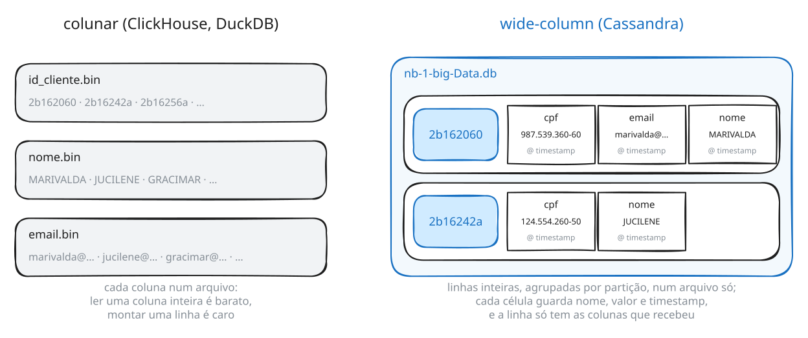

Um banco **colunar** guarda cada coluna separada, e por isso é ótimo para somar uma coluna de bilhões de linhas — o caso analítico. Um banco **wide-column** guarda a linha inteira junta, agrupada por partição, e por isso é ótimo para buscar tudo sobre uma chave — o caso do aplicativo. Nesta seção você vai abrir esse arquivo e ver exatamente o desenho da direita.

### 10.c. O caminho da escrita

Quando você executa um `INSERT`, o Cassandra faz duas coisas e só então responde:

1. gravou a operação no fim do **commit log**, um arquivo sequencial;
2. aplicou a mudança na **memtable**, uma estrutura em memória.

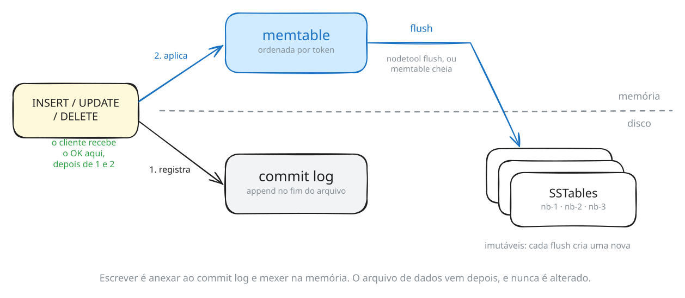

Só isso. Nenhuma escrita em arquivo de dados, nenhuma leitura do que já existia, nenhuma procura por onde encaixar a linha. É por esse motivo que a escrita no Cassandra é rápida — e é por isso que ela é rápida *igualmente*, com dez linhas ou dez bilhões.

Nesta seção vamos acompanhar o resto do caminho: da memtable até o disco, e daí até a compactação.

Os arquivos do Cassandra ficam em `/var/lib/cassandra`, e o seu usuário pode lê-los sem `sudo`: ele pertence ao grupo `cassandra`, dono desses diretórios.

### 10.d. Onde a tabela mora no disco

```sh
# 10.d.1
DIR=$(ls -rtd /var/lib/cassandra/data/lab/cliente-* | tail -1)
echo $DIR

```

```
/var/lib/cassandra/data/lab/cliente-547a6700885d11f192528d1521edebb1
```

O caminho é `keyspace/tabela-uuid`, e o UUID é sorteado na criação da tabela — o do seu ambiente será outro. Guardamos em `$DIR` para não repetir esse nome enorme.

> O `| tail -1` não é decoração. Um `DROP TABLE` não remove o diretório: ele guarda um snapshot e deixa a pasta antiga no lugar. Se você recriar a tabela, passam a existir dois diretórios `cliente-*`, e sem o `tail -1` a variável receberia os dois caminhos de uma vez. Pegando sempre o mais recente, o comando funciona quantas vezes você repetir esta seção.

```sh
# 10.d.2
ls -la $DIR

```

```
total 8
drwxr-x--- 2 cassandra cassandra 4096 Oct 10 10:03 .
drwxr-x--- 3 cassandra cassandra 4096 Oct 10 10:03 ..
```

**Vazio.** Você inseriu cinco clientes, atualizou um, apagou dois, e consultou tudo isso com sucesso — e não existe um único arquivo de dados. Onde está?

### 10.e. No commit log

```sh
# 10.e.1
ls -la /var/lib/cassandra/commitlog/

```

```
-rw-r----- 1 cassandra cassandra 33554432 Oct 10 10:03 CommitLog-7-1791626562385.log
-rw-r----- 1 cassandra cassandra 33554432 Oct 10 10:02 CommitLog-7-1791626562386.log
```

Os 32 MB de cada arquivo são **pré-alocados**: o tamanho não diz nada sobre quanto dado existe. O Cassandra reserva o espaço adiantado justamente para que a escrita seja uma gravação sequencial no fim de um arquivo que já está lá.

Procure algo que só existe por causa do que você fez na seção 3, e repetiu em 10.a — a linha fantasma do upsert:

```sh
# 10.e.2
grep --text -o 'FANTASMA' /var/lib/cassandra/commitlog/*.log

```

```
/var/lib/cassandra/commitlog/CommitLog-7-1791626562385.log:FANTASMA
```

O `grep` informa em qual dos arquivos encontrou — os nomes serão outros no seu ambiente, porque incluem o instante de criação do segmento. E o e-mail que você atualizou:

```sh
# 10.e.3
grep --text -o 'aldenora.moreira@bmail.com' /var/lib/cassandra/commitlog/*.log

```

```
/var/lib/cassandra/commitlog/CommitLog-7-1791626562385.log:aldenora.moreira@bmail.com
```

Está tudo ali, em texto claro. Agora experimente com um nome:

```sh
# 10.e.4
grep -c --text 'MARIVALDA' /var/lib/cassandra/commitlog/*.log

```

```
/var/lib/cassandra/commitlog/CommitLog-7-1792866260265.log:1
/var/lib/cassandra/commitlog/CommitLog-7-1792866260266.log:0
```

Uma ocorrência: a Marivalda que você acabou de inserir. Mas repare nos nomes dos arquivos: nenhum deles é da `lab.cliente`. **O commit log é do nó, não da tabela.** Ele recebe as escritas de todas as tabelas de todas as keyspaces, num único fluxo sequencial.

Isso responde por que a escrita não fica mais lenta conforme você cria tabelas: há um só arquivo recebendo tudo, e nunca uma busca por posição.

> O número no seu ambiente pode ser maior. O commit log não é histórico permanente: quando todas as tabelas de um segmento já descarregaram seus dados em SSTables, o Cassandra recicla aquele segmento. Logo depois de o ambiente subir, a Marivalda aparece várias vezes, porque ela também é cliente do `infobarbank` e da infobarShop, carregadas no primeiro boot; a esta altura do laboratório, essas escritas já foram descarregadas e os segmentos reciclados. É a mesma lição vista de outro ângulo: o commit log existe para sobreviver a uma queda, não para guardar histórico.

> **Durabilidade.** Se o processo morrer agora, a memtable se perde — mas o commit log não. Na volta, o Cassandra o relê e reconstrói a memtable. É esse arquivo que faz da escrita algo confirmado, não o arquivo de dados.

### 10.f. Ciclo 1 — o flush

`nodetool flush` força a memtable a descer para o disco:

```sh
# 10.f.1
nodetool flush lab cliente

```

```sh
# 10.f.2
ls -la $DIR

```

```
total 44
drwxr-x--- 2 cassandra cassandra 4096 Oct 10 10:03 .
drwxr-x--- 3 cassandra cassandra 4096 Oct 10 10:03 ..
-rw-r----- 1 cassandra cassandra   47 Oct 10 10:03 nb-1-big-CompressionInfo.db
-rw-r----- 1 cassandra cassandra  338 Oct 10 10:03 nb-1-big-Data.db
-rw-r----- 1 cassandra cassandra   10 Oct 10 10:03 nb-1-big-Digest.crc32
-rw-r----- 1 cassandra cassandra   24 Oct 10 10:03 nb-1-big-Filter.db
-rw-r----- 1 cassandra cassandra   78 Oct 10 10:03 nb-1-big-Index.db
-rw-r----- 1 cassandra cassandra 4973 Oct 10 10:03 nb-1-big-Statistics.db
-rw-r----- 1 cassandra cassandra   68 Oct 10 10:03 nb-1-big-Summary.db
-rw-r----- 1 cassandra cassandra   92 Oct 10 10:03 nb-1-big-TOC.txt
```

> O `Data.db` do seu ambiente pode ter um ou dois bytes de diferença. Os timestamps de cada escrita são gravados dentro do arquivo, em codificação de largura variável, e a sua execução aconteceu em outro instante.

Oito arquivos, todos com o prefixo `nb-1-big`. Juntos eles formam **uma SSTable**:

| Componente | Conteúdo |
|---|---|
| `Data.db` | as linhas propriamente ditas |
| `Index.db` | de cada partition key para a posição dela no `Data.db` |
| `Summary.db` | uma amostra do `Index.db`, mantida em memória |
| `Filter.db` | o *bloom filter*: responde, sem tocar no disco, "esta chave **certamente não** está aqui" |
| `CompressionInfo.db` | mapa dos blocos comprimidos, para conseguir ler um pedaço sem descomprimir tudo |
| `Statistics.db` | metadados: menor e maior timestamp, faixa de tokens, histogramas |
| `Digest.crc32` | checksum do `Data.db` |
| `TOC.txt` | a lista dos componentes acima |

### 10.g. O que existe dentro do `Data.db`

São pouco mais de trezentos bytes. Cabe inteiro na tela:

```sh
# 10.g.1
od -A d -t x1z -v $DIR/nb-1-big-Data.db

```

```
0000000 99 01 00 00 f2 01 00 08 32 62 31 36 33 36 61 65  >........2b1636ae<
0000016 7f ff ff ff 80 00 01 00 f2 33 24 3f 16 8a 8f 08  >.........3$?....<
0000032 0e 37 39 37 2e 33 39 39 2e 35 32 30 2d 30 33 08  >.797.399.520-03.<
0000048 0e 76 65 72 61 40 62 6d 61 69 6c 2e 63 6f 6d 08  >.vera@bmail.com.<
0000064 04 56 45 52 41 08 14 4c 55 43 49 41 20 52 4f 44  >.VERA..LUCIA ROD<
0000080 52 49 47 55 45 53 20 53 45 4e 41 01 58 00 4b 32  >RIGUES SENA.X.K2<
0000096 34 32 61 58 00 f7 0d 83 94 08 0e 31 32 34 2e 35  >42aX.......124.5<
0000112 35 34 2e 32 36 30 2d 35 30 08 12 6a 75 63 69 6c  >54.260-50..jucil<
0000128 65 6e 65 5c 00 f4 21 08 4a 55 43 49 4c 45 4e 45  >ene\..!.JUCILENE<
0000144 08 0c 4d 4f 52 45 49 52 41 20 43 52 55 5a 01 00  >..MOREIRA CRUZ..<
0000160 0a 4e 41 4f 2d 45 58 49 53 54 45 6a 65 0b 8b 00  >.NAO-EXISTEje...<
0000176 06 57 74 53 69 9b c3 71 00 35 35 36 61 17 00 33  >.WtSi..q.556a..3<
[... 10 linhas ...]
0000320 4c 44 41 08 08 4b 41 4e 41 4d 41 52 59 01 5c 28  >LDA..KANAMARY.\(<
0000336 8e a6                                            >..<
0000338
```

Três coisas nesse despejo.

**A primeira linha começa com `2b1636ae`**, a Vera — não a Marivalda, que foi a primeira a ser inserida. É a ordem de token da seção 4, agora materializada em bytes. Esse é o primeiro **S** de SSTable: *Sorted*.

**`NAO-EXISTE` está lá, no offset 160**, e note que depois da chave não vem CPF, nem nome, nem e-mail. Você apagou aquela linha. Ela continua no arquivo, sem conteúdo.

**Tudo legível.** CPF, e-mail e nome completo em texto claro, sem nenhum esforço para lê-los. O `LZ4Compressor` que apareceu no `DESCRIBE TABLE` comprime, mas não cifra — e comprime por blocos, então trechos ficam intactos. Se dado sensível precisa estar cifrado em repouso, isso é configuração de disco ou de sistema de arquivos, não algo que o Cassandra faça por você.

> O `hexdump -C $DIR/nb-1-big-Data.db` produz uma saída equivalente, também disponível no ambiente. Usamos `od` porque ele existe em qualquer Linux, inclusive nos servidores em que você não pode instalar nada.

### 10.h. O tombstone

O hexadecimal mostra que a linha apagada está no arquivo. Para ver **o que** ela guarda, existe uma ferramenta melhor, que traduz a SSTable para JSON:

```sh
# 10.h.1
sstabledump $DIR/nb-1-big-Data.db

```

Procure a Gracimar, `2b16256a`, e a linha fantasma:

```json
  {
    "partition" : {
      "key" : [ "NAO-EXISTE" ],
      "position" : 200,
      "deletion_info" : { "marked_deleted" : "2026-07-25T19:16:27.516867Z", "local_delete_time" : "2026-07-25T19:16:27Z" }
    },
    "rows" : [ ]
  },
  {
    "partition" : {
      "key" : [ "2b16256a" ],
      "position" : 223,
      "deletion_info" : { "marked_deleted" : "2026-07-25T19:16:27.951731Z", "local_delete_time" : "2026-07-25T19:16:27Z" }
    },
    "rows" : [ ]
  },
```

Aqui está a promessa da seção 3, cumprida. A Gracimar não foi apagada: o `DELETE` **escreveu** um registro novo, uma marca de exclusão com data e hora, e é isso que se chama **tombstone**. `"rows" : [ ]` — a partição existe, sem linhas vivas.

Faz sentido, dado tudo o que você viu: apagar de verdade exigiria localizar o dado e reescrever o arquivo. Num sistema em que arquivo de dados nunca é modificado, apagar é mais uma escrita. O `SELECT` da seção 3 devolveu vazio porque a leitura encontrou o tombstone e o respeitou.

### 10.i. Ciclo 2 — arquivo de dados não se altera

Insira mais duas clientes:

```sh
# 10.i.1
cqlsh -e "
INSERT INTO lab.cliente(id_cliente, cpf, nome, sobrenome, email) VALUES ('2b16396a','661.428.060-00','IVONE','GLAUCIA VIANA DUTRA','ivone@bmail.com');
INSERT INTO lab.cliente(id_cliente, cpf, nome, sobrenome, email) VALUES ('2b163bcc','190.523.300-00','LUCILIA','ROSA LIMA PEREIRA','lucilia@yahoo.com');"

```

O arquivo que já existe mudou?

```sh
# 10.i.2
ls -l $DIR/nb-1-big-Data.db; grep -c --text IVONE $DIR/nb-1-big-Data.db

```

```
-rw-r----- 1 cassandra cassandra 338 Oct 10 10:03 .../nb-1-big-Data.db
0
```

Mesmo tamanho, mesmo horário, e a Ivone não está nele. Agora um novo flush:

```sh
# 10.i.3
nodetool flush lab cliente

```

```sh
# 10.i.4
ls -1 $DIR/*-Data.db

```

```
.../nb-1-big-Data.db
.../nb-2-big-Data.db
```

**SSTable é imutável.** Uma vez escrita, nunca é alterada — só criada ou removida. Todo flush produz uma nova.

Isso tem uma consequência incômoda: a mesma partição pode ter pedaços em várias SSTables, e uma leitura precisaria, em princípio, procurar em todas. É para evitar isso que existe o `Filter.db`, o bloom filter: antes de tocar no disco, o Cassandra pergunta a ele se aquela chave *pode* estar naquela SSTable, e na maioria das vezes a resposta é um "não" que custa nada.

Mas o número de arquivos não pode crescer para sempre.

### 10.j. Ciclo 3 — compactação

Vamos atualizar o sobrenome da Marivalda para algo bem grande, de modo que fique fácil de achar no disco:

```sh
# 10.j.1
cqlsh -e "
UPDATE lab.cliente
SET sobrenome = 'DE ALCÂNTARA FRANCISCO ANTÔNIO JOÃO CARLOS XAVIER DE PAULA MIGUEL RAFAEL JOAQUIM JOSÉ GONZAGA PASCOAL CIPRIANO SERAFIM DE BRAGANÇA E BOURBON KANAMARY'
WHERE id_cliente = '2b162060';"

```

```sh
# 10.j.2
nodetool flush lab cliente

```

```sh
# 10.j.3
ls -l $DIR/*-Data.db | awk '{print $5, $NF}'

```

```
338 .../nb-1-big-Data.db
171 .../nb-2-big-Data.db
193 .../nb-3-big-Data.db
```

Três arquivos. E agora existem **duas versões do sobrenome da Marivalda no disco**: o `KANAMARY` original no `nb-1` e o nome comprido no `nb-3`. Olhe o `nb-3` inteiro — são menos de duzentos bytes:

```sh
# 10.j.4
od -A d -t x1z -v $DIR/nb-3-big-Data.db

```

```
0000000 b9 00 00 00 f2 01 00 08 32 62 31 36 32 30 36 30  >........2b162060<
0000016 7f ff ff ff 80 00 01 00 f0 73 20 80 9f 16 00 00  >.........s .....<
0000032 80 9a 44 45 20 41 4c 43 c3 82 4e 54 41 52 41 20  >..DE ALC..NTARA <
0000048 46 52 41 4e 43 49 53 43 4f 20 41 4e 54 c3 94 4e  >FRANCISCO ANT..N<
[... 5 linhas ...]
0000144 49 41 4e 4f 20 53 45 52 41 46 49 4d 46 00 f0 0e  >IANO SERAFIMF...<
0000160 42 52 41 47 41 4e c3 87 41 20 45 20 42 4f 55 52  >BRAGAN..A E BOUR<
0000176 42 4f 4e 20 4b 41 4e 41 4d 41 52 59 01 aa be 6a  >BON KANAMARY...j<
0000192 fa                                               >.<
0000193
```

A chave `2b162060` e o sobrenome novo. **Só isso**: nem CPF, nem nome, nem e-mail. Compare com o despejo do `nb-1` no Ciclo 1, que tinha a linha inteira de cada cliente.

> O trecho `SERAFIMF...BRAGAN` não é dado corrompido. Onde deveria estar `SERAFIM DE BRAGANÇA`, o LZ4 trocou o `DE ` — que já tinha aparecido no começo do sobrenome — por uma referência ao trecho anterior. É a compressão por blocos do Ciclo 1: ela encurta repetições e deixa o resto legível.

O `sstabledump` mostra o mesmo de forma legível:

```sh
# 10.j.5
sstabledump $DIR/nb-3-big-Data.db

```

```json
    "partition" : {
      "key" : [ "2b162060" ],
      "position" : 22
    },
    "rows" : [
      {
        "type" : "row",
        "position" : 22,
        "cells" : [
          { "name" : "sobrenome", "value" : "DE ALCÂNTARA [...] BOURBON KANAMARY", "tstamp" : "2026-07-25T19:16:32.571401Z" }
        ]
      }
    ]
```

Uma linha com **uma célula**. O `UPDATE` gravou só o que mudou. É isso que se chama de **colunas esparsas**: uma SSTable guarda as células que foram escritas, não a linha inteira, e cada linha tem só as colunas que recebeu. A linha completa da Marivalda não existe em nenhum arquivo: ela é montada na leitura, juntando as células do `nb-1` e do `nb-3`.

A leitura resolve isso comparando timestamps e devolvendo o valor mais recente — o que funciona, mas custa. Cedo ou tarde é preciso consolidar. Normalmente o Cassandra faz isso sozinho, por conta da `SizeTieredCompactionStrategy` que apareceu no `DESCRIBE TABLE`; aqui vamos forçar:

```sh
# 10.j.6
nodetool compact lab cliente

```

```sh
# 10.j.7
ls -l $DIR/*-Data.db | awk '{print $5, $NF}'

```

```
630 .../nb-4-big-Data.db
```

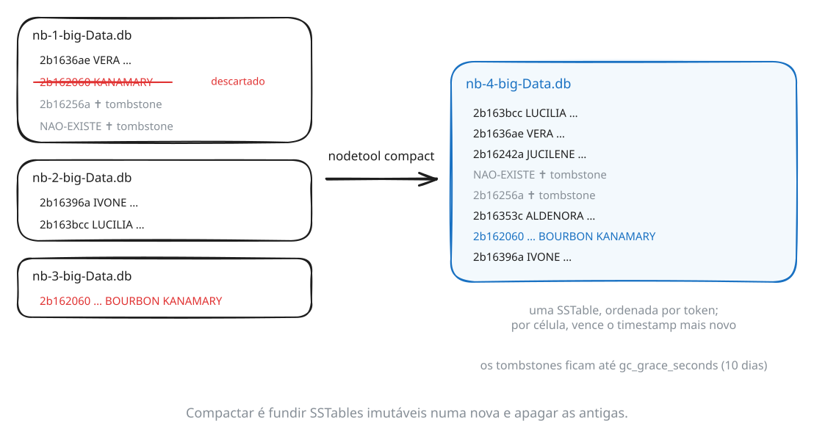

Três arquivos viraram um. Isso é **compactação**, e o conceito por trás dela é a [Log-structured merge-tree](https://en.wikipedia.org/wiki/Log-structured_merge-tree), a **LSM tree**: escreve-se sempre em arquivo novo, e a consolidação acontece depois, em segundo plano.

> Se a numeração do seu ambiente for diferente de `nb-1` a `nb-4`, é porque houve algum flush a mais. Use os nomes que o `ls` mostrar.

Veja o que sobrou da Marivalda:

```sh
# 10.j.8
sstabledump $DIR/nb-4-big-Data.db

```

```json
      "key" : [ "2b162060" ],
      "position" : 439
    },
    "rows" : [
      {
        "type" : "row",
        "liveness_info" : { "tstamp" : "2026-07-25T19:16:26.203224Z" },
        "cells" : [
          { "name" : "cpf", "value" : "987.539.360-60" },
          { "name" : "email", "value" : "marivalda@bmail.com" },
          { "name" : "nome", "value" : "MARIVALDA" },
          { "name" : "sobrenome", "value" : "DE ALCÂNTARA [...] BOURBON KANAMARY", "tstamp" : "2026-07-25T19:16:32.571401Z" }
        ]
      }
    ]
```

Uma única célula `sobrenome`, com o valor novo. E repare no detalhe: ela tem **timestamp próprio**, `19:16:32`, diferente do `liveness_info` da linha, `19:16:26`. O timestamp no Cassandra é por célula, não por linha — o que explica como a compactação resolveu o conflito sem precisar de nada além dos próprios arquivos: para cada célula, vence a escrita mais recente.

### 10.k. O tombstone que sobreviveu

```sh
# 10.k.1
sstabledump $DIR/nb-4-big-Data.db | grep -B3 deletion_info

```

```json
      "key" : [ "NAO-EXISTE" ],
      "deletion_info" : { "marked_deleted" : "2026-07-25T19:16:27.516867Z", ... }
      "key" : [ "2b16256a" ],
      "deletion_info" : { "marked_deleted" : "2026-07-25T19:16:27.951731Z", ... }
```

A compactação descartou o sobrenome antigo da Marivalda, mas **manteve os dois tombstones**. Por quê?

```sh
# 10.k.2
cqlsh -e "SELECT gc_grace_seconds FROM system_schema.tables WHERE keyspace_name='lab' AND table_name='cliente';"

```

```
 gc_grace_seconds
------------------
           864000
```

864.000 segundos são **dez dias** — a terceira opção que separamos no `DESCRIBE TABLE` da seção 3. Antes desse prazo, nenhuma compactação remove um tombstone.

A razão está num cluster, não aqui. Imagine três réplicas e uma delas fora do ar no momento do `DELETE`. Quando ela voltar, ainda terá a Gracimar. Se as outras duas já tivessem descartado o tombstone, a réplica atrasada espalharia a linha de volta — o registro apagado ressuscitaria. O tombstone precisa sobreviver o tempo suficiente para que o `nodetool repair` o propague a todas as réplicas.

O preço de um tombstone é ocupar espaço e ser lido junto com o dado vivo. Uma tabela que apaga muito acumula tombstones, e leituras que atravessam milhares deles ficam lentas — é um dos problemas de desempenho mais comuns em Cassandra, e vem de decisões de modelagem, não de configuração.

### 10.l. A wide partition no disco

Volte à `lab.cartao_credito` da seção 5, com os três cartões da Marivalda e o da Jucilene. Lá a ordem por `id_cartao` apareceu sem `ORDER BY`, e o texto afirmou que ela é a ordem em que o dado está gravado. Mande a tabela para o disco e confira:

```sh
# 10.l.1
nodetool flush lab cartao_credito

```

```sh
# 10.l.2
DIR_CARTAO=$(ls -rtd /var/lib/cassandra/data/lab/cartao_credito-* | tail -1)
sstabledump $DIR_CARTAO/*-Data.db

```

O resultado tem **duas partições**, não quatro — e a da Jucilene vem primeiro, porque as partições ficam em ordem de token (seção 4). A da Marivalda:

```json
    "partition" : {
      "key" : [ "2b162060" ],
      "position" : 86
    },
    "rows" : [
      {
        "type" : "row",
        "clustering" : [ "007c2c1c" ],
        "cells" : [ ... ]
      },
      {
        "type" : "row",
        "clustering" : [ "897199aa" ],
        "cells" : [ ... ]
      },
      {
        "type" : "row",
        "clustering" : [ "9a748c3c" ],
        "cells" : [ ... ]
      }
    ]
```

> O `| tail -1` é o mesmo truque de 10.d: cada `DROP TABLE` da seção 5 deixou para trás o diretório de uma tentativa anterior, e queremos o mais recente.

Uma `key`, três `rows`, cada uma com o seu `clustering`: o desenho da seção 5, agora em bytes. A wide partition não é uma visão da consulta. É assim que as linhas da Marivalda moram no arquivo — juntas e em ordem, prontas para serem lidas de uma vez.

### 10.m. O que você deve conseguir explicar

- Por que a escrita é rápida, e por que não fica mais lenta com o volume.
- Por que o dado aparece na consulta antes de existir arquivo de dados, e o que garante que ele não se perca.
- O que significa cada **S** de SSTable, e por que arquivos imutáveis exigem compactação.
- Por que `DELETE` é uma escrita, e o que `gc_grace_seconds` protege.
- Por que dado sensível em Cassandra não está protegido por padrão.
- Onde uma *wide partition* aparece no `sstabledump`.

**→ Próxima seção.** Duas novidades da versão 5 mexem exatamente no que você acabou de ver: um índice que mora dentro da SSTable e uma nova estratégia de compactação.

---

## 11. Cassandra 5: SAI e UCS

Duas novidades da versão 5 mexem exatamente no que você viu nas seções 10 e 8.

### 11.a. SAI — Storage Attached Index

Volte à consulta que falhou na seção 3:

> **Provoque este erro.**

```sh
# 11.a.1
cqlsh -e "SELECT nome, sobrenome FROM lab.cliente WHERE nome='MARIVALDA';"

```

```
InvalidRequest: ... "Cannot execute this query as it might involve data filtering..."
```

Agora crie um índice sobre `nome`:

```sh
# 11.a.2
cqlsh -e "CREATE INDEX cliente_nome_sai ON lab.cliente(nome) USING 'sai';"

```

E repita a consulta:

```sh
# 11.a.3
cqlsh -e "SELECT id_cliente, nome, sobrenome FROM lab.cliente WHERE nome='MARIVALDA';"

```

```
 id_cliente | nome      | sobrenome
------------+-----------+--------------------------------------------------
   2b162060 | MARIVALDA | DE ALCÂNTARA FRANCISCO ANTÔNIO [...] KANAMARY

(1 rows)
```

Funciona. O `USING 'sai'` seleciona o **Storage Attached Index**, que na versão 5 substituiu os índices secundários antigos — mais rápidos para escrever, muito menos custosos em memória, e com suporte a mais tipos de consulta.

O nome não é decorativo: o índice está *anexado ao armazenamento*. Veja o que apareceu no diretório da tabela:

```sh
# 11.a.4
ls -1 $DIR | grep SAI

```

> Se o comando não devolver nada, é porque `$DIR` foi definida na seção 10 e você está em outro terminal. Redefina:
> ```sh
> DIR=$(ls -rtd /var/lib/cassandra/data/lab/cliente-* | tail -1)
> ```

```
nb-4-big-SAI+aa+GroupComplete.db
nb-4-big-SAI+aa+GroupMeta.db
nb-4-big-SAI+aa+PartitionKeyBlockOffsets.db
nb-4-big-SAI+aa+PartitionKeyBlocks.db
nb-4-big-SAI+aa+PartitionToSize.db
nb-4-big-SAI+aa+RowToPartition.db
nb-4-big-SAI+aa+RowToToken.db
nb-4-big-SAI+aa+cliente_nome_sai+ColumnComplete.db
nb-4-big-SAI+aa+cliente_nome_sai+Meta.db
nb-4-big-SAI+aa+cliente_nome_sai+PostingLists.db
nb-4-big-SAI+aa+cliente_nome_sai+TermsData.db
```

Onze componentes novos, todos da `nb-4`, com o prefixo da SSTable que você já conhece. Os quatro últimos trazem o nome do índice; os sete primeiros são estrutura compartilhada, reaproveitável por outros índices SAI na mesma tabela. O índice é parte da SSTable, e é reconstruído a cada flush e a cada compactação — junto do dado, pelo mesmo mecanismo da seção 10. Índice não é grátis: custa disco e custa em cada escrita.

#### Por que isso não substitui a modelagem

Ligue o `TRACING` e leia com cuidado:

```sh
# 11.a.5
cqlsh -e "TRACING ON; SELECT id_cliente, nome FROM lab.cliente WHERE nome='MARIVALDA';"

```

```
Index mean cardinalities are cliente_nome_sai:9223372036854775807. Scanning with cliente_nome_sai.
Computing ranges to query
Submitting range requests on 17 ranges with a concurrency of 17
Executing read on lab.cliente using index cliente_nome_sai
Executing single-partition query on cliente
Read 1 live rows and 0 tombstone cells
Index query accessed memtable indexes, 1 SSTable index, and 1 segment,
post-filtered 1 row in 1 partition, and took 1074 microseconds.
```

A boa notícia está no fim: **1 linha lida, 1 partição** — nada de varredura sequencial como no `ALLOW FILTERING` da seção 8.i.

A notícia importante está no meio: **`Submitting range requests on 17 ranges`**. O índice SAI é **local a cada nó**: ele sabe onde está o dado *dentro* do nó, mas não sabe em qual nó procurar. Então o coordinator pergunta a todos.

Aqui há um nó e 17 faixas de token. Num cluster de cinquenta nós, essa consulta fala com os cinquenta, e a resposta depende do mais lento deles. Compare com `cliente_por_cpf`: a partition key diz exatamente qual nó tem o dado, e a consulta fala com um.

| | Vai a quantos nós | Custo por nó |
|---|---|---|
| `WHERE` na partition key (`cliente_por_cpf`) | um | leitura pontual |
| `WHERE` em coluna com SAI | **todos** | leitura pontual |
| `WHERE` com `ALLOW FILTERING` | **todos** | varredura |

O SAI resolve o segundo problema, não o primeiro. Por isso ele é excelente para consulta de baixa frequência sobre coluna de alta cardinalidade — um relatório, uma busca administrativa, um filtro secundário dentro de uma partição já delimitada. E por isso ele **não** é a resposta para a consulta que a tela principal do aplicativo faz a cada acesso. Para essa, a resposta continua sendo a da seção 7: uma tabela cuja partition key é aquilo que você tem em mãos.

Ou seja: o SAI não substitui a modelagem orientada a consultas, ele **cobre o que ela não previu**. É a segunda das três saídas que a seção 8 anunciou para a consulta sem tabela — e a que você escolhe quando a consulta é rara o bastante para não merecer uma tabela própria, e frequente o bastante para não merecer uma varredura.

Remova o índice antes de seguir:

```sh
# 11.a.6
cqlsh -e "DROP INDEX lab.cliente_nome_sai;"

```

### 11.b. UCS — Unified Compaction Strategy

Na seção 10 você viu três SSTables virarem uma. A estratégia que decidiu isso apareceu no `DESCRIBE TABLE`:

```sh
# 11.b.1
cqlsh -e "SELECT compaction FROM system_schema.tables WHERE keyspace_name='lab' AND table_name='cliente';"

```

```
{'class': 'org.apache.cassandra.db.compaction.SizeTieredCompactionStrategy', 'max_threshold': '32', 'min_threshold': '4'}
```

Historicamente era preciso escolher entre estratégias com comportamentos bem diferentes — `SizeTiered` (barata para escrever, ruim para ler), `Leveled` (o oposto), `TimeWindow` (para série temporal) — e trocar de estratégia depois, com a tabela em produção, era operação delicada.

A versão 5 trouxe a **Unified Compaction Strategy**, que unifica as duas primeiras em um único algoritmo com um parâmetro:

```sh
# 11.b.2
cqlsh -e "ALTER TABLE lab.cliente WITH compaction = {'class':'UnifiedCompactionStrategy'};"

```

```sh
# 11.b.3
cqlsh -e "SELECT compaction FROM system_schema.tables WHERE keyspace_name='lab' AND table_name='cliente';"

```

```
{'class': 'org.apache.cassandra.db.compaction.UnifiedCompactionStrategy'}
```

O parâmetro é o `scaling_parameters`:

| Valor | Comportamento |
|---|---|
| `T4`, `T8`… | *tiered*: menos trabalho de compactação, leitura toca mais arquivos |
| `L4`, `L8`… | *leveled*: mais trabalho de compactação, leitura toca menos arquivos |
| `N` | o meio do caminho |

```sh
# 11.b.4
cqlsh -e "ALTER TABLE lab.cliente WITH compaction = {'class':'UnifiedCompactionStrategy','scaling_parameters':'T4'};"

```

Também é possível declarar valores diferentes por nível, o que permite ser econômico nos dados recentes e agressivo nos antigos — algo que nenhuma estratégia anterior fazia.

> **O que este laboratório não mostra.** A diferença entre `T4` e `L4` aparece em carga sustentada de escrita, com gigabytes e dezenas de SSTables. Numa tabela de seis linhas, trocar a estratégia muda o que o `DESCRIBE TABLE` informa e nada mais. O que fica desta seção é onde essa decisão vive e o que ela negocia: **trabalho de compactação contra número de arquivos que uma leitura precisa consultar** — a mesma troca da seção 10, agora com um dial só.

Devolva a tabela à estratégia padrão:

```sh
# 11.b.5
cqlsh -e "ALTER TABLE lab.cliente WITH compaction = {'class':'SizeTieredCompactionStrategy'};"

```

**→ Desafio.** Você percorreu um modelo completo, das telas às tabelas, executou-o de dentro de uma aplicação e viu o que ele vira no disco. Agora é a sua vez — em outra empresa.

---

## 12. Desafio

Você acabou de percorrer o modelo de um banco digital, das sete perguntas do fluxo aplicacional até as doze tabelas que as respondem. Agora o exercício inverso: um modelo pronto, feito pelo mesmo método, e a sua tarefa é **reconstruir qual consulta motivou cada tabela** — em outra empresa, sem receber o mapa.

A keyspace `infobarshop` é a **infobarShop**, uma loja virtual, já carregada. Ela foi modelada com as mesmas convenções do `infobarbank`: nomes no padrão `entidade_por_critério`, ordenação física por data decrescente, uma tabela dedicada à leitura pontual pelo id — e, acima de tudo, a regra que governa toda partition key deste laboratório: **ela é sempre algo que a aplicação tem em mãos**.

Repare que a regra não diz "o cliente". Diz *o que a aplicação tem*. Às vezes é o cliente logado, às vezes é o CPF que o atendente anotou, às vezes é o id que veio da lista anterior. Quando você for justificar cada escolha, é essa a pergunta a fazer primeiro.

A cliente é a mesma pessoa. No infobarBank ela é `2b162060`; na infobarShop, **`CLI-000001`** — mesmo nome, mesmo CPF, id próprio de cada sistema. É por isso que as duas empresas precisam de uma tabela de acesso por CPF.

### 12.a. Explorando

```sh
# 12.a.1
cqlsh -e "DESCRIBE KEYSPACE infobarshop;"

```

```sh
# 12.a.2
cqlsh -e "SELECT table_name FROM system_schema.tables WHERE keyspace_name='infobarshop';"

```

```
 table_name
-----------------------------
                     cliente
             cliente_por_cpf
           cliente_por_email
 forma_pagamento_por_cliente
              pedido_detalhe
 pedidos_por_forma_pagamento
         pedidos_por_periodo
         pedidos_por_produto
          pedidos_por_status

(9 rows)
```

Descubra as competências disponíveis — aqui também os dados são relativos à data de execução:

```sh
# 12.a.3
cqlsh -e "SELECT DISTINCT id_cliente, competencia FROM infobarshop.pedidos_por_periodo;"

```

Use uma competência **fechada** com bom volume. Nos exemplos deste desafio aparece `2026-05`; troque pela que existir no seu ambiente.

### 12.b. As consultas

Escreva, para cada item, a consulta CQL que o responde. De Q1' a Q8', cada consulta tem uma tabela pronta que a responde: **não é necessário criar nenhuma tabela**. Q9' e Q10' são de outra natureza, e descobrir qual é faz parte do desafio (veja 12.c).

| | Consulta |
|---|---|
| **Q1'** | Exibir os dados cadastrais da cliente `CLI-000001`. |
| **Q2'** | Dado apenas o CPF `987.539.360-60`, descobrir de quem é a conta. |
| **Q3'** | Exibir as formas de pagamento cadastradas pela cliente, com a situação de cada uma. |
| **Q4'** | Exibir os cinco pedidos **aprovados** mais recentes da cliente na competência escolhida. |
| **Q5'** | Exibir os pedidos da cliente entre os dias 10 e 20 da competência. |
| **Q6'** | Exibir os pedidos de `TABLET` feitos pela cliente na competência. |
| **Q7'** | Exibir os pedidos que a cliente pagou com `PIX` na competência. |
| **Q8'** | Exibir o detalhe completo de um pedido, tendo apenas o `id_pedido`. |
| **Q9'** | *(analítica)* Exibir todas as vendas do estado de `SP` em um dia específico. |
| **Q10'** | *(analítica)* Exibir todas as vendas de `NOTEBOOK` em um dia específico. |

### 12.c. O que você deve conseguir responder

Para cada consulta de Q1' a Q8', três coisas:

1. **O comando CQL**, executado e funcionando.
2. **O resultado** que ele devolveu.
3. **Uma linha** dizendo qual tabela você usou e por que ela, e não outra.

A terceira é a que mostra se você entendeu. Duas tabelas diferentes podem devolver o mesmo resultado nesta base pequena; só uma delas responde àquela pergunta com uma leitura pontual em uma partição. A justificativa deve mencionar a partition key e, quando for o caso, a clustering key.

Use estas perguntas para conferir cada resposta de Q1' a Q8':

- A consulta informa a **partition key completa**? Nenhuma resposta deve precisar de `ALLOW FILTERING`.
- A tabela escolhida já entrega o resultado **na ordem pedida**? Nenhuma resposta deve precisar de `ORDER BY`.
- A justificativa percorre, ao contrário, o caminho da seção 8: *desta consulta, o que eu tenho em mãos? logo, qual partition key? logo, qual tabela?*

> Se alguma resposta sua de Q1' a Q8' precisar de `ALLOW FILTERING` ou de `ORDER BY`, ela está usando a tabela errada. Releia a seção 8.

#### As duas consultas analíticas

Q9' e Q10' não falam de uma cliente: falam de **todas as vendas** de um estado, ou de um produto, num dia. Para elas, a pergunta da seção 8 — *o que eu tenho em mãos?* — tem outra resposta, e é isso que você precisa mostrar. Para cada uma, quatro coisas:

1. **A tentativa.** A consulta que você escreveria, numa das nove tabelas, e o erro que o Cassandra devolve.
2. **O custo.** A mesma consulta com `ALLOW FILTERING` e `TRACING ON`, como na seção 8.i. Anote quantas linhas foram lidas para devolver quantas.
3. **O porquê.** Qual coluna está na partition key de cada uma das nove tabelas, e por que nenhuma delas é algo que essas consultas têm em mãos.
4. **Uma proposta.** O que precisaria existir para responder bem: a `PRIMARY KEY` de uma tabela nova (sem criá-la), o risco que ela traz — pense em quantas vendas um único estado concentra num dia de Black Friday — e se essa pergunta deveria mesmo ser respondida pelo Cassandra (seções 1 e 11).

<details>
<summary><b>Solução de referência das consultas analíticas</b> (tente antes de abrir)</summary>

Esta é **uma** resposta possível; outras propostas são defensáveis, desde que justificadas. Troque `2026-05-15` por um dia de uma competência fechada do seu ambiente.

**1. A tentativa.** A única tabela que tem todos os pedidos com `uf` e `produto` é a `pedido_detalhe`:

```sh
cqlsh -e "SELECT * FROM infobarshop.pedido_detalhe WHERE uf='SP' AND data_criacao >= '2026-05-15' AND data_criacao < '2026-05-16';"

```

```
InvalidRequest: ... "Cannot execute this query as it might involve data filtering..."
```

A Q10' é igual, com `produto='NOTEBOOK'` no lugar de `uf='SP'`. Tentar as tabelas de pedidos por cliente dá o mesmo erro: sem `id_cliente`, nenhuma delas sabe qual partição ler.

**2. O custo.**

```sh
cqlsh -e "TRACING ON; SELECT count(*) FROM infobarshop.pedido_detalhe WHERE uf='SP' AND data_criacao >= '2026-05-15' AND data_criacao < '2026-05-16' ALLOW FILTERING;"

```

No rastro, `Submitting range requests on 17 ranges` e `Read 12004 live rows`: o Cassandra varreu **a tabela inteira** para devolver um punhado de pedidos — às vezes nenhum. É a varredura da seção 8.i, agora sobre todos os pedidos da loja.

**3. O porquê.** As partition keys das nove tabelas são `id_cliente`, `cpf`, `email`, `(id_cliente, competencia)`, `(id_cliente, produto)` e `id_pedido`. Todas identificam **uma cliente** ou **um pedido**, porque o esquema serve ao painel da cliente: é isso que aquela aplicação tem em mãos. A Q9' tem em mãos um estado e um dia; a Q10', um produto e um dia. Nenhuma tabela começa por isso, e a regra da seção 8 não tem exceção: sem a partition key, não há leitura pontual.

**4. A proposta.** Se a consulta for de uma tela que roda a toda hora, ela pede a sua própria tabela, gravada junto com as outras a cada pedido:

```sql
CREATE TABLE infobarshop.pedidos_por_uf_dia (
    uf text, dia date, data_criacao timestamp, id_pedido text,
    id_cliente text, produto text, valor_total float, ...,
    PRIMARY KEY ((uf, dia), data_criacao, id_pedido)
) WITH CLUSTERING ORDER BY (data_criacao DESC, id_pedido ASC);
```

A Q10' é a mesma ideia, com `((produto, dia), data_criacao, id_pedido)`. O `dia` na partition key é o bucket da seção 8.f: sem ele, a partição de SP cresceria para sempre.

O risco é a **partição quente**. As partições não têm o mesmo tamanho: SP concentra boa parte das vendas, e numa Black Friday a partição `('SP', dia)` recebe uma fração enorme das escritas da loja inteira, todas no mesmo conjunto de réplicas. A saída é um bucket mais fino, `((uf, dia, hora), ...)`, ou sintético, `((uf, dia, bucket), ...)` com `bucket = hash(id_pedido) % N`. Em troca, a leitura do dia passa a juntar 24 (ou N) partições.

Há duas alternativas, e a pergunta decisiva é **quem faz essa consulta, e com que frequência**:

- **SAI (seção 11).** Índices em `uf`, `produto` e `data_criacao` na `pedido_detalhe` respondem as duas sem `ALLOW FILTERING` e sem tabela nova. Mas, sem partition key, a consulta ainda pergunta a todos os nós do cluster. Serve para uma consulta ocasional, não para uma tela de alto volume.
- **Fora do Cassandra (seção 1).** "Vendas de SP no dia" e "vendas de NOTEBOOK no dia" são perguntas de **relatório**, de quem gerencia a loja, não da cliente no painel. O caminho natural é levar os pedidos por CDC para uma camada analítica (um banco colunar, Spark), que agrega bilhões de linhas por qualquer coluna. O Cassandra continua fazendo o que faz bem: servir o painel, uma partição por vez.

A melhor resposta não escolhe uma das três por gosto: justifica a escolha pelo padrão de acesso.

</details>

### 12.d. Duas perguntas para discutir em sala

Não precisam de código.

1. A infobarShop quer uma tela com **os dez pedidos de maior valor** de uma cliente numa competência. Nenhuma das nove tabelas responde a isso com eficiência. Por quê, e o que precisaria existir?
2. `pedidos_por_produto` particiona por `(id_cliente, produto)` — é a única tabela de pedidos sem bucket. O que aconteceria com ela se a partition key fosse `(id_cliente, produto, competencia)`? Ganha-se o quê, e perde-se qual consulta?

---

## Referências

Cada referência indica as seções deste roteiro a que ela se liga.

### Artigos de base

| Referência | O que traz | Seções |
|---|---|---|
| A. Lakshman, P. Malik. [*Cassandra: A Decentralized Structured Storage System*](https://doi.org/10.1145/1773912.1773922). ACM SIGOPS Operating Systems Review, 2010. | O artigo original do Cassandra, escrito no Facebook. | 1, 2 |
| G. DeCandia et al. [*Dynamo: Amazon's Highly Available Key-value Store*](https://www.allthingsdistributed.com/files/amazon-dynamo-sosp2007.pdf). SOSP, 2007. | A origem do ring, das réplicas e da consistência eventual que o Cassandra herdou. | 2, 4 |
| F. Chang et al. [*Bigtable: A Distributed Storage System for Structured Data*](https://research.google/pubs/bigtable-a-distributed-storage-system-for-structured-data/). OSDI, 2006. | A origem do modelo wide-column, da memtable e da SSTable. | 1, 5, 10 |
| P. O'Neil et al. [*The Log-Structured Merge-Tree (LSM-Tree)*](https://www.cs.umb.edu/~poneil/lsmtree.pdf). Acta Informatica, 1996. | A estrutura por trás do caminho de escrita e da compactação. | 10 |
| S. Gilbert, N. Lynch. [*Brewer's Conjecture and the Feasibility of Consistent, Available, Partition-Tolerant Web Services*](https://users.ece.cmu.edu/~adrian/731-sp04/readings/GL-cap.pdf). ACM SIGACT News, 2002. | A prova do teorema CAP. | 1 |
| E. Brewer. [*CAP Twelve Years Later: How the "Rules" Have Changed*](https://www.infoq.com/articles/cap-twelve-years-later-how-the-rules-have-changed/). IEEE Computer, 2012. | O autor do CAP revisitando o teorema, com menos dogma e mais nuance. | 1 |
| A. Chebotko, A. Kashlev, S. Lu. [*A Big Data Modeling Methodology for Apache Cassandra*](https://ieeexplore.ieee.org/document/7207225). IEEE BigData Congress, 2015. | A metodologia de modelagem orientada a consultas e a notação K / C↑ / C↓. | 6, 8 |
| B. Bloom. [*Space/Time Trade-offs in Hash Coding with Allowable Errors*](https://doi.org/10.1145/362686.362692). Communications of the ACM, 1970. | O bloom filter, o `Filter.db` de cada SSTable. | 10 |
| D. Karger et al. [*Consistent Hashing and Random Trees*](https://doi.org/10.1145/258533.258660). STOC, 1997. | O hashing consistente, base da distribuição por faixas de token. | 2, 4 |

### Documentação

| Referência | Seções |
|---|---|
| [Arquitetura distribuída do Cassandra](https://cassandra.apache.org/doc/latest/cassandra/architecture/dynamo.html): ring, partitioner, replicação, consistência | 2, 4 |
| [Storage engine](https://cassandra.apache.org/doc/latest/cassandra/architecture/storage-engine.html): commit log, memtable, SSTable | 5, 10 |
| [Tombstones e `gc_grace_seconds`](https://cassandra.apache.org/doc/latest/cassandra/managing/operating/compaction/tombstones.html) | 10 |
| [CQL](https://cassandra.apache.org/doc/latest/cassandra/developing/cql/index.html): tipos, `CREATE TABLE`, `SELECT` | 3, 5, 8 |
| [Modelagem de dados](https://cassandra.apache.org/doc/latest/cassandra/developing/data-modeling/index.html) | 6, 7, 8 |
| [Storage Attached Index (SAI)](https://cassandra.apache.org/doc/latest/cassandra/developing/cql/indexing/sai/sai-overview.html) e a proposta original, [CEP-7](https://cwiki.apache.org/confluence/display/CASSANDRA/CEP-7%3A+Storage+Attached+Index) | 11 |
| [Unified Compaction Strategy (UCS)](https://cassandra.apache.org/doc/latest/cassandra/managing/operating/compaction/ucs.html) e a proposta original, [CEP-26](https://cwiki.apache.org/confluence/display/CASSANDRA/CEP-26%3A+Unified+Compaction+Strategy) | 11 |
| [Busca vetorial](https://cassandra.apache.org/doc/latest/cassandra/getting-started/vector-search-quickstart.html) | Apêndice A |
| [`cqlsh`](https://cassandra.apache.org/doc/latest/cassandra/managing/tools/cqlsh.html), [`nodetool`](https://cassandra.apache.org/doc/latest/cassandra/managing/tools/nodetool/nodetool.html) e [`sstabledump`](https://cassandra.apache.org/doc/latest/cassandra/managing/tools/sstable/sstabledump.html) | 2 a 5, 10 |
| [MurmurHash3](https://github.com/aappleby/smhasher), a função hash do `Murmur3Partitioner` | 4 |
| [Driver Python](https://docs.datastax.com/en/developer/python-driver/latest/) | 9 |
| [Debezium](https://debezium.io/documentation/), um dos motores de CDC mais usados | 1 |

### Para ir além

| Referência | Seções |
|---|---|
| M. Kleppmann. [*Designing Data-Intensive Applications*](https://dataintensive.net/). O'Reilly. Replicação, particionamento e motores de armazenamento, comparando vários bancos. | 1, 2, 7, 10 |
| DataStax. [*Data Modeling by Example*](https://www.datastax.com/learn/data-modeling-by-example). Casos de modelagem resolvidos passo a passo. | 6, 8 |
| Neontri. [*Apache Cassandra Use Cases*](https://neontri.com/blog/apache-cassandra-use-cases/). Casos de uso por setor, com exemplos de empresas e de quando não usar. | 1 |
| [Ranking DB-Engines de bancos wide-column](https://db-engines.com/en/ranking/wide+column+store) | 1 |
| [Certificações DataStax para Cassandra](https://www.datastax.com/dev/certifications) | — |

## A. Busca vetorial

A versão 5 trouxe um tipo de dado novo, `vector<float, N>`, e uma forma de consulta que não existia: **buscar por proximidade** em vez de por igualdade.

A ideia: representar cada item por uma lista de números — um **embedding** — em que a posição no espaço carrega significado. Itens parecidos ficam próximos. A consulta então pede "os N mais próximos deste ponto".

Vamos montar um exemplo minúsculo e explícito, com três dimensões inventadas: **portabilidade**, **uso pessoal** e **cozinha**.

```sh
cqlsh -e "
CREATE TABLE lab.produto_similar (
    produto         text PRIMARY KEY,
    categoria       text,
    caracteristicas vector<float, 3>
);"

```

O índice é SAI, o mesmo da seção 11:

```sh
cqlsh -e "CREATE INDEX ON lab.produto_similar(caracteristicas) USING 'sai';"

```

```
Warnings :
SAI ANN indexes on vector columns are experimental and are not recommended for production use.
They don't yet support SELECT queries with:
 * Consistency level higher than ONE/LOCAL_ONE.
 * Paging.
 * No LIMIT clauses.
 * PER PARTITION LIMIT clauses.
 * GROUP BY clauses.
 * Aggregation functions.
 * Filters on columns without a SAI index.
```

Leia esse aviso: na 5.0 a busca vetorial é **experimental**, e a lista de restrições é concreta. Duas delas valem destacar — consulta vetorial exige `LIMIT` (a terceira linha diz que consultas *sem* `LIMIT` não são suportadas) e não funciona com consistency level acima de `LOCAL_ONE`, o que a torna inadequada a caso de uso que exija leitura forte. Não é erro: é o Cassandra dizendo em que estágio o recurso está.

```sh
cqlsh -e "
INSERT INTO lab.produto_similar(produto, categoria, caracteristicas) VALUES ('NOTEBOOK',       'informatica',  [0.9, 0.9, 0.0]);
INSERT INTO lab.produto_similar(produto, categoria, caracteristicas) VALUES ('TABLET',         'informatica',  [1.0, 0.8, 0.0]);
INSERT INTO lab.produto_similar(produto, categoria, caracteristicas) VALUES ('COMPUTADOR',     'informatica',  [0.1, 0.9, 0.0]);
INSERT INTO lab.produto_similar(produto, categoria, caracteristicas) VALUES ('CELULAR',        'telefonia',    [1.0, 0.6, 0.1]);
INSERT INTO lab.produto_similar(produto, categoria, caracteristicas) VALUES ('GELADEIRA',      'linha branca', [0.0, 0.1, 1.0]);
INSERT INTO lab.produto_similar(produto, categoria, caracteristicas) VALUES ('LIQUIDIFICADOR', 'linha branca', [0.1, 0.1, 0.9]);"

```

Agora a consulta nova. `ANN` é *Approximate Nearest Neighbor* — "os vizinhos mais próximos", aproximadamente:

```sh
cqlsh -e "
SELECT produto, categoria, similarity_cosine(caracteristicas, [0.9, 0.9, 0.0]) AS similaridade
FROM lab.produto_similar
ORDER BY caracteristicas ANN OF [0.9, 0.9, 0.0]
LIMIT 4;"

```

```
 produto    | categoria   | similaridade
------------+-------------+--------------
   NOTEBOOK | informatica |            1
     TABLET | informatica |     0.996942
    CELULAR |   telefonia |     0.983298
 COMPUTADOR | informatica |     0.890434

(4 rows)
```

Perguntamos "o que é parecido com um notebook?" sem nenhum `WHERE`, e sem que o banco soubesse o que é um notebook. Os dois eletrodomésticos de cozinha nem apareceram entre os quatro primeiros. Faça a pergunta do outro lado do espaço:

```sh
cqlsh -e "
SELECT produto, categoria, similarity_cosine(caracteristicas, [0.0, 0.1, 1.0]) AS similaridade
FROM lab.produto_similar
ORDER BY caracteristicas ANN OF [0.0, 0.1, 1.0]
LIMIT 3;"

```

```
 produto        | categoria    | similaridade
----------------+--------------+--------------
      GELADEIRA | linha branca |            1
 LIQUIDIFICADOR | linha branca |     0.996949
        CELULAR |    telefonia |     0.568009
```

### Três coisas a observar

**A dimensão faz parte do tipo.** `vector<float, 3>` só aceita vetores de exatamente três posições:

> **Provoque este erro.**

```sh
cqlsh -e "SELECT produto FROM lab.produto_similar ORDER BY caracteristicas ANN OF [0.9, 0.9] LIMIT 1;"

```

```
InvalidRequest: ... "Invalid vector literal for caracteristicas of type vector<float, 3>..."
```

**A função de similaridade importa, e é uma decisão.** O padrão é cosseno, que compara **direção** e ignora **magnitude**. Foi por isso que escolhemos vetores em que cada dimensão significa algo: com valores arbitrários, um item de valores pequenos pode sair mais "parecido" que um item semanticamente próximo, simplesmente porque aponta na mesma direção. As alternativas são `dot_product` e `euclidean`, declaráveis na criação do índice.

**O "aproximado" do ANN é real.** A busca não garante os vizinhos exatos: ela troca precisão por velocidade, o que é o que torna viável pesquisar entre milhões de vetores. Para seis linhas, o resultado é exato.

### Onde isso se usa

Embeddings de verdade não são inventados à mão: vêm de um modelo que transforma texto, imagem ou áudio em algumas centenas ou milhares de dimensões. O que este apêndice mostra é o lado do banco — como armazenar, indexar e consultar por proximidade.

Vale notar o que **não** mudou: `produto` continua sendo a partition key, e a busca vetorial continua sendo um índice SAI, com a limitação da seção 11 — ela pergunta a todos os nós. Tudo o que você aprendeu na Parte 2 continua valendo.

E vale repetir o aviso do próprio Cassandra: na 5.0 isso é experimental. Serve para conhecer o mecanismo e para prototipar; não para sustentar um produto.

Limpando:

```sh
cqlsh -e "DROP TABLE lab.produto_similar;"

```

## B. Encerrando o ambiente

Ao fim de cada aula, pare a instância: no Console AWS (`us-east-1`), **EC2** > **Instances**, selecione a sua instância **`lab-cassandra-widecolumn-<data e hora>`** e clique em **Instance state** > **Stop instance**. Os dados são preservados, e na próxima aula basta seguir [Retomando o laboratório](#retomando-o-laboratório).

Quando o laboratório tiver terminado de vez, use **Instance state** > **Terminate instance**. Isso apaga a instância e o disco; não há o que preservar.

### Para onde ir depois

Este laboratório trabalha com base pequena, de propósito: doze mil lançamentos cabem numa partição de dois quilobytes, e o que se aprende aqui é a **forma** da modelagem. O que ela custa em escala é outro assunto — partições de 224 MB, `ReadTimeout` porque a partição não caberia na resposta, 18,5 milhões de registros. Isso está no [cassandra-datamodeling-lab](https://github.com/infobarbosa/cassandra-datamodeling-lab).

Cluster de verdade — vários nós, `nodetool repair`, consistency level sob falha — tem laboratório próprio, pelos motivos que a seção 2 explica.

## C. Troubleshooting

Antes de qualquer coisa, rode a verificação — ela costuma responder sozinha:

```sh
curl -sS https://raw.githubusercontent.com/infobarbosa/cassandra-widecolumn-demo/main/scripts/check.sh | bash

```

### A página `http://<IP-PUBLICO>:8080` não abre

Logo após o `launch-lab.sh`, a instância ainda está instalando o Docker e baixando a imagem: aguarde de 3 a 5 minutos e atualize o navegador. Depois de religar a instância, confira se está usando o **novo** IP público — ele muda a cada reinício.

### `Connection refused` ou `Unable to connect to any servers`

O Cassandra ainda está subindo — a IDE fica pronta antes dele. Espere alguns segundos e repita. Para acompanhar:

```sh
tail -f /var/log/lab/cassandra.log

```

Quando aparecer `Startup complete`, o nó está pronto. Para sair do `tail -f`, digite `Control+C`.

### `Server is not initialized yet, cannot run nodetool`

O mesmo caso acima, visto pelo `nodetool`. Espere e repita.

### `$DIR` vazia, ou `ls: cannot access '/*-Data.db'`

A variável `$DIR` da seção 10 vale só no terminal em que foi definida. Abriu outro, ou fechou e reabriu? Defina de novo:

```sh
DIR=$(ls -rtd /var/lib/cassandra/data/lab/cliente-* | tail -1)

```

### `keyspace infobarshop does not exist` (ou `infobarbank`)

A carga do primeiro boot ainda não terminou, ou falhou. Veja o que ela diz:

```sh
cat /var/log/lab/carga.log

```

Se terminou com erro, rode a carga de novo:

```sh
carregar-keyspaces

```

Ela recria `infobarbank` e `infobarshop` do zero e não toca na sua keyspace `lab`.

Se o `DESCRIBE KEYSPACES` mostrar uma keyspace `ecommerce` no lugar de `infobarshop`, o seu ambiente foi criado com uma versão anterior da imagem. Crie um ambiente novo rodando o `launch-lab.sh` de novo ([O ambiente](#o-ambiente)); na execução local, rode `docker compose down` e `docker compose pull` antes de subir de novo.

### Os resultados não batem com o texto

Confira nesta ordem:

1. **Competência.** Os lançamentos e pedidos são gerados em relação à data em que você criou o ambiente. Use `SELECT DISTINCT` para descobrir as suas, e prefira uma competência fechada — a mais recente é o mês corrente.
2. **Cliente.** No `infobarbank`, sete das cinquenta clientes têm conta, cartões e lançamentos: `2b162060`, `2b16242a`, `2b16256a`, `2b16353c`, `2b1636ae`, `2b16396a`, `2b163bcc`.
3. **Valores que sempre variam.** `Host ID`, `Load`, UUID do diretório da tabela, timestamps, e o tamanho do `Data.db` em um ou dois bytes.
4. **Numeração das SSTables.** Se você fez um flush a mais, seus arquivos não serão `nb-1` a `nb-4`. Use os nomes que o `ls` mostrar.

### Recomeçar do zero

Apague a sua keyspace e recarregue as do curso:

```sh
cqlsh -e "DROP KEYSPACE IF EXISTS lab;"

```

```sh
carregar-keyspaces

```

Leva cerca de um minuto. Não hesite: nada neste laboratório merece ser preservado.

### O tamanho da tabela em disco não diminui depois do `DELETE`

Não é problema — é a seção 10. Veja `gc_grace_seconds`.

## D. Execução local

Fora do horário de aula, é possível executar o mesmo ambiente em qualquer máquina com Docker. A imagem é publicada para `linux/amd64` e `linux/arm64` (inclusive Macs com Apple Silicon), e precisa de cerca de **2 GB de RAM** livres.

Baixe o `compose.yaml` numa pasta vazia e inicialize o container:

```sh
mkdir cassandra-lab && cd cassandra-lab
curl -sSO https://raw.githubusercontent.com/infobarbosa/cassandra-widecolumn-demo/main/compose.yaml
docker compose up -d

```

Ou, sem clonar o repositório:

```sh
docker run -d --name cassandra-lab -p 8080:8080 --stop-timeout 60 ghcr.io/infobarbosa/cassandra-lab-docker-image:latest

```

Acesse `http://localhost:8080` no navegador e siga o tutorial a partir do [Passo 3](#passo-3-acessar-a-ide).

> O `--stop-timeout 60` dá ao Cassandra tempo de descarregar as memtables em disco quando o container é parado. Sem ele, o Docker encerra o processo depois de dez segundos.

Para parar e retomar depois, preservando os dados:

```sh
docker stop cassandra-lab
docker start cassandra-lab

```

Para encerrar e remover o container (os dados serão descartados):

```sh
docker compose down

```

ou

```sh
docker rm -f cassandra-lab

```
